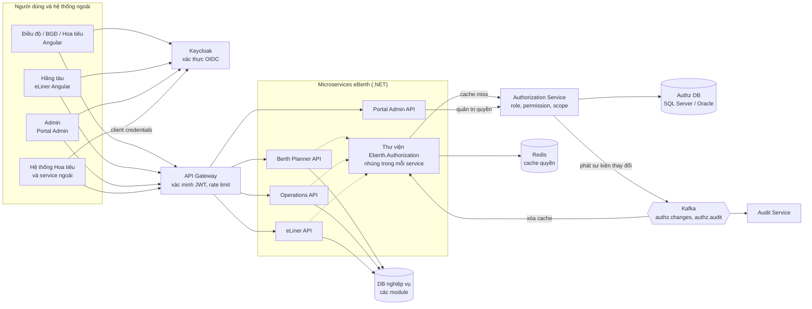
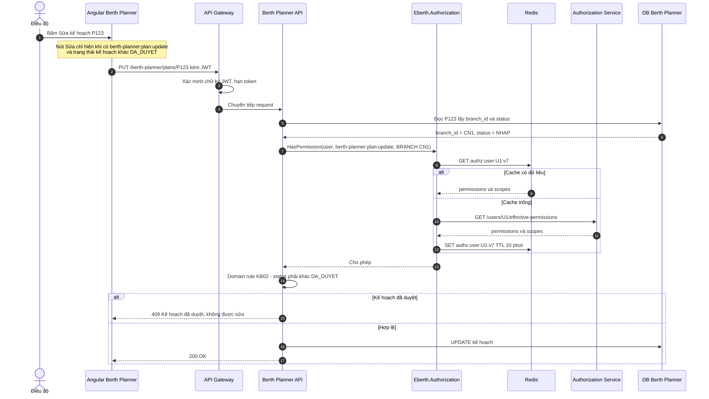
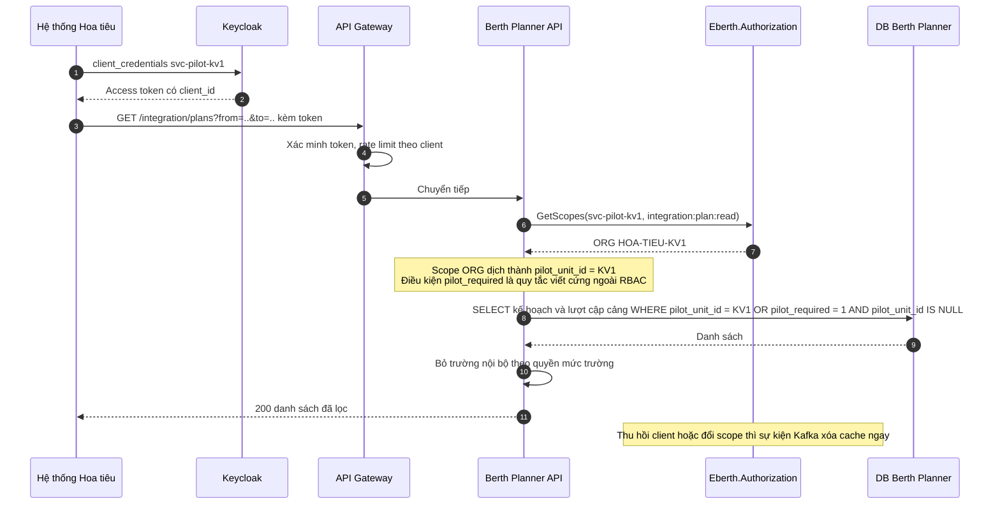
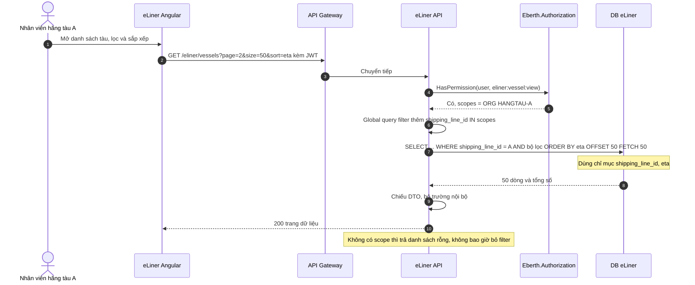
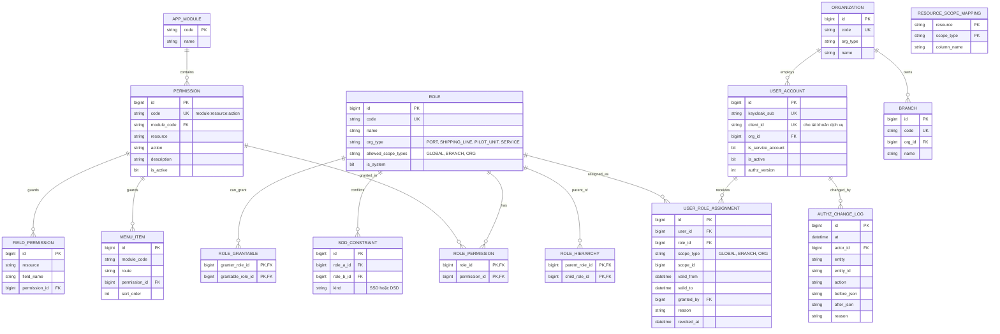

# Đánh giá mô hình RBAC – Role-Based Access Control cho dự án eBerth

> Agent 1 – phụ trách RBAC. Trọng tâm: thiết kế role/permission dạng `module:tài_nguyên:hành_động`, tránh bùng nổ vai trò, bổ sung data scope, ranh giới RBAC thuần và RBAC mở rộng.

**Phạm vi đánh giá.** Báo cáo phân biệt hai mức:

- **RBAC thuần**: đúng chuẩn NIST/ANSI INCITS 359 – user, role, permission, phân cấp role, ràng buộc phân tách nhiệm vụ. Quyền chỉ trả lời câu hỏi "user được làm *hành động* gì trên *loại tài nguyên* nào".
- **RBAC mở rộng (RBAC + data scope)**: RBAC thuần cộng thêm *phạm vi gán* (scope) trên mỗi lần gán role, ví dụ "Điều độ **tại chi nhánh CN1**", "Nhân viên hãng tàu **của hãng A**", cùng thời hạn hiệu lực của lần gán.

Mức đáp ứng chính thức trong bảng kịch bản là của **RBAC mở rộng**. Phần mở rộng *không* bao gồm điều kiện theo trạng thái nghiệp vụ, so sánh "người tạo ≠ người duyệt" hay quan hệ theo từng tàu/chuyến. Những thứ đó thuộc ABAC/ReBAC, nên nếu đưa vào thì không còn là RBAC nữa.

---

## 1. GIẢI THÍCH MÔ HÌNH

### 1.1. Định nghĩa và nguồn gốc

**RBAC (Role-Based Access Control – kiểm soát truy cập dựa trên vai trò)**: quyền không gán trực tiếp cho người dùng mà gán cho **vai trò** (role), rồi người dùng được gán vào vai trò. Ý tưởng được David Ferraiolo và Richard Kuhn (NIST) công bố năm 1992. Năm 1996 Sandhu và cộng sự đưa ra họ mô hình RBAC96. Chuẩn hóa thành **ANSI INCITS 359-2004** (NIST RBAC), bản sửa đổi 2012.

Chuẩn NIST chia RBAC thành bốn cấp:

| Cấp | Tên | Nội dung |
|---|---|---|
| RBAC0 | Core RBAC | User, Role, Permission, Session; gán user–role (UA) và role–permission (PA) |
| RBAC1 | Hierarchical RBAC | Phân cấp role: role cha kế thừa quyền của role con |
| RBAC2 | Constrained RBAC | Ràng buộc: **SSD** (Static Separation of Duty – không cho một user *được gán* đồng thời hai role xung đột), **DSD** (Dynamic Separation of Duty – không cho *kích hoạt* đồng thời trong một phiên) |
| RBAC3 | Symmetric RBAC | RBAC1 + RBAC2 |

### 1.2. Thành phần cốt lõi

- **User (chủ thể)**: người hoặc tài khoản dịch vụ.
- **Role (vai trò)**: tập quyền gắn với một chức năng công việc, ví dụ "Điều độ".
- **Permission (quyền)**: cặp *(hành động, đối tượng)*. Trong báo cáo này viết dạng `module:tài_nguyên:hành_động`.
- **User Assignment (UA)**: gán user vào role.
- **Permission Assignment (PA)**: gán permission vào role.
- **Session (phiên)**: tập role đang được kích hoạt của user trong một lần đăng nhập.
- **Role hierarchy** và **Constraints** (SSD/DSD).

### 1.3. Ví dụ minh họa (không phải eBerth)

Một thư viện trường đại học:

| Role | Permission |
|---|---|
| `SinhVien` | `sach:xem`, `sach:muon` |
| `ThuThu` | `sach:xem`, `sach:muon`, `sach:nhap_kho`, `phieu_muon:duyet` |
| `QuanTri` | kế thừa `ThuThu` + `nguoi_dung:quan_ly` |

Bạn An được gán `SinhVien` nên mượn được sách. Khi An làm cộng tác viên thư viện, chỉ cần gán thêm `ThuThu`, không phải sửa code. Nhưng câu "An chỉ được duyệt phiếu mượn của khoa mình" thì RBAC thuần **không diễn đạt được**, vì nó nói về *dữ liệu cụ thể* chứ không chỉ về *loại hành động*.

### 1.4. Khi nào phù hợp, khi nào không

**Phù hợp khi:**
- Quyền bám theo chức danh/phòng ban, tương đối ổn định.
- Câu hỏi chính là "ai được vào màn hình/chức năng nào".
- Cần đội phát triển và admin nghiệp vụ dễ hiểu, dễ audit dạng ma trận role × permission.

**Không phù hợp khi:**
- Quyền phụ thuộc **dữ liệu cụ thể** (bản ghi của tổ chức nào, tàu nào).
- Quyền phụ thuộc **trạng thái** hoặc **ngữ cảnh** (đã duyệt, ngoài giờ, IP).
- Quyền phát sinh từ **quan hệ** (người được phân công, đại lý được ủy quyền cho một chuyến).
- Nếu cố đưa các điều kiện trên vào role thì sẽ gặp **bùng nổ vai trò** (role explosion), ví dụ `DieuDo_CN1`, `DieuDo_CN2`, `HangTau_A_Xem`, `HangTau_B_Xem`...

---

## 2. ÁP DỤNG VÀO eBERTH

### 2.1. Nguyên tắc thiết kế

1. **Role = chức năng công việc**, không chứa tên chi nhánh, tên hãng tàu hay tên tàu.
2. **Permission đặt tên theo `module:tài_nguyên:hành_động`**, chữ thường, gạch nối. Đây là "hợp đồng" giữa code và dữ liệu phân quyền: code chỉ kiểm tra mã permission, admin gán permission cho role.
3. **Phạm vi dữ liệu nằm ở lần gán role** (`user_role_assignment.scope_type/scope_id`), không nằm trong role.
4. **Ràng buộc trạng thái và phân tách nhiệm vụ theo từng bản ghi** nằm trong code nghiệp vụ (domain service), không phải trong RBAC. Phần này được tách rõ ở mục 6.

### 2.2. Danh mục module và mã module

| Module | Mã module |
|---|---|
| Berth Planner | `berth-planner` |
| Module điều hành | `operations` |
| eLiner | `eliner` |
| Portal Admin | `admin` |
| API tích hợp bên ngoài (hệ thống Hoa tiêu, hải quan…) | `integration` |

### 2.3. Danh mục permission (trích)

| Permission | Ý nghĩa |
|---|---|
| `berth-planner:plan:view` | Xem kế hoạch cầu bến |
| `berth-planner:plan:create` | Tạo kế hoạch |
| `berth-planner:plan:update` | Sửa kế hoạch |
| `berth-planner:plan:submit` | Gửi kế hoạch đi duyệt |
| `berth-planner:plan-board:view` | Màn hình bảng xếp cầu bến của Điều độ |
| `berth-planner:pilot-screen:view` | Nhóm màn hình dành riêng cho hoa tiêu |
| `berth-planner:pilot-assignment:update` | Hoa tiêu cập nhật thông tin dẫn tàu [GIẢ ĐỊNH] |
| `berth-planner:port-call:view` | Xem lượt cập cảng |
| `berth-planner:port-call.internal-note:view` | Xem trường ghi chú nội bộ (quyền mức trường) |
| `berth-planner:port-call.internal-cost:view` | Xem trường chi phí nội bộ (quyền mức trường) |
| `operations:dashboard:view` | Xem tổng quan |
| `operations:plan:approve` | Phê duyệt kế hoạch |
| `operations:plan:reject` | Từ chối kế hoạch |
| `eliner:vessel:view` / `eliner:vessel:register` | Xem / đăng ký tàu |
| `eliner:schedule:view` | Xem lịch cập cảng |
| `eliner:org-user:manage` | Admin phía hãng tàu quản lý tài khoản của hãng mình (KB-THÊM-01) |
| `admin:user:manage` | Quản lý tài khoản |
| `admin:role:manage` | Quản lý role và permission |
| `admin:assignment:manage` | Gán role cho user |
| `admin:audit:view` | Xem nhật ký phân quyền |
| `integration:plan:read` | Service bên ngoài đọc kế hoạch |
| `integration:port-call:read` | Service bên ngoài đọc lượt cập cảng |

Ký tự đại diện chỉ dùng ở mức gán, không dùng trong code: ví dụ role `ADMIN_HT` có thể được gán `admin:*:*`. Code luôn kiểm tra mã đầy đủ.

### 2.4. Định nghĩa role

| Role | Loại tổ chức | Permission chính | Scope được phép khi gán |
|---|---|---|---|
| `DIEU_DO` | Cảng (nội bộ) | `berth-planner:plan:view/create/update/submit`, `berth-planner:plan-board:view`, `berth-planner:port-call:view`, `…internal-note:view`, `…internal-cost:view` | `BRANCH` |
| `DIEU_DO_TRUONG` | Cảng | kế thừa `DIEU_DO` | `BRANCH` |
| `BGD` | Cảng | `operations:dashboard:view`, `operations:plan:approve/reject`, `berth-planner:plan:view` | `BRANCH` hoặc `GLOBAL` (BGĐ tổng công ty) |
| `HOA_TIEU` | Đơn vị hoa tiêu | `berth-planner:pilot-screen:view`, `berth-planner:plan:view`, `berth-planner:pilot-assignment:update` | `ORG` (đơn vị hoa tiêu) + `BRANCH` |
| `HANG_TAU_NHAN_VIEN` | Hãng tàu | `eliner:vessel:view`, `eliner:schedule:view` | `ORG` (hãng tàu) |
| `HANG_TAU_QUAN_TRI` | Hãng tàu | kế thừa `HANG_TAU_NHAN_VIEN` + `eliner:vessel:register`, `eliner:org-user:manage` | `ORG` |
| `ADMIN_HT` | Cảng | `admin:*:*` | `GLOBAL` |
| `ADMIN_CHI_NHANH` [GIẢ ĐỊNH] | Cảng | `admin:user:manage`, `admin:assignment:manage` | `BRANCH` |
| `SVC_HOA_TIEU` | Tài khoản dịch vụ | `integration:plan:read`, `integration:port-call:read` | `ORG` (đơn vị hoa tiêu) |

**Ràng buộc SSD**: `DIEU_DO` và `BGD` không được gán cho cùng một user *trong cùng scope*. Ràng buộc này chỉ chặn ở mức gán role; trường hợp một người vừa tạo vừa duyệt *cùng một kế hoạch* vẫn phải kiểm tra trong code (xem KB03).

**Phân cấp role**: tối đa 2 tầng (`DIEU_DO_TRUONG` → `DIEU_DO`, `HANG_TAU_QUAN_TRI` → `HANG_TAU_NHAN_VIEN`). Phân cấp sâu hơn làm khó trả lời "vì sao user có quyền này".

### 2.5. Data scope – phần mở rộng

Mỗi lần gán role có thêm:

| Trường | Giá trị | Ý nghĩa |
|---|---|---|
| `scope_type` | `GLOBAL` / `BRANCH` / `ORG` | Loại phạm vi |
| `scope_id` | id chi nhánh hoặc id tổ chức | Phạm vi cụ thể |
| `valid_from`, `valid_to` | thời điểm | Quyền có thời hạn (KB12) |

Ví dụ:

```text
Nguyễn Văn A  → DIEU_DO           @ BRANCH:CN-CAILAI     (vô thời hạn)
Trần Thị B    → BGD               @ BRANCH:CN-CAILAI
Lê Văn C      → BGD               @ BRANCH:CN-CAILAI     valid 10/11–15/11 (ủy quyền khi B đi vắng)
Phạm D        → HOA_TIEU          @ ORG:HOA-TIEU-KV1
Hãng A – user1 → HANG_TAU_NHAN_VIEN @ ORG:HANGTAU-A
svc-pilot     → SVC_HOA_TIEU      @ ORG:HOA-TIEU-KV1
```

Quy tắc đánh giá: user có permission `P` trên bản ghi `R` khi tồn tại một lần gán còn hiệu lực, với role chứa `P` (kể cả qua kế thừa), và scope của lần gán **bao phủ** `R`:
- `GLOBAL` bao phủ mọi bản ghi.
- `BRANCH:x` bao phủ bản ghi có `branch_id = x`.
- `ORG:y` bao phủ bản ghi có cột tổ chức tương ứng bằng `y`: `shipping_line_id` với hãng tàu, `pilot_unit_id` với đơn vị hoa tiêu. Mỗi loại tài nguyên khai báo *cột nào* là cột tổ chức (bảng `resource_scope_mapping`).

### 2.6. Giả định đã dùng

| Mã | Giả định | Nếu sai thì sao |
|---|---|---|
| GĐ-R01 | [GIẢ ĐỊNH] Mỗi user thuộc đúng một tổ chức (cảng, một hãng tàu, hoặc một đơn vị hoa tiêu). | Nếu một user thuộc nhiều tổ chức thì scope ORG vẫn dùng được (nhiều lần gán), không đổi kết luận. |
| GĐ-R02 | [GIẢ ĐỊNH] Cấu trúc tách dữ liệu một tầng: chi nhánh/cảng. Bến và cầu bến thuộc một chi nhánh. | Nếu cần scope theo từng bến hoặc theo cây nhiều tầng thì phải thêm bảng cây và truy vấn đệ quy; RBAC xử lý kém hơn, độ phức tạp tăng. |
| GĐ-R03 | [GIẢ ĐỊNH] Kế hoạch có trạng thái tối thiểu `NHAP → CHO_DUYET → DA_DUYET` (có thể có `TU_CHOI`). | Không đổi kết luận: điều kiện theo trạng thái vẫn phải xử lý ngoài RBAC. |
| GĐ-R04 | [GIẢ ĐỊNH] Lượt cập cảng (port call) có cột `shipping_line_id`, `branch_id`, `pilot_unit_id` (đơn vị hoa tiêu được phân công, có thể null) và cờ `pilot_required`. | Nếu phân công hoa tiêu nằm ở hệ thống Hoa tiêu và không đồng bộ về eBerth thì KB07 không làm được bằng bất kỳ mô hình nào nếu không đồng bộ dữ liệu. |
| GĐ-R05 | [GIẢ ĐỊNH] Hoa tiêu dùng màn hình trong Berth Planner bằng tài khoản Keycloak riêng (hoặc qua identity brokering từ IdP của đơn vị hoa tiêu); hệ thống Hoa tiêu gọi API eBerth bằng client credentials. | Nếu hệ thống Hoa tiêu gọi API *thay mặt* từng hoa tiêu thì cần OAuth 2.0 Token Exchange (RFC 8693) trên Keycloak; RBAC vẫn dùng được nhưng tích hợp phức tạp hơn. |
| GĐ-R06 | [GIẢ ĐỊNH] Hãng tàu không bị giới hạn theo chi nhánh: hãng tàu A thấy mọi lượt cập cảng của mình ở mọi chi nhánh. | Nếu cần giới hạn cả hai chiều (hãng + chi nhánh) thì phải hỗ trợ scope kết hợp (`ORG` AND `BRANCH`); làm được nhưng mô hình scope phức tạp hơn. |
| GĐ-R07 | Theo PHẦN 1.4: **hiện không có đại lý hàng hải**. KB10 được đánh giá cho trường hợp sau này phát sinh. | Nếu đại lý xuất hiện sớm thì RBAC yếu rõ ở KB10 (xem mục 6). |
| GĐ-R08 | [GIẢ ĐỊNH] Quy mô: vài trăm user nội bộ, vài nghìn user hãng tàu, hàng trăm nghìn lượt cập cảng/năm. | Nếu lớn hơn nhiều bậc thì RBAC vẫn là mô hình có hiệu năng tốt nhất; không đổi kết luận. |
| GĐ-R09 | [GIẢ ĐỊNH] Keycloak chỉ phát token định danh (sub, client_id). Role và permission eBerth **không** nhét vào JWT. | Nếu nhét permission vào JWT thì KB11 kém đi (quyền cũ sống tới khi token hết hạn) và token phình to. |

---

## 3. TRẢ LỜI BỘ KỊCH BẢN KB01–KB18

Mức đáp ứng là của **RBAC mở rộng**. Mức của RBAC thuần ghi trong cột ghi chú khi khác.

| Mã | Cách xử lý | Mức đáp ứng | Lý do / ghi chú |
|---|---|---|---|
| KB01 | Role `DIEU_DO` có `berth-planner:plan:create/update`; gán với scope `BRANCH`. API kiểm tra permission + scope chi nhánh của kế hoạch. | **Tốt** | Đúng bài toán sở trường của RBAC. |
| KB02 | RBAC không biết trạng thái. Domain service kiểm tra `plan.status != DA_DUYET` trước khi cho sửa, sau bước kiểm tra permission. | **Kém** | Quy tắc phải hard-code, không cấu hình được, không nằm trong mô hình quyền nên audit không thấy. Có thể "lách" bằng permission riêng `plan:update-approved` cho người được sửa sau duyệt, nhưng điều kiện trạng thái vẫn nằm trong code. |
| KB03 | SSD chặn gán `DIEU_DO` và `BGD` cho cùng user. Việc "không duyệt kế hoạch của chính mình" phải kiểm tra `plan.created_by != currentUser` trong code. | **Kém** | SSD chỉ chặn ở mức role. Phân tách nhiệm vụ theo từng bản ghi nằm ngoài RBAC. Nếu cho phép một người vừa là Điều độ trưởng vừa duyệt thì bắt buộc dùng code. |
| KB04 | Role `BGD` có `operations:dashboard:view`, `operations:plan:approve`; scope `BRANCH` hoặc `GLOBAL`. | **Tốt** | – |
| KB05 | Keycloak xác thực hoa tiêu (tài khoản riêng hoặc identity brokering). eBerth tra role `HOA_TIEU` của user và cho xem `berth-planner:plan:view`. | **Được** | Phần RBAC đơn giản. Khó nằm ở tích hợp định danh (federation/token exchange), không phải ở RBAC. Phụ thuộc GĐ-R05. |
| KB06 | Màn hình hoa tiêu gắn permission `berth-planner:pilot-screen:view`; màn hình Điều độ gắn `berth-planner:plan-board:view`. Role `HOA_TIEU` chỉ có cái đầu. Kiểm tra ở cả route guard Angular và API. | **Tốt** | Quyền mức màn hình/chức năng là thế mạnh của RBAC. |
| KB07 | Scope `ORG:đơn-vị-hoa-tiêu` lọc `port_call.pilot_unit_id = X`. Điều kiện "hoặc có yêu cầu hoa tiêu" (`pilot_required = 1` và chưa phân công) phải viết cứng trong truy vấn. | **Kém** | Phần "của đơn vị mình" làm được nhờ scope. Phần "có yêu cầu hoa tiêu" là điều kiện theo thuộc tính, ngoài RBAC. Nếu phân công theo *từng hoa tiêu* (không chỉ theo đơn vị) thì là quan hệ, RBAC không làm được. RBAC thuần: Không làm được. |
| KB08 | Gán `HANG_TAU_*` với scope `ORG:HANGTAU-A`. Mọi truy vấn eLiner thêm `WHERE shipping_line_id IN (scope)`. | **Được** | Làm được và hiệu năng tốt, nhưng an toàn phụ thuộc việc *mọi* truy vấn đều áp scope; nên dùng global query filter tập trung. RBAC thuần: Không làm được (phải tạo role theo từng hãng). |
| KB09 | Permission mức trường `berth-planner:port-call.internal-note:view`, `…internal-cost:view`. Role hãng tàu không có. Backend chiếu DTO theo danh sách permission (bỏ trường khi không có quyền). | **Được** | Diễn đạt được bằng permission. Nhược điểm: mỗi trường nhạy cảm thêm một permission, code DTO phải biết danh sách trường. Không phụ thuộc trạng thái. |
| KB10 | Có thể gán role `DAI_LY` với scope `VESSEL:x` hoặc `VOYAGE:y`, `valid_to` = ngày hết hợp đồng. | **Kém** | Scope theo từng tàu/chuyến làm số lần gán tăng nhanh, hãng tàu không tự ủy quyền được nếu không làm thêm luồng riêng. Bản chất là quan hệ ủy quyền, hợp với ReBAC hơn. Hiện không có đại lý (GĐ-R07). |
| KB11 | Admin hủy lần gán `DIEU_DO@BRANCH`. Authz Service phát sự kiện Kafka `authz.assignment.changed`, các service xóa cache Redis của user đó. | **Tốt** | Đạt "mất hiệu lực ngay" với điều kiện permission không nằm trong JWT (GĐ-R09) và có cơ chế xóa cache. Có thể tự động hóa: đồng bộ phòng ban từ HR thì hủy gán. |
| KB12 | Lần gán có `valid_from/valid_to`. Ủy quyền phê duyệt: gán `BGD@BRANCH:x` cho người thay với thời hạn. Job định kỳ dọn lần gán hết hạn; kiểm tra luôn so `now()` với thời hạn. | **Được** | Đây là RBAC có thời hạn (temporal RBAC), mở rộng phổ biến. Hạn chế: ủy quyền *chỉ một số kế hoạch* hoặc *chỉ dưới một hạn mức* thì không diễn đạt được. |
| KB13 | Permission, role, menu là dữ liệu. Admin tạo permission mới, gán vào role, gắn menu trên Portal Admin. Không deploy lại để *gán quyền*. | **Tốt** | Màn hình mới vẫn phải deploy code của chính màn hình đó; code chỉ cần khai báo mã permission. Danh mục permission được service tự đăng ký lúc khởi động để admin không phải gõ tay. |
| KB14 | Lấy tập scope của user cho permission `…:view` (từ cache), dịch thành `WHERE branch_id IN (…) / shipping_line_id IN (…)`. Phân trang, lọc, sắp xếp do DB làm. | **Tốt** | Điều kiện lọc đơn giản, đánh chỉ mục được, không phải gọi engine bên ngoài cho từng bản ghi. Đây là điểm mạnh nhất của RBAC so với ReBAC/PBAC. |
| KB15 | API `GET /authz/me/permissions` trả danh sách mã permission (theo module). Angular dùng directive `*hasPermission` và route guard. | **Tốt** | Danh sách permission phẳng, dễ dùng ở frontend. Lưu ý: nút phụ thuộc trạng thái (nút "Sửa" khi đã duyệt) vẫn phải theo logic riêng. |
| KB16 | "Vì sao X xem được Y": truy vấn lần gán → role → permission → scope bao phủ Y. "Ai có quyền trên Y": truy vấn ngược các lần gán có scope bao phủ Y và role chứa permission. | **Được** | Trả lời được bằng SQL vì mô hình đơn giản. Phần quy tắc nằm trong code (KB02, KB03, KB07) **không** hiện ra trong câu trả lời, nên kết quả audit có thể "thừa quyền" so với thực tế. |
| KB17 | Gán `BGD@BRANCH:CN1`. Mọi tài nguyên có `branch_id`. Lọc như KB14. | **Tốt** | Với GĐ-R02 (một tầng chi nhánh). Nếu cây nhiều tầng thì giảm xuống Được. |
| KB18 | Client credentials trên Keycloak (`svc-pilot`). eBerth ánh xạ `client_id` sang user dịch vụ, gán `SVC_HOA_TIEU@ORG:đơn-vị`. Chỉ có permission `integration:*:read`. | **Được** | Làm tốt phần "chỉ đọc, chỉ API tích hợp". Giới hạn thêm theo giờ, IP, tần suất là việc của API gateway, ngoài RBAC. |
| KB-THÊM-01 | Admin phía hãng tàu tự quản lý user của hãng mình: role `HANG_TAU_QUAN_TRI` có `eliner:org-user:manage`, chỉ gán được role thuộc danh sách "được ủy quyền gán" và chỉ trong scope `ORG` của mình. | **Được** | Giảm tải cho Admin cảng. Cần bảng "role nào được gán bởi role nào" (`role_grantable`) để tránh leo thang quyền. |
| KB-THÊM-02 | Hoa tiêu chỉ xem kế hoạch **đã duyệt**, không xem bản nháp. | **Kém** | Lại là điều kiện theo trạng thái, phải hard-code bộ lọc. |

**Tổng hợp mức đáp ứng (KB01–KB18):** Tốt 8 · Được 6 · Kém 4 · Không làm được 0.
RBAC thuần: KB07, KB08 xuống Không làm được; KB14, KB17 xuống Kém (phải tạo role theo chi nhánh/hãng).

---

## 4. ƯU ĐIỂM VÀ NHƯỢC ĐIỂM

### 4.1. Ưu điểm

| Ưu điểm | Ví dụ trong eBerth |
|---|---|
| **Dễ hiểu với nghiệp vụ và admin** | Ma trận "role × permission" trên Portal Admin đọc được ngay: cột `DIEU_DO` có tick ở `berth-planner:plan:update`, cột `HOA_TIEU` không có. Ban giám đốc nhìn hiểu được. |
| **Hợp với quyền mức module/màn hình** | KB06, KB13, KB15: menu Berth Planner tự ẩn màn hình bảng xếp cầu bến với hoa tiêu chỉ bằng một permission. |
| **Hiệu năng tốt khi lọc danh sách** | KB14: danh sách lượt cập cảng của hãng A chỉ là `WHERE shipping_line_id = @A`, dùng chỉ mục `(shipping_line_id, eta)`, phân trang bằng `OFFSET/FETCH` hoặc keyset. Không phải gọi dịch vụ bên ngoài cho từng dòng. |
| **Chi phí triển khai thấp, dùng sẵn công nghệ hiện có** | ASP.NET Core có sẵn `[Authorize(Policy=…)]` và `IAuthorizationHandler`; EF Core có global query filter; Redis và Kafka đã có trong dự án để làm cache và xóa cache. |
| **Đội phát triển quen** | Đa số dev .NET/Angular đã từng làm role/permission; không cần học ngôn ngữ policy mới. |
| **Audit dạng tĩnh rõ ràng** | KB16: "Ai đang có quyền phê duyệt ở chi nhánh CN1?" là một câu SQL trên bảng gán. |

### 4.2. Nhược điểm

| Nhược điểm | Ví dụ trong eBerth |
|---|---|
| **Không biết trạng thái nghiệp vụ** | KB02: "Kế hoạch đã duyệt thì không được sửa" phải viết `if (plan.Status == Approved) throw…` trong service Berth Planner. Muốn đổi thành "Điều độ trưởng được sửa trong 2 giờ sau duyệt" thì phải sửa code và deploy, trái với yêu cầu phân quyền động. |
| **Không xử lý phân tách nhiệm vụ theo bản ghi** | KB03: SSD chỉ cấm gán đồng thời hai role; không cấm "người tạo kế hoạch #123 duyệt kế hoạch #123". |
| **Data scope là phần "chắp vá" ngoài chuẩn** | KB07, KB08, KB17: mỗi service phải biết cột nào là cột scope; quên áp filter ở một truy vấn là lộ dữ liệu giữa các hãng tàu. |
| **Nguy cơ bùng nổ vai trò** | Nếu không dùng scope mà tạo `BGD_CN1`, `BGD_CN2`…, với 5 chi nhánh × 8 role đã là 40 role; thêm các biến thể "chỉ xem", "xem + chi phí" thì nhân lên tiếp. |
| **Quan hệ ủy quyền chi tiết làm không tốt** | KB10: đại lý thay hãng tàu trên *một chuyến* phải tạo scope `VOYAGE`, mỗi chuyến một lần gán; hãng tàu không tự quản lý được nếu không xây thêm chức năng. |
| **Audit bị "thủng" phần logic trong code** | KB16: báo cáo nói Điều độ X có `plan:update` trên CN1, nhưng thực tế X không sửa được kế hoạch đã duyệt; logic này không hiển thị trong công cụ audit. |

---

## 5. THIẾT KẾ TRIỂN KHAI

### 5.1. Các service và module cần thêm hoặc sửa

| Thành phần | Mới/Sửa | Trách nhiệm |
|---|---|---|
| **Keycloak** | Sửa cấu hình | Xác thực (OIDC – OpenID Connect). Realm cho nội bộ, hãng tàu, hoa tiêu (hoặc một realm, phân biệt bằng nhóm). Identity brokering nếu đơn vị hoa tiêu có IdP riêng. Client credentials cho service bên ngoài. **Không** quản lý quyền eBerth. |
| **API Gateway** [GIẢ ĐỊNH: đã có hoặc sẽ có, ví dụ YARP/Ocelot] | Sửa | Xác minh JWT, giới hạn tần suất, chặn thô theo module (ví dụ client hãng tàu chỉ đi vào route `/eliner/*`). Không đánh giá quyền chi tiết. |
| **Authorization Service (eberth-authz)** | Mới | Lưu role, permission, lần gán, scope, ràng buộc SSD. API: `GET /me/permissions`, `POST /check`, `GET /me/scopes?permission=…`, `GET /audit/who-can?…`. Phát sự kiện thay đổi qua Kafka. |
| **Thư viện dùng chung `Eberth.Authorization` (.NET NuGet nội bộ)** | Mới | `RequirePermission` attribute, `PermissionAuthorizationHandler`, `IScopeProvider` dịch scope thành điều kiện EF Core, cache cục bộ + Redis, consumer Kafka để xóa cache, tự đăng ký danh mục permission của service lúc khởi động. |
| **Redis** | Dùng sẵn | Cache `authz:user:{id}:v{version}` chứa permission và scope đã tính sẵn (kể cả kế thừa role). TTL ngắn (ví dụ 5–10 phút) làm lưới an toàn. |
| **Kafka** | Dùng sẵn | Topic `authz.changes` (lần gán, role, permission thay đổi) → các service xóa cache. Topic `authz.audit` → Audit Service. |
| **Audit Service / bảng audit** | Mới | Ghi nhật ký thay đổi phân quyền (ai gán gì, cho ai, khi nào, lý do) và nhật ký quyết định quan trọng (từ chối truy cập, phê duyệt). |
| **Portal Admin – phân hệ Phân quyền** | Sửa | Màn hình: danh mục permission (theo module), role và ma trận role × permission, gán role cho user kèm scope và thời hạn, cấu hình SSD, menu ↔ permission, báo cáo "ai có quyền gì". |
| **Các module Berth Planner, Operations, eLiner** | Sửa | Gắn `RequirePermission` cho API; dùng global query filter theo scope; chiếu DTO mức trường; **giữ trong domain service** các quy tắc trạng thái và phân tách nhiệm vụ (KB02, KB03, KB07). |
| **Angular shared library** | Mới | `PermissionService` (tải `me/permissions`), directive `*hasPermission`, route guard, menu động. |
| **Job đồng bộ HR/phòng ban** [GIẢ ĐỊNH: có nguồn HR] | Mới (tùy chọn) | Khi nhân viên chuyển phòng thì hủy lần gán cũ (KB11). |

### 5.2. Kiến trúc tổng thể



### 5.3. Luồng kiểm tra quyền

**Điểm kiểm tra chung:**

| Tầng | Kiểm tra gì |
|---|---|
| Frontend (Angular) | Ẩn/hiện menu, nút, route theo `me/permissions`. **Chỉ để trải nghiệm, không phải lớp bảo mật.** |
| API Gateway | JWT hợp lệ, client được vào route của module, rate limit. |
| Backend từng module | `RequirePermission` (permission + scope chi nhánh/tổ chức của tài nguyên). |
| Domain service | Quy tắc trạng thái, phân tách nhiệm vụ theo bản ghi (ngoài RBAC). |
| Tầng truy vấn DB | Global query filter theo scope cho danh sách (KB08, KB14, KB17). |

**Cache:** permission và scope đã "làm phẳng" (bao gồm kế thừa role) lưu ở Redis theo `userId + authzVersion`, cộng cache bộ nhớ trong service 30–60 giây. **Khi quyền thay đổi:** Authorization Service tăng `authzVersion` của user và phát sự kiện Kafka; consumer trong mỗi service xóa cache bộ nhớ; key Redis cũ không còn được đọc vì version đã đổi.

**(a) Điều độ sửa kế hoạch trong Berth Planner (KB01, KB02)**



**(b) Hoa tiêu từ hệ thống ngoài xem kế hoạch (KB05, KB07)**

Luồng dưới đây là trường hợp hệ thống Hoa tiêu gọi API eBerth bằng tài khoản dịch vụ (GĐ-R05). Trường hợp hoa tiêu đăng nhập trực tiếp màn hình Berth Planner thì giống luồng (a), chỉ khác role.



**(c) Hãng tàu xem danh sách tàu trên eLiner (KB08, KB14)**



### 5.4. Thiết kế cơ sở dữ liệu

**ERD**



**Danh sách bảng**

| Bảng | Cột chính | Khóa / chỉ mục quan trọng | Mục đích |
|---|---|---|---|
| `app_module` | `code`, `name` | PK `code` | Danh mục module. |
| `permission` | `code`, `module_code`, `resource`, `action`, `is_active` | PK `id`; UK `code`; IX `module_code` | Danh mục permission. Service tự đăng ký lúc khởi động (upsert theo `code`). |
| `role` | `code`, `org_type`, `allowed_scope_types`, `is_system` | UK `code` | Role theo chức năng. `org_type` ngăn gán role nội bộ cho user hãng tàu. |
| `role_permission` | `role_id`, `permission_id` | PK kép; IX `permission_id` | Ma trận role × permission. |
| `role_hierarchy` | `parent_role_id`, `child_role_id` | PK kép | Kế thừa role, tối đa 2 tầng (kiểm tra khi lưu). |
| `sod_constraint` | `role_a_id`, `role_b_id`, `kind` | UK `(role_a_id, role_b_id)` | Ràng buộc SSD/DSD, kiểm tra khi gán. |
| `role_grantable` | `granter_role_id`, `grantable_role_id` | PK kép | Role nào được phép gán role nào (chống leo thang quyền, dùng cho admin chi nhánh và admin hãng tàu). |
| `organization` | `code`, `org_type`, `name` | UK `code` | Cảng, hãng tàu, đơn vị hoa tiêu, đối tác. |
| `branch` | `code`, `org_id` | UK `code`; IX `org_id` | Chi nhánh/cảng (GĐ-R02). |
| `user_account` | `keycloak_sub`, `client_id`, `org_id`, `authz_version` | UK `keycloak_sub`; UK `client_id` (lọc null) | Ánh xạ định danh Keycloak sang user eBerth. `authz_version` tăng mỗi khi quyền đổi, dùng làm key cache. |
| `user_role_assignment` | `user_id`, `role_id`, `scope_type`, `scope_id`, `valid_from`, `valid_to`, `revoked_at` | IX `(user_id, revoked_at, valid_to)`; IX `(scope_type, scope_id, role_id)` cho truy vấn "ai có quyền trên Y" | Lần gán role có phạm vi và thời hạn. Không xóa cứng, chỉ đặt `revoked_at` để audit. |
| `menu_item` | `module_code`, `route`, `permission_id` | IX `module_code` | Menu động (KB13, KB15). |
| `field_permission` | `resource`, `field_name`, `permission_id` | UK `(resource, field_name)` | Quyền mức trường (KB09). |
| `resource_scope_mapping` | `resource`, `scope_type`, `column_name` | PK `(resource, scope_type)` | Cho thư viện biết cột nào áp scope, ví dụ `port_call` + `ORG` → `shipping_line_id` (hãng tàu) hoặc `pilot_unit_id` (hoa tiêu). Có thể để ở cấu hình code thay vì bảng. |
| `authz_change_log` | `actor_id`, `entity`, `action`, `before_json`, `after_json`, `reason` | IX `(entity, entity_id, at)` | Nhật ký thay đổi phân quyền (KB16). |

**Yêu cầu với DB nghiệp vụ:** mọi bảng cần tách dữ liệu phải có cột scope (`branch_id`, `shipping_line_id`, `pilot_unit_id`) và chỉ mục ghép bắt đầu bằng cột scope, ví dụ `IX_port_call_shipping_line_eta (shipping_line_id, eta)`, `IX_port_call_branch_eta (branch_id, eta)`.

RBAC không cần kho lưu riêng ngoài Authz DB. Authz DB tham chiếu `organization` và `branch`; nếu hai bảng này đang là dữ liệu gốc của module khác thì đồng bộ qua sự kiện Kafka (`org.created`, `branch.updated`) [GIẢ ĐỊNH].

### 5.5. Ví dụ mã giả

**Backend .NET – API sửa kế hoạch**

```csharp
// Thư viện Eberth.Authorization
public sealed class RequirePermissionAttribute : AuthorizeAttribute
{
    public RequirePermissionAttribute(string permission) => Policy = $"perm:{permission}";
}

public interface IAuthz
{
    Task<bool> HasPermissionAsync(string permission, ScopeRef resourceScope);
    Task<IReadOnlyList<ScopeRef>> GetScopesAsync(string permission);
}

// Berth Planner
[HttpPut("plans/{id}")]
[RequirePermission("berth-planner:plan:update")]          // chặn sớm: có permission ở ít nhất một scope
public async Task<IActionResult> UpdatePlan(long id, UpdatePlanDto dto)
{
    var plan = await _db.Plans.FindAsync(id) ?? throw new NotFound();

    // Data scope: permission phải bao phủ chi nhánh của kế hoạch
    if (!await _authz.HasPermissionAsync("berth-planner:plan:update", ScopeRef.Branch(plan.BranchId)))
        return Forbid();

    // Ngoài RBAC: quy tắc trạng thái (KB02) - nằm trong domain
    plan.Update(dto, _currentUser.Id);   // ném DomainException nếu Status == Approved
    await _db.SaveChangesAsync();
    return Ok();
}
```

**Lọc danh sách theo scope (KB08, KB14) – EF Core global query filter**

```csharp
// Tính sẵn scope một lần mỗi request, sau đó EF Core tự thêm WHERE vào mọi truy vấn PortCall
modelBuilder.Entity<PortCall>().HasQueryFilter(pc =>
       _scope.IsGlobal
    || _scope.BranchIds.Contains(pc.BranchId)
    || _scope.ShippingLineIds.Contains(pc.ShippingLineId));
```

**Angular**

```html
<button *hasPermission="'berth-planner:plan:update'" [disabled]="plan.status === 'DA_DUYET'">Sửa</button>
```

### 5.6. Lộ trình triển khai

| Giai đoạn | Nội dung | Độ phức tạp |
|---|---|---|
| GĐ1 – Nền tảng | Authz Service, bảng role/permission/assignment, thư viện `Eberth.Authorization`, `me/permissions`, ánh xạ Keycloak `sub` sang user. Áp cho Portal Admin và Berth Planner (KB01, KB04, KB06, KB13, KB15). | Trung bình |
| GĐ2 – Data scope | Scope `BRANCH`/`ORG` trên lần gán, global query filter, thêm cột và chỉ mục scope ở DB nghiệp vụ. Áp cho eLiner và Operations (KB08, KB14, KB17). | Trung bình |
| GĐ3 – Vòng đời quyền | Thời hạn gán, ủy quyền tạm thời, Kafka xóa cache, đồng bộ HR (nếu có), SSD, `role_grantable`, admin hãng tàu (KB11, KB12, KB-THÊM-01). | Trung bình |
| GĐ4 – Tích hợp và audit | Tài khoản dịch vụ, identity brokering cho hoa tiêu, quyền mức trường, báo cáo "ai có quyền gì", audit log (KB05, KB09, KB16, KB18). | Trung bình |
| GĐ5 – Các quy tắc ngoài RBAC | Quy tắc trạng thái, phân tách nhiệm vụ theo bản ghi, lọc hoa tiêu (KB02, KB03, KB07). Viết trong domain service, hoặc chuyển sang policy engine nếu chọn mô hình kết hợp. | Thấp nếu hard-code / Cao nếu muốn cấu hình được |

### 5.7. Công cụ và thư viện

> Phiên bản và tính năng cần được kiểm tra lại tại thời điểm triển khai.

| Công cụ | Ưu điểm | Nhược điểm |
|---|---|---|
| **ASP.NET Core Authorization** (policy, requirement, handler) | Có sẵn trong .NET, không thêm phụ thuộc. Đủ để làm `RequirePermission` và kiểm tra theo tài nguyên. | Chỉ là khung; lưu trữ role/permission, scope, cache phải tự làm. |
| **EF Core Global Query Filters** | Áp scope tập trung cho mọi truy vấn, giảm rủi ro quên filter. | Có thể bị vô hiệu bằng `IgnoreQueryFilters()`; truy vấn SQL thô và Dapper không được áp. Với Oracle cần kiểm tra provider. |
| **Casbin.NET** | Hỗ trợ RBAC có domain (`RBAC with domains` – gần với scope), lưu policy ở DB, có adapter. | Mô hình lưu dạng chuỗi `p, sub, dom, obj, act` khó làm báo cáo; thêm một khái niệm cho đội phải học; không giúp lọc danh sách. |
| **Keycloak Authorization Services** | Có sẵn trong Keycloak: resource, scope, policy, permission. | Dự án đã chọn để eBerth tự phân quyền; dùng thì phụ thuộc Keycloak, gọi mạng cho mỗi lần kiểm tra, không lọc danh sách được. Không khuyến nghị. |
| **ngx-permissions** (Angular) | Directive và guard có sẵn cho permission/role. | Cần kiểm tra tương thích với phiên bản Angular đang dùng; tự viết directive cũng chỉ vài chục dòng. |
| **StackExchange.Redis** + **Confluent.Kafka** | Đã có trong hệ sinh thái dự án. | – |

---

## 6. CÁC TRƯỜNG HỢP KHÔNG LÀM ĐƯỢC HOẶC LÀM KHÔNG TỐT

| # | Trường hợp | Hậu quả nếu cố ép RBAC | Cách bù đắp |
|---|---|---|---|
| 1 | **Quyền theo trạng thái nghiệp vụ** (KB02, KB-THÊM-02): kế hoạch đã duyệt không được sửa; hoa tiêu chỉ xem kế hoạch đã duyệt. | Tạo permission kiểu `plan:update-draft`, `plan:update-approved` rồi vẫn phải viết code chọn permission theo trạng thái. Mỗi trạng thái mới lại thêm permission. Quy tắc nằm rải rác trong code, không cấu hình được, không audit được. | Đặt quy tắc trạng thái trong **ABAC/PBAC** (policy engine), hoặc chấp nhận hard-code trong domain service nếu quy tắc ổn định. |
| 2 | **Phân tách nhiệm vụ theo bản ghi** (KB03): người lập không tự duyệt kế hoạch của mình. | SSD cấm luôn việc một người có cả hai role, quá cứng với chi nhánh nhỏ (Điều độ trưởng có thể kiêm duyệt kế hoạch của người khác). | Điều kiện `resource.created_by != subject.id` trong **ABAC/PBAC**, hoặc kiểm tra trong domain. |
| 3 | **Phân công và yêu cầu hoa tiêu** (KB07): thấy lượt cập cảng của đơn vị mình hoặc có yêu cầu hoa tiêu; nếu phân công theo từng hoa tiêu thì còn khó hơn. | Tạo scope `PORT_CALL:x` cho từng lượt, mỗi ngày hàng trăm lần gán/thu hồi, bảng gán phình to, Authz Service thành hệ thống đồng bộ phân công. | Quan hệ phân công dùng **ReBAC**, hoặc thuộc tính `pilot_unit_id`/`pilot_required` dùng **ABAC** dịch thành điều kiện SQL. |
| 4 | **Ủy quyền đại lý theo tàu/chuyến** (KB10). | Scope `VESSEL`/`VOYAGE`, hãng tàu phải nhờ Admin cảng gán; thu hồi khi hết hợp đồng phải làm tay hoặc làm job riêng. | **ReBAC**: tuple `voyage:V1#agent@org:DAILY-X` do chính hãng tàu tạo/xóa. |
| 5 | **Bùng nổ vai trò** khi nghiệp vụ đòi biến thể (ví dụ "BGĐ chỉ xem không duyệt", "Điều độ xem chi phí", "Điều độ không xem chi phí" × 5 chi nhánh). | Hàng trăm role, admin không còn biết role nào dùng cho ai, audit vô nghĩa. | Giữ role theo chức năng, dùng scope cho chi nhánh/tổ chức; cho phép gán nhiều role nhỏ ghép lại (permission set); review định kỳ role không dùng; quy tắc theo ngữ cảnh chuyển sang ABAC/PBAC. |
| 6 | **Điều kiện ngữ cảnh** (giờ làm việc, IP, thiết bị, hạn mức). | Không có chỗ để biểu diễn. | API gateway (IP, rate limit) hoặc ABAC/PBAC. |

---

## 7. RỦI RO KHI TRIỂN KHAI VÀ VẬN HÀNH

| Loại | Rủi ro | Biện pháp |
|---|---|---|
| Bảo mật | **Quên áp data scope** ở một truy vấn (SQL thô, báo cáo, export Excel), làm lộ dữ liệu hãng tàu A cho hãng B. | Global query filter mặc định; cấm `IgnoreQueryFilters` trừ code đã review; kiểm thử tự động "hãng A không thấy dữ liệu hãng B" cho mọi endpoint danh sách. |
| Bảo mật | **Leo thang quyền** qua admin chi nhánh hoặc admin hãng tàu tự gán role cao hơn. | `role_grantable`, kiểm tra `org_type` của role khớp tổ chức của user, ghi `authz_change_log`. |
| Bảo mật | Chỉ ẩn nút ở frontend nhưng quên kiểm tra ở API. | Bắt buộc `RequirePermission` cho mọi endpoint; test quét endpoint thiếu attribute. |
| Sai lệch quyền | Cache cũ khiến quyền đã thu hồi vẫn còn (KB11). | Key cache có `authz_version`; sự kiện Kafka xóa cache; TTL ngắn làm lưới an toàn; không để permission trong JWT. |
| Sai lệch quyền | Quy tắc nằm cả trong RBAC và trong code, hai bên lệch nhau sau nhiều lần sửa. | Gom quy tắc ngoài RBAC vào một lớp chính sách duy nhất trong mỗi module; viết test bảng quyết định. |
| Vận hành | **Bùng nổ vai trò** dần theo thời gian. | Quy định đặt tên, không chứa tên tổ chức trong role; báo cáo role ít người dùng; quy trình phê duyệt tạo role mới. |
| Hiệu năng | User có quá nhiều scope (BGĐ tổng có hàng chục chi nhánh) làm `IN (...)` dài. | Dùng `GLOBAL`; hoặc bảng tạm/TVP trong SQL Server; chỉ mục bắt đầu bằng cột scope. |
| Đồng bộ dữ liệu | Danh mục tổ chức, chi nhánh ở Authz DB lệch với DB nghiệp vụ. | Một nguồn gốc duy nhất, đồng bộ bằng sự kiện, job đối soát định kỳ. |
| Khó debug | Người dùng báo "không sửa được" nhưng RBAC nói có quyền (do quy tắc trạng thái). | Mã lỗi phân biệt `FORBIDDEN_PERMISSION` và `RULE_VIOLATION`; log lý do từ chối. |
| Phụ thuộc nhà cung cấp | Thấp: tự xây trên .NET, SQL, Redis, Kafka. | – |

---

## 8. CHẤM ĐIỂM THEO TIÊU CHÍ (PHẦN 3)

| Tiêu chí | Trọng số | Điểm 1–5 | Giải thích |
|---|---|---|---|
| Mức độ đáp ứng bộ kịch bản KB01–KB18 | 25% | 3 | 8 Tốt, 6 Được, 4 Kém, không có Không làm được, nhưng các điểm Kém rơi vào yêu cầu cốt lõi (trạng thái, phân tách nhiệm vụ, hoa tiêu). |
| Phân quyền theo dữ liệu và tổ chức | 15% | 3 | Tách theo hãng tàu, chi nhánh làm được nhờ scope mở rộng; theo quan hệ phân công hoặc ủy quyền thì yếu. |
| Phân quyền động, đổi quyền không cần deploy | 10% | 4 | Gán role/permission/scope là dữ liệu, đổi ngay; nhưng quy tắc trạng thái nằm trong code nên đổi phải deploy. |
| Độ phức tạp triển khai (cao = đơn giản) | 15% | 4 | Tự xây trên công nghệ có sẵn, khái niệm đơn giản; data scope và xóa cache đòi hỏi làm cẩn thận. |
| Chi phí vận hành, bảo trì | 10% | 4 | Không có hạ tầng mới; rủi ro dài hạn là bùng nổ vai trò và quy tắc phân tán trong code. |
| Hiệu năng, đặc biệt là lọc danh sách | 10% | 5 | Scope dịch thẳng thành điều kiện SQL có chỉ mục, không gọi engine theo từng bản ghi. |
| Khả năng audit, giải thích quyết định | 10% | 4 | "Ai có quyền gì" trả lời bằng SQL đơn giản; quy tắc trong code thì không hiện trong audit. |
| Mức độ quen thuộc với đội, chi phí học | 5% | 5 | Mô hình mà đa số dev .NET/Angular đã biết. |

**Điểm tổng có trọng số:**
3×0,25 + 3×0,15 + 4×0,10 + 4×0,15 + 4×0,10 + 5×0,10 + 4×0,10 + 5×0,05
= 0,75 + 0,45 + 0,40 + 0,60 + 0,40 + 0,50 + 0,40 + 0,25 = **3,75 / 5**

---

## 9. KẾT LUẬN NGẮN

RBAC **nên dùng** cho eBerth nhưng **không nên dùng một mình**. Dùng RBAC mở rộng (role theo chức năng + scope chi nhánh/tổ chức + thời hạn) làm lớp nền cho quyền module, màn hình, chức năng, menu và tách dữ liệu theo hãng tàu, chi nhánh (KB01, KB04, KB06, KB08, KB13–KB15, KB17). Các yêu cầu theo trạng thái nghiệp vụ, phân tách nhiệm vụ theo bản ghi và phân công hoa tiêu (KB02, KB03, KB07) cần kết hợp ABAC hoặc PBAC; ủy quyền đại lý theo chuyến (KB10), nếu phát sinh, hợp với ReBAC hơn. Thiết kế mã permission dạng `module:tài_nguyên:hành_động` ở báo cáo này có thể giữ nguyên làm "từ vựng hành động" khi kết hợp với policy engine sau này.
