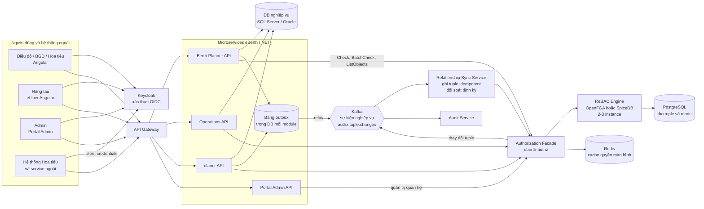
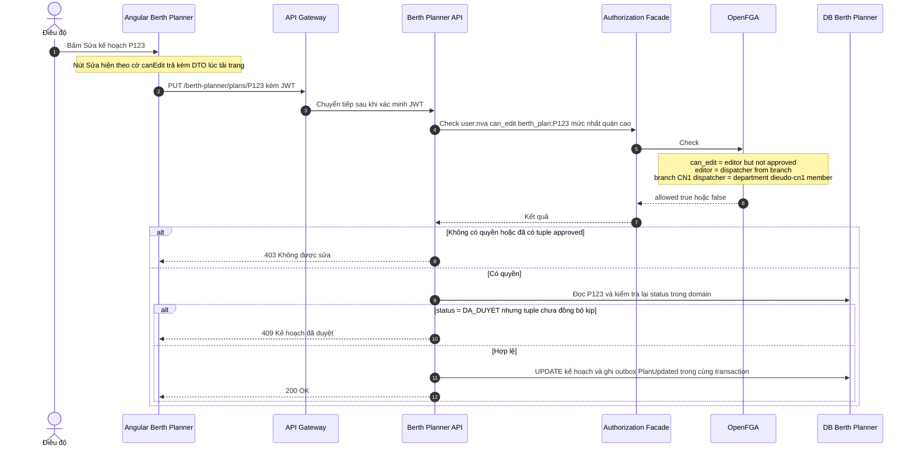
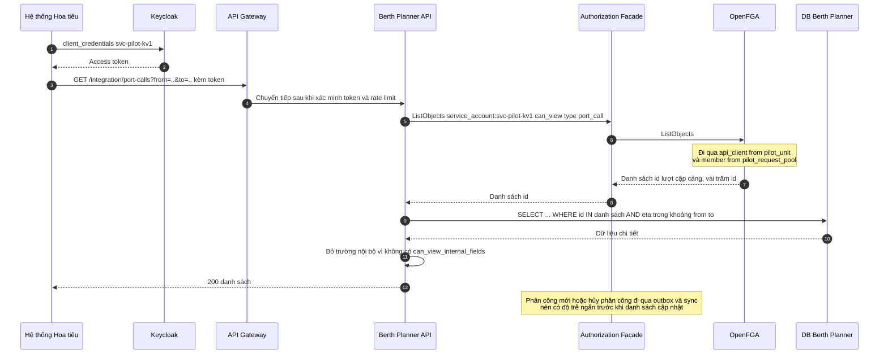
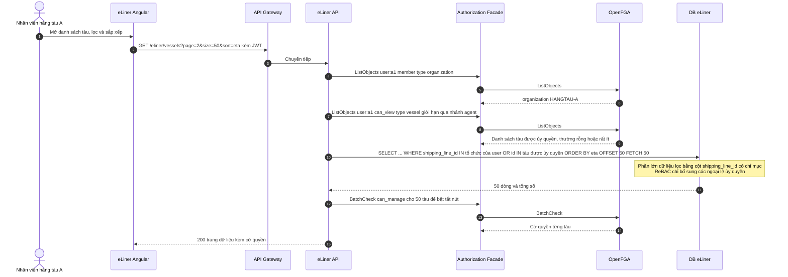
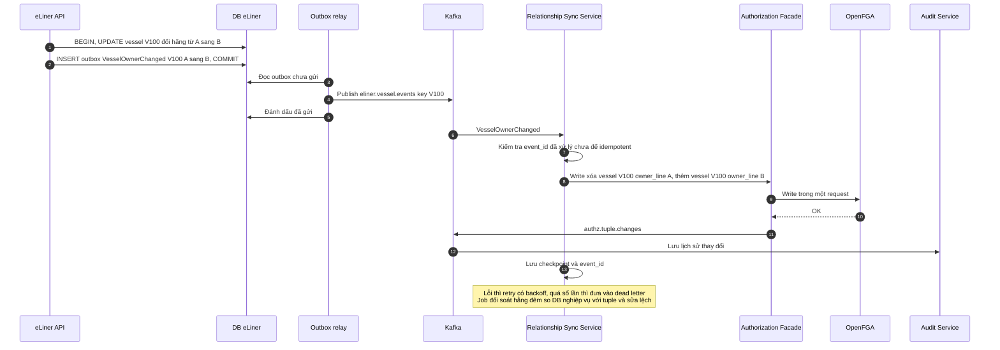
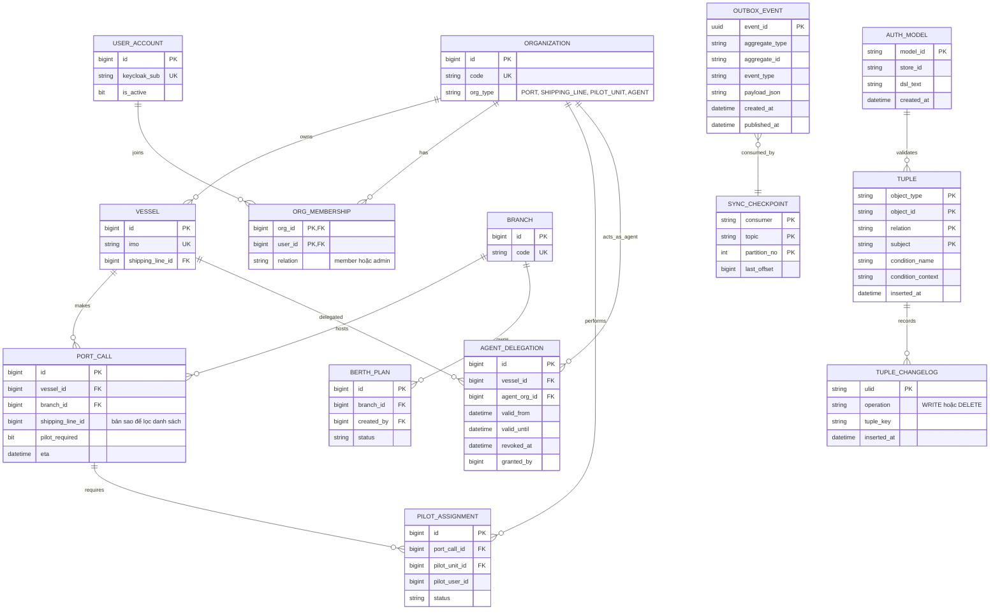

# Đánh giá mô hình ReBAC – Relationship-Based Access Control cho dự án eBerth

> Agent 2 – phụ trách ReBAC. Trọng tâm: mô hình hóa quan hệ (user – tổ chức – tàu – lượt cập cảng – kế hoạch – đại lý – đơn vị hoa tiêu) theo kiểu Zanzibar; đồng bộ quan hệ giữa DB nghiệp vụ và hệ thống ReBAC; hiệu năng khi liệt kê danh sách; công cụ OpenFGA, SpiceDB, Permify.

**Phạm vi đánh giá.** Báo cáo phân biệt hai mức:

- **ReBAC thuần (kiểu Zanzibar)**: quyền suy ra hoàn toàn từ các bộ quan hệ (relationship tuple) và quy tắc ghép quan hệ trong schema (hợp, giao, loại trừ, đi theo quan hệ).
- **ReBAC có điều kiện**: ReBAC thuần cộng *điều kiện gắn trên quan hệ* (OpenFGA gọi là *conditions*, SpiceDB gọi là *caveats*, viết bằng CEL – Common Expression Language), ví dụ "quan hệ đại lý chỉ có hiệu lực trước ngày hết hợp đồng".

Mức đáp ứng chính thức trong bảng kịch bản là của **ReBAC có điều kiện**, vì đó là tính năng có sẵn trong các công cụ phổ biến hiện nay. Kịch bản nào chỉ làm được nhờ điều kiện thì ghi rõ trong cột ghi chú. Cách làm "lách" bằng cách gọi SQL nghiệp vụ trong code ứng dụng thì không tính là ReBAC.

---

## 1. GIẢI THÍCH MÔ HÌNH

### 1.1. Định nghĩa và nguồn gốc

**ReBAC (Relationship-Based Access Control – kiểm soát truy cập dựa trên quan hệ)**: quyền của chủ thể trên một đối tượng được suy ra từ **chuỗi quan hệ** nối chủ thể với đối tượng. Ví dụ: "user U xem được lượt cập cảng PC vì U là *thành viên* của hãng tàu A, và hãng A là *chủ* của tàu V, và PC là *lượt cập cảng của* tàu V".

- Ý tưởng được Carrie Gates nêu năm 2007 và Philip Fong hình thức hóa năm 2011, ban đầu cho mạng xã hội ("bạn của bạn được xem ảnh").
- Bước ngoặt là bài báo **"Zanzibar: Google's Consistent, Global Authorization System"** (USENIX ATC 2019). Zanzibar là hệ thống phân quyền dùng chung cho Google Drive, YouTube, Calendar…. Đây là khuôn mẫu cho các công cụ mã nguồn mở OpenFGA, SpiceDB, Permify, Ory Keto.

### 1.2. Thành phần cốt lõi (theo Zanzibar)

| Thành phần | Ý nghĩa | Ví dụ |
|---|---|---|
| **Object (đối tượng)** | `kiểu:id` | `vessel:V100`, `organization:HANGTAU-A` |
| **Relation (quan hệ)** | Tên quan hệ khai báo trên kiểu | `owner_line`, `member`, `agent` |
| **Subject / userset** | Một user, hoặc một *tập user* được định nghĩa qua quan hệ khác | `user:u1`, `organization:HANGTAU-A#member` |
| **Relationship tuple** | Một sự kiện quan hệ: `object#relation@subject` | `vessel:V100#owner_line@organization:HANGTAU-A` |
| **Schema / authorization model** | Khai báo kiểu, quan hệ và **userset rewrite**: hợp (`or`), giao (`and`), loại trừ (`but not`), đi theo quan hệ (`X from Y` trong OpenFGA, `Y->X` trong SpiceDB) | `define can_view: member from owner_line` |
| **API** | **Check** (U có quyền R trên O?), **ListObjects/LookupResources** (U có quyền R trên những O nào?), **ListUsers/LookupSubjects** (ai có quyền R trên O?), **Expand** (cây suy diễn), **Write/Read**, **Watch/ReadChanges** (dòng thay đổi) | |
| **Consistency token** | Zanzibar dùng *zookie* để tránh "new enemy problem" (quyền vừa thu hồi nhưng lần kiểm tra sau vẫn đọc dữ liệu cũ). SpiceDB gọi là *ZedToken*; OpenFGA dùng tham số mức nhất quán (consistency preference) | |

### 1.3. Ví dụ minh họa (không phải eBerth)

Hệ thống lưu trữ tài liệu của một công ty:

```text
folder:hopdong#owner@user:lan
document:hd01#parent@folder:hopdong
team:phaply#member@user:minh
folder:hopdong#viewer@team:phaply#member

Schema:
  document.can_view = viewer OR owner OR can_view from parent
  folder.can_view   = viewer OR owner
```

Minh xem được `hd01` vì Minh là thành viên team Pháp lý, team Pháp lý được xem thư mục `hopdong`, và `hd01` nằm trong thư mục đó. Khi Minh rời team, chỉ cần xóa một tuple `team:phaply#member@user:minh` là Minh mất quyền trên *mọi* tài liệu liên quan, không phải sửa role hay code.

### 1.4. Khi nào phù hợp, khi nào không

**Phù hợp khi:**
- Quyền đi theo **quan hệ sở hữu, thành viên, phân công, ủy quyền** giữa các đối tượng cụ thể.
- Có nhiều **tổ chức bên ngoài** và cần chia sẻ chéo có kiểm soát (hãng tàu ủy quyền cho đại lý, cảng chia sẻ cho đơn vị hoa tiêu).
- Cần trả lời "ai có quyền trên đối tượng này" một cách chính xác.

**Không phù hợp khi:**
- Quyền chủ yếu theo **chức năng/màn hình**: RBAC đơn giản hơn nhiều.
- Quyền phụ thuộc **thuộc tính thay đổi liên tục** (trạng thái, số tiền, giờ, IP): phải đồng bộ thành tuple hoặc dùng điều kiện CEL, nên kém tự nhiên.
- Cần **lọc danh sách lớn có phân trang, sắp xếp, lọc theo cột nghiệp vụ**: engine ReBAC không biết cột nghiệp vụ, nên khó kết hợp với truy vấn SQL.
- Đội nhỏ, không muốn vận hành thêm hạ tầng và pipeline đồng bộ dữ liệu.

---

## 2. ÁP DỤNG VÀO eBERTH

### 2.1. Đồ thị quan hệ eBerth

```text
user ──member──▶ organization (cảng / hãng tàu / đơn vị hoa tiêu / đại lý)
user ──member──▶ department (phòng Điều độ CN1, Ban giám đốc CN1)
branch ──dispatcher──▶ department#member        branch ──director──▶ department#member
vessel ──owner_line──▶ organization(hãng tàu)    vessel ──agent──▶ organization(đại lý)  [có điều kiện thời hạn]
port_call ──vessel──▶ vessel                     port_call ──branch──▶ branch
port_call ──pilot_unit──▶ organization(hoa tiêu) port_call ──pilot_request_pool──▶ organization(hoa tiêu)
port_call ──assigned_pilot──▶ user
berth_plan ──branch──▶ branch                    berth_plan ──creator──▶ user
berth_plan ──approved──▶ user:*  (cờ trạng thái biểu diễn bằng quan hệ)
app_screen ──viewer──▶ role#assignee | department#member | organization#member
```

Hai loại quan hệ cần phân biệt rõ vì chúng có **nguồn sự thật** (source of truth) khác nhau:

| Loại | Ví dụ | Nguồn sự thật | Ai ghi tuple |
|---|---|---|---|
| **Quan hệ phân quyền thuần** | user là thành viên phòng Điều độ CN1; phòng Điều độ CN1 là `dispatcher` của chi nhánh CN1; role `pilot` được xem màn hình hoa tiêu | **Kho ReBAC** | Portal Admin, qua Authorization Facade |
| **Quan hệ phát sinh từ nghiệp vụ** | tàu V thuộc hãng A; lượt cập cảng PC của tàu V tại CN1; PC được phân công đơn vị hoa tiêu KV1; kế hoạch P đã duyệt | **DB nghiệp vụ** | Relationship Sync Service, đọc sự kiện từ outbox/Kafka |

### 2.2. Authorization model (OpenFGA DSL)

```text
model
  schema 1.1

type user

type service_account

type role
  relations
    define assignee: [user]

type organization
  relations
    define member: [user]
    define admin: [user]
    define api_client: [service_account]

type department
  relations
    define member: [user]

type branch
  relations
    define dispatcher: [user, department#member]
    define director: [user, department#member, user with in_time_window]
    define pilot_viewer: [organization#member, organization#api_client]

type app_screen
  relations
    define viewer: [user, role#assignee, department#member, organization#member]

type vessel
  relations
    define owner_line: [organization]
    define agent: [organization with in_time_window]
    define can_view: member from owner_line or member from agent
    define can_manage: admin from owner_line or member from agent

type port_call
  relations
    define vessel: [vessel]
    define branch: [branch]
    define pilot_unit: [organization]
    define pilot_request_pool: [organization]
    define assigned_pilot: [user]
    define internal_viewer: dispatcher from branch or director from branch
    define can_view: can_view from vessel or internal_viewer or member from pilot_unit or member from pilot_request_pool or api_client from pilot_unit or assigned_pilot
    define can_view_internal_fields: internal_viewer

type berth_plan
  relations
    define branch: [branch]
    define creator: [user]
    define approved: [user:*]
    define editor: dispatcher from branch
    define approver: director from branch
    define can_view: editor or approver or pilot_viewer from branch
    define can_edit: editor but not approved
    define can_approve: approver but not creator

condition in_time_window(current_time: timestamp, valid_from: timestamp, valid_until: timestamp) {
  current_time >= valid_from && current_time < valid_until
}
```

**Giải thích theo nhóm người dùng:**

| Nhóm | Quan hệ trao quyền | Ví dụ tuple |
|---|---|---|
| **Điều độ** | thành viên `department:dieudo-cn1`, phòng này là `dispatcher` của `branch:CN1`. Từ đó có `editor` trên mọi kế hoạch của CN1 và `can_edit` khi kế hoạch chưa có `approved`. | `department:dieudo-cn1#member@user:nva`<br>`branch:CN1#dispatcher@department:dieudo-cn1#member` |
| **Ban giám đốc** | thành viên `department:bgd-cn1`, phòng này là `director` của `branch:CN1`. Có `can_approve` nếu không phải `creator`. Ủy quyền tạm thời: tuple `director` có điều kiện thời hạn. | `branch:CN1#director@department:bgd-cn1#member`<br>`branch:CN1#director@user:lvc` với điều kiện `in_time_window` |
| **Hoa tiêu** | thành viên `organization:HOATIEU-KV1`. Xem lượt cập cảng qua `pilot_unit`/`pilot_request_pool`. Xem kế hoạch qua `branch#pilot_viewer`. Màn hình hoa tiêu qua `app_screen`. | `organization:HOATIEU-KV1#member@user:pd`<br>`port_call:PC9#pilot_unit@organization:HOATIEU-KV1`<br>`app_screen:bp-pilot-board#viewer@organization:HOATIEU-KV1#member` |
| **Hãng tàu** | thành viên `organization:HANGTAU-A`; hãng là `owner_line` của tàu, nên xem được tàu và lượt cập cảng của tàu. | `organization:HANGTAU-A#member@user:a1`<br>`vessel:V100#owner_line@organization:HANGTAU-A`<br>`port_call:PC9#vessel@vessel:V100` |
| **Admin hệ thống** | `role:admin#assignee`, role này được xem các màn hình Portal Admin. Quyền *ghi tuple* nằm ở Authorization Facade, không nằm trong model. | `role:admin#assignee@user:admin1`<br>`app_screen:admin-users#viewer@role:admin#assignee` |
| **Hệ thống Hoa tiêu** | `service_account` là `api_client` của đơn vị hoa tiêu, chỉ được `can_view`, không có quan hệ màn hình hay ghi. | `organization:HOATIEU-KV1#api_client@service_account:svc-pilot-kv1` |

Cùng model viết bằng SpiceDB schema (trích, để so sánh cú pháp):

```text
definition berth_plan {
    relation branch: branch
    relation creator: user
    relation approved: user:*
    permission edit = branch->dispatcher - approved
    permission approve = branch->director - creator
}
```

Lưu ý: ReBAC **mô phỏng được RBAC** (kiểu `role` với quan hệ `assignee`). Tuy nhiên mỗi lần frontend cần danh sách quyền màn hình sẽ phải gọi nhiều Check, kém tiện hơn bảng permission phẳng của RBAC (xem KB15).

### 2.3. Giả định đã dùng

| Mã | Giả định | Nếu sai thì sao |
|---|---|---|
| GĐ-B01 | [GIẢ ĐỊNH] Mỗi user thuộc ít nhất một tổ chức. User nội bộ cảng thuộc một hoặc nhiều phòng ban. | Không đổi kết luận: ReBAC xử lý tự nhiên trường hợp một user nhiều tổ chức. |
| GĐ-B02 | [GIẢ ĐỊNH] Tách dữ liệu một tầng chi nhánh/cảng; bến và cầu bến thuộc một chi nhánh. | Nếu là cây nhiều tầng (tổng công ty, chi nhánh, bến) thì ReBAC xử lý tốt bằng quan hệ `parent`, thậm chí *tốt hơn* RBAC. Đổi lại, đường suy diễn dài hơn nên Check chậm hơn. |
| GĐ-B03 | [GIẢ ĐỊNH] Kế hoạch có trạng thái `NHAP → CHO_DUYET → DA_DUYET`; trạng thái `DA_DUYET` được đồng bộ thành tuple `approved`. | Nếu có nhiều trạng thái và nhiều quy tắc theo trạng thái thì số quan hệ "cờ" tăng, model khó đọc. Khi đó nên chuyển quy tắc trạng thái sang ABAC/PBAC. |
| GĐ-B04 | [GIẢ ĐỊNH] eBerth lưu phân công đơn vị hoa tiêu và cờ `pilot_required` cho từng lượt cập cảng; hệ thống Hoa tiêu đẩy phân công về qua API. | Nếu phân công chỉ nằm ở hệ thống Hoa tiêu thì không có dữ liệu để sinh tuple, KB07 không làm được (với mọi mô hình). |
| GĐ-B05 | [GIẢ ĐỊNH] Hoa tiêu dùng màn hình Berth Planner bằng tài khoản Keycloak (riêng hoặc qua identity brokering). Hệ thống Hoa tiêu gọi API bằng client credentials. | Nếu gọi API thay mặt từng hoa tiêu thì cần Token Exchange (RFC 8693). ReBAC vẫn dùng được: Check theo `user:` thay vì `service_account:`. |
| GĐ-B06 | [GIẢ ĐỊNH] Hãng tàu thấy mọi lượt cập cảng của mình ở mọi chi nhánh. | Nếu phải giới hạn theo cả chi nhánh thì thêm quan hệ giao (`and`) với chi nhánh; ReBAC diễn đạt được. |
| GĐ-B07 | Theo PHẦN 1.4: **hiện không có đại lý hàng hải**. KB10 đánh giá cho trường hợp phát sinh sau này. | Nếu đại lý xuất hiện thì giá trị của ReBAC tăng rõ (đây là kịch bản sở trường). |
| GĐ-B08 | [GIẢ ĐỊNH] Quy mô khoảng 200.000 lượt cập cảng/năm, vài nghìn tàu, vài nghìn user ngoài. Ước tính khoảng 5–8 tuple cho mỗi lượt cập cảng (kế hoạch, chi nhánh, tàu, hoa tiêu), tức khoảng 1–2 triệu tuple/năm. | Khối lượng này nằm trong khả năng của OpenFGA/SpiceDB trên PostgreSQL. Nếu lớn hơn nhiều bậc thì cần sizing lại và cân nhắc dọn tuple của dữ liệu lịch sử. |
| GĐ-B09 | [GIẢ ĐỊNH] Hệ thống chạy on-premise, không dùng dịch vụ cloud bên ngoài (Okta FGA, AuthZed Cloud). | Nếu được dùng managed service thì chi phí vận hành giảm nhưng phát sinh phụ thuộc nhà cung cấp và vấn đề dữ liệu ra ngoài. |
| GĐ-B10 | [GIẢ ĐỊNH] Đội được phép vận hành thêm **PostgreSQL** (hoặc MySQL) cho kho tuple, vì OpenFGA, SpiceDB, Permify đều **không hỗ trợ SQL Server/Oracle** làm kho lưu (cần kiểm tra lại tại thời điểm triển khai). | Nếu bắt buộc chỉ dùng SQL Server/Oracle thì phải tự xây engine ReBAC. Độ phức tạp tăng lên Cao và rủi ro sai thuật toán. |
| GĐ-B11 | Keycloak chỉ xác thực; quyền không nằm trong JWT. | – |

---

## 3. TRẢ LỜI BỘ KỊCH BẢN KB01–KB18

Mức đáp ứng là của **ReBAC có điều kiện**. Ghi chú "(cần điều kiện)" nghĩa là ReBAC thuần không đủ, phải dùng conditions/caveats.

| Mã | Cách xử lý | Mức đáp ứng | Lý do / ghi chú |
|---|---|---|---|
| KB01 | `berth_plan:P#branch@branch:CN1`; Điều độ là thành viên phòng `dispatcher` của CN1. Check `can_edit` trên `berth_plan:P`. Tạo kế hoạch: Check `dispatcher` trên `branch:CN1`, rồi ghi tuple `branch` và `creator` cho kế hoạch mới. | **Tốt** | Diễn đạt tự nhiên. Tạo đối tượng mới đồng nghĩa phải ghi tuple, tức thêm một bước đồng bộ. |
| KB02 | Khi kế hoạch được duyệt, sync ghi `berth_plan:P#approved@user:*`. `can_edit = editor but not approved`. | **Được** | Làm được trong model, nhưng **trạng thái phải đồng bộ thành tuple**. Nếu đồng bộ bất đồng bộ qua Kafka thì có độ trễ: trong vài trăm ms tới vài giây sau khi duyệt, Điều độ vẫn sửa được. Khuyến nghị kiểm tra trạng thái thêm một lần trong domain (phòng thủ nhiều lớp). |
| KB03 | `can_approve = approver but not creator`. | **Tốt** | Phân tách nhiệm vụ theo từng bản ghi là thế mạnh nhờ phép loại trừ (`but not`/`-`). Dữ liệu `creator` được ghi lúc tạo kế hoạch. |
| KB04 | Phê duyệt: Check `can_approve`. Tổng quan: màn hình là `app_screen`; số liệu tổng hợp theo chi nhánh lấy bằng SQL lọc theo các chi nhánh user là `director` (lấy qua ListObjects `branch`, số lượng nhỏ). | **Được** | Phê duyệt làm tốt. Dashboard tổng hợp (đếm, thống kê trên hàng nghìn kế hoạch) không thể Check từng dòng, phải quy về lọc theo chi nhánh. |
| KB05 | Keycloak xác thực hoa tiêu. eBerth Check `can_view` trên `berth_plan` qua `branch#pilot_viewer@organization:HOATIEU-KV1#member`. | **Được** | Phần ReBAC đơn giản; khó nằm ở tích hợp định danh (GĐ-B05). |
| KB06 | `app_screen:bp-pilot-board#viewer@organization:HOATIEU-KV1#member`; màn hình Điều độ chỉ cấp cho phòng Điều độ. Route guard và API Check `viewer` trên `app_screen`. | **Được** | Làm được nhưng thực chất là mô phỏng RBAC. Mỗi màn hình một đối tượng, menu cần BatchCheck. Không có lợi thế so với RBAC. |
| KB07 | `port_call#pilot_unit` (đã phân công) và `port_call#pilot_request_pool` (có yêu cầu, chưa phân công, gửi tới các đơn vị hoa tiêu phục vụ chi nhánh). Phân công chi tiết theo từng hoa tiêu dùng `assigned_pilot`. | **Tốt** | Đúng sở trường: quyền đi theo phân công. Tuple thay đổi theo vòng đời phân công nên cần đồng bộ (GĐ-B04). Danh sách của một đơn vị hoa tiêu trong khung thời gian ngắn là nhỏ, ListObjects dùng được. |
| KB08 | `vessel#owner_line@organization:HANGTAU-A`; `port_call#vessel@vessel:V`. Hãng B không có đường quan hệ tới tàu của hãng A, nên Check trả về `false`. | **Tốt** | Tách tổ chức là mặc định của mô hình: không có quan hệ thì không có quyền. Phần liệt kê danh sách xem KB14. |
| KB09 | Quan hệ riêng `can_view_internal_fields` trên `port_call` (chỉ nội bộ). Backend Check một lần cho mỗi đối tượng (hoặc theo loại), rồi bỏ trường khi trả về DTO. | **Được** | Làm được. Với danh sách nhiều dòng, quyền mức trường thường tính theo nhóm user chứ không theo từng dòng, nên ReBAC không có lợi thế. |
| KB10 | Hãng A (admin) tự ghi `vessel:V100#agent@organization:DAILY-X` kèm điều kiện `in_time_window` (từ ngày, đến ngày hợp đồng). Hết hạn thì điều kiện trả về `false`, thu hồi sớm thì xóa tuple. Ủy quyền theo chuyến: thêm kiểu `voyage` tương tự. | **Tốt** (cần điều kiện) | Kịch bản sở trường. Không có điều kiện thì vẫn làm được bằng job xóa tuple khi hết hạn (ReBAC thuần: Được). Hiện chưa có đại lý (GĐ-B07). |
| KB11 | Nhân viên chuyển phòng thì xóa `department:dieudo-cn1#member@user:X` (một tuple) và ghi tuple thành viên phòng mới. Check sau đó dùng mức nhất quán cao hoặc consistency token nên mất quyền ngay. | **Tốt** | Quyền gắn qua nhóm nên chỉ đổi một tuple. Nếu thông tin phòng ban gốc nằm ở HR thì cần đồng bộ HR sang tuple. |
| KB12 | Trực thay ca, ủy quyền phê duyệt: tuple `branch:CN1#director@user:lvc` kèm điều kiện `in_time_window`. Ứng dụng truyền `current_time` trong context khi Check. | **Được** (cần điều kiện) | Làm được, có hạn chế: điều kiện chỉ nhìn thấy dữ liệu trong tuple và context. "Chỉ được duyệt kế hoạch dưới X giờ tàu" thì phải truyền thêm thuộc tính, tức là đã sang ABAC. |
| KB13 | Màn hình mới = đối tượng `app_screen` mới + tuple cấp quyền, không cần đổi model. Nếu cần *kiểu quan hệ mới* thì phải ghi phiên bản model mới (model bất biến theo phiên bản) nhưng không deploy lại ứng dụng. | **Được** | Gán quyền động tốt. Thay đổi model cần quy trình review/test giống deploy cấu hình. Code của màn hình mới vẫn phải deploy. |
| KB14 | Ba cách: (1) ListObjects lấy danh sách id rồi SQL `WHERE id IN (...)` để phân trang; (2) SQL lọc thô, rồi BatchCheck từng trang; (3) lai: SQL lọc theo cột tổ chức đã có sẵn (`shipping_line_id`), cộng thêm id được ủy quyền lấy từ ReBAC. | **Kém** | Đây là điểm yếu lớn nhất. Engine không biết cột nghiệp vụ (ngày ETA, trạng thái, tên tàu) nên không phân trang, sắp xếp, lọc được. ListObjects có giới hạn số kết quả và thời gian xử lý. Cách khả thi (3) là đưa lại logic phạm vi về SQL, tức là quay về RBAC + scope. Chi tiết ở mục 5.3 (c). |
| KB15 | Menu, nút chung: BatchCheck danh sách `app_screen`/hành động khi đăng nhập, cache ở frontend. Nút trên từng dòng (Sửa, Duyệt): BatchCheck theo trang dữ liệu hoặc trả cờ quyền kèm DTO. | **Được** | Làm được nhưng tốn nhiều lần Check hơn RBAC. Bù lại, nút trên từng dòng phản ánh đúng quyền theo bản ghi (KB02, KB03). |
| KB16 | "Ai có quyền trên Y": ListUsers/LookupSubjects. "Vì sao X xem được Y": Expand trả về cây suy diễn (SpiceDB có thêm chế độ debug trace cho Check). Lịch sử thay đổi tuple: ReadChanges/Watch đưa vào Audit Service. | **Tốt** | Mô hình tập trung, quyền chỉ suy ra từ tuple + schema nên giải thích được chính xác. Hạn chế: "liệt kê *mọi* quyền của X trên mọi loại đối tượng" thì tốn kém; engine không lưu lịch sử quyết định, phải tự ghi log. |
| KB17 | Mọi kế hoạch và lượt cập cảng có quan hệ `branch`. BGĐ chi nhánh là `director` của chi nhánh đó. | **Tốt** | Diễn đạt tự nhiên; cây chi nhánh nhiều tầng cũng làm được. Phần danh sách và dashboard xem KB04, KB14. |
| KB18 | Keycloak client credentials, `service_account:svc-pilot-kv1` là `api_client` của đơn vị hoa tiêu. Chỉ `can_view` có nhánh `api_client`, các quan hệ sửa và duyệt không có. | **Được** | Hạn chế phạm vi dữ liệu tốt. Hạn chế theo loại API, giờ, tần suất là việc của API gateway. |
| KB-THÊM-01 | Hãng tàu tự quản lý thành viên và ủy quyền của mình (ghi tuple `member`, `agent` trong phạm vi tổ chức mình) qua eLiner. Authorization Facade chỉ cho ghi tuple khi người ghi là `admin` của tổ chức sở hữu. | **Tốt** | Ủy quyền phân tán, giảm tải Admin cảng. Facade bắt buộc phải kiểm soát *ai được ghi tuple nào*; bản thân engine không có khái niệm này. |
| KB-THÊM-02 | Thu hồi quyền rồi thao tác ngay ("new enemy problem"): ví dụ thu hồi đại lý X rồi hãng A cập nhật lịch nhạy cảm. | **Được** | SpiceDB dùng ZedToken (`at_least_as_fresh`, `fully_consistent`). OpenFGA dùng mức nhất quán cao (bỏ qua cache). Đổi lại, độ trễ tăng; ứng dụng phải biết khi nào cần nhất quán cao. |

**Tổng hợp mức đáp ứng (KB01–KB18):** Tốt 8 · Được 9 · Kém 1 · Không làm được 0.
ReBAC thuần (không điều kiện): KB10 và KB12 xuống Được/Kém tùy việc chấp nhận job xóa tuple khi hết hạn; các kịch bản khác không đổi.

---

## 4. ƯU ĐIỂM VÀ NHƯỢC ĐIỂM

### 4.1. Ưu điểm

| Ưu điểm | Ví dụ trong eBerth |
|---|---|
| **Tách dữ liệu giữa tổ chức là mặc định, an toàn theo thiết kế** | KB08: hãng B không có đường quan hệ tới `vessel:V100`, nên mọi Check đều `false`. Không có chuyện "quên thêm WHERE" như RBAC + scope, *với điều kiện* mọi truy cập đều đi qua Check. |
| **Phân công và ủy quyền chi tiết theo đối tượng** | KB07: hoa tiêu chỉ thấy lượt cập cảng được phân công. KB10: hãng A ủy quyền cho đại lý X trên tàu V100 đến 31/12, không cần tạo role. |
| **Phân tách nhiệm vụ theo bản ghi nằm ngay trong model** | KB03: `can_approve = approver but not creator`, không phải viết `if` trong code. |
| **Ủy quyền quản trị phân tán** | KB-THÊM-01: admin hãng tàu tự thêm hoặc bớt nhân viên của hãng, tự ủy quyền đại lý; Admin cảng không phải làm thay. |
| **Audit "ai có quyền" chính xác** | KB16: ListUsers trên `port_call:PC9` với `can_view` trả về đủ: Điều độ CN1, BGĐ CN1, thành viên hãng A, đơn vị hoa tiêu KV1, đại lý X (nếu còn hạn). |
| **Thu hồi một chỗ, hiệu lực mọi nơi** | KB11: xóa một tuple thành viên phòng là mất quyền trên mọi kế hoạch của chi nhánh. |

### 4.2. Nhược điểm

| Nhược điểm | Ví dụ trong eBerth |
|---|---|
| **Phải đồng bộ dữ liệu nghiệp vụ sang kho tuple** | Mỗi lần đăng ký tàu, tạo lượt cập cảng, phân công hoa tiêu, duyệt kế hoạch đều phải sinh hoặc xóa tuple. Nếu sync lỗi (consumer Kafka dừng), hoa tiêu không thấy lượt cập cảng vừa phân công, hoặc tệ hơn, đại lý đã bị thu hồi trong DB nhưng tuple vẫn còn. |
| **Lọc danh sách lớn yếu** | KB14: "lượt cập cảng của hãng A, ETA trong 30 ngày, trạng thái Đã xác nhận, sắp xếp theo tên tàu, trang 3" thì engine không làm được; ListObjects trả về hàng chục nghìn id, rồi `WHERE id IN (...)` không khả thi. |
| **Thêm hạ tầng mới** | Kho tuple cần PostgreSQL hoặc MySQL (không dùng được SQL Server/Oracle hiện có – GĐ-B10), thêm cụm OpenFGA/SpiceDB cần HA, giám sát, backup. Engine thành điểm phụ thuộc chung: engine chết thì mọi module bị chặn (fail closed). |
| **Quy tắc theo trạng thái/thuộc tính kém tự nhiên** | KB02: trạng thái `DA_DUYET` phải chuyển thành tuple `approved`, kèm độ trễ đồng bộ. Quy tắc "Điều độ trưởng được sửa trong 2 giờ sau duyệt" cần điều kiện CEL với thời điểm duyệt lưu trong tuple, model rối dần. |
| **Mô phỏng quyền màn hình/chức năng kém tiện** | KB06, KB15: menu 40 mục là 40 Check (hoặc một BatchCheck), trong khi RBAC chỉ cần trả một danh sách permission. |
| **Đường cong học tập** | Đội .NET/Angular chưa quen tư duy tuple, userset, "tuple-to-userset", mức nhất quán; viết sai model dễ mở quyền ngoài ý muốn. |

---

## 5. THIẾT KẾ TRIỂN KHAI

### 5.1. Các service và module cần thêm hoặc sửa

| Thành phần | Mới/Sửa | Trách nhiệm |
|---|---|---|
| **Keycloak** | Sửa cấu hình | Xác thực OIDC; identity brokering cho hoa tiêu; client credentials cho service ngoài. Không quản lý quyền. |
| **API Gateway** | Sửa | Xác minh JWT, rate limit, định tuyến theo module. Không gọi engine ReBAC (tránh tăng độ trễ cho mọi request). |
| **ReBAC Engine (OpenFGA hoặc SpiceDB)** | Mới | Lưu authorization model và tuple; trả lời Check, BatchCheck, ListObjects, ListUsers, Expand; cung cấp dòng thay đổi (ReadChanges/Watch). Chạy tối thiểu 2–3 instance sau load balancer, **chỉ mở trong mạng nội bộ**, xác thực bằng preshared key hoặc mTLS. |
| **PostgreSQL cho kho tuple** | Mới | Kho lưu của engine. HA (streaming replication), backup, giám sát. |
| **Authorization Facade (eberth-authz)** | Mới | Lớp duy nhất các module gọi tới: bọc SDK của engine, chuẩn hóa tên đối tượng, **kiểm soát ai được ghi tuple nào** (ví dụ admin hãng A chỉ ghi tuple trên tàu của hãng A), API cho Portal Admin và eLiner, quản lý phiên bản model, ghi audit. |
| **Relationship Sync Service** | Mới | Đọc sự kiện nghiệp vụ từ Kafka (do outbox của từng module phát ra) rồi ghi/xóa tuple một cách idempotent; lưu checkpoint; job đối soát định kỳ so DB nghiệp vụ với kho tuple; đưa sự kiện lỗi vào dead letter topic. |
| **Transactional Outbox trong từng module** | Sửa | Berth Planner, eLiner, module phân công hoa tiêu ghi sự kiện vào bảng `outbox_event` *trong cùng transaction* với dữ liệu nghiệp vụ; một tiến trình đẩy sang Kafka. Tránh trường hợp DB commit mà sự kiện bị mất. |
| **Thư viện `Eberth.Authorization` (.NET)** | Mới | `RequireRelation` attribute (Check theo đối tượng trong route), helper BatchCheck cho danh sách, lọc lai SQL + ReBAC, cache ngắn hạn kết quả Check. |
| **Redis** | Dùng sẵn | Cache ngắn (vài giây tới 1 phút) cho kết quả quyền màn hình/menu của user; **không** cache kết quả Check cho thao tác ghi quan trọng. |
| **Kafka** | Dùng sẵn | Topic sự kiện nghiệp vụ (`berth.plan.events`, `eliner.vessel.events`, `pilot.assignment.events`), topic `authz.tuple.changes` (từ ReadChanges) cho audit và xóa cache. |
| **Audit Service** | Mới | Lưu lịch sử thay đổi tuple (ai, khi nào, vì sao) và nhật ký quyết định quan trọng (từ chối truy cập, phê duyệt). |
| **Portal Admin – phân hệ Quan hệ & Quyền** | Sửa | Quản lý phòng ban, thành viên, gán phòng vào chi nhánh (dispatcher/director), cấp quyền màn hình, xem "ai có quyền trên đối tượng Y" (ListUsers), xem cây suy diễn (Expand), quản lý ủy quyền tạm thời. |
| **eLiner – màn hình quản trị của hãng tàu** | Sửa | Admin hãng tàu quản lý thành viên của hãng và ủy quyền đại lý (KB10, KB-THÊM-01). |
| **Angular shared library** | Mới | Tải quyền màn hình (BatchCheck qua Facade), directive `*canDo`, route guard; dùng cờ quyền trả kèm DTO cho nút trên từng dòng. |

### 5.2. Kiến trúc tổng thể



### 5.3. Luồng kiểm tra quyền

**Điểm kiểm tra chung:**

| Tầng | Kiểm tra gì |
|---|---|
| Frontend | Ẩn/hiện menu theo BatchCheck `app_screen`; nút trên từng dòng theo cờ quyền trả kèm DTO. Không phải lớp bảo mật. |
| API Gateway | JWT, rate limit, định tuyến. |
| Backend từng module | Check quan hệ trên đối tượng cụ thể (`can_edit` trên `berth_plan:P123`) trước khi thao tác. |
| Domain service | Kiểm tra lại trạng thái (phòng trường hợp tuple trạng thái chưa đồng bộ kịp). |
| Tầng truy vấn DB | Danh sách: lọc lai (cột tổ chức trong SQL + danh sách id từ ReBAC cho các trường hợp ủy quyền). |

**Cache và khi quyền thay đổi:**
- Engine có cache Check nội bộ (bật/tắt, TTL cấu hình được).
- Thao tác ghi và thao tác nhạy cảm dùng mức nhất quán cao: OpenFGA `HIGHER_CONSISTENCY`, SpiceDB `fully_consistent` hoặc ZedToken nhận được khi ghi tuple. Danh sách và màn hình dùng mức "ưu tiên độ trễ" (minimize latency).
- Redis chỉ cache quyền màn hình theo user, TTL ngắn. Facade nhận thay đổi tuple (ReadChanges/Watch, đẩy qua Kafka) rồi xóa key của user liên quan.

**(a) Điều độ sửa kế hoạch trong Berth Planner (KB01, KB02)**



**(b) Hoa tiêu từ hệ thống ngoài xem kế hoạch (KB05, KB07)**



**(c) Hãng tàu xem danh sách tàu trên eLiner (KB08, KB14) – cách lai khuyến nghị**



Ở cách (c), quan hệ `vessel#owner_line` tồn tại **ở cả hai nơi**: cột `vessel.shipping_line_id` trong SQL và tuple trong ReBAC. SQL dùng để lọc danh sách, ReBAC dùng cho Check từng đối tượng và cho các ngoại lệ. Như vậy là chấp nhận trùng lặp dữ liệu để đổi lấy hiệu năng; job đối soát phải kiểm tra hai nơi khớp nhau.

**Các chiến lược lọc danh sách với ReBAC (tóm tắt):**

| Chiến lược | Khi nào dùng | Hạn chế |
|---|---|---|
| ListObjects rồi `WHERE id IN (...)` | Tập kết quả nhỏ (vài trăm tới vài nghìn), ví dụ danh sách của đơn vị hoa tiêu trong 7 ngày | ListObjects có giới hạn số kết quả và thời gian (OpenFGA cấu hình được `ListObjects` max results và deadline); `IN` dài làm chậm SQL |
| SQL lọc thô rồi BatchCheck theo trang | Tỷ lệ "được xem" cao trên tập lọc thô | Trang có thể thiếu dòng, phải lấy dư rồi lặp; đếm tổng số không chính xác |
| **Lai: cột tổ chức trong SQL + ReBAC cho ngoại lệ** | eBerth (hãng tàu, chi nhánh) | Trùng lặp sự thật ở hai nơi, cần đối soát |
| Bảng quyền vật chất hóa (materialized) trong DB nghiệp vụ, ví dụ AuthZed Materialize (thương mại) hoặc tự tính bằng Watch | Quy mô rất lớn, quan hệ sâu | Phức tạp, độ trễ cập nhật, thêm một hệ thống đồng bộ nữa |

**(d) Đồng bộ quan hệ từ DB nghiệp vụ sang kho tuple (trọng tâm riêng)**



Nguyên tắc đồng bộ:
1. **Một nguồn sự thật cho mỗi loại quan hệ** (bảng ở mục 2.1). Không ghi cùng một quan hệ từ hai nơi.
2. **Không dual-write trực tiếp** (ghi DB rồi gọi engine trong cùng request): nếu bước sau lỗi thì hai bên lệch. Dùng outbox + Kafka (đã có sẵn), hoặc CDC (Change Data Capture, ví dụ Debezium) nếu không sửa được code module.
3. **Idempotent**: dùng `event_id`; ghi tuple đã tồn tại hoặc xóa tuple không tồn tại thì bỏ qua (cần kiểm tra hành vi của engine; OpenFGA ở các bản gần đây có tùy chọn bỏ qua tuple trùng khi ghi).
4. **Thứ tự**: partition Kafka theo id đối tượng (ví dụ `vessel_id`) để các sự kiện của cùng đối tượng xử lý đúng thứ tự.
5. **Đối soát định kỳ**: so sánh toàn bộ quan hệ nghiệp vụ với tuple, sửa lệch, báo cáo số lệch (chỉ số giám sát quan trọng).
6. **Quyền nhạy cảm theo trạng thái** (KB02): luôn kiểm tra lại trong domain, không chỉ dựa vào tuple.

### 5.4. Thiết kế cơ sở dữ liệu

**ERD** (gồm phía DB nghiệp vụ sinh quan hệ, bảng hỗ trợ đồng bộ, và mô hình khái niệm của kho tuple)



**Danh sách bảng – phía eBerth**

| Bảng | Cột chính | Khóa / chỉ mục quan trọng | Mục đích |
|---|---|---|---|
| `organization` | `code`, `org_type` | UK `code` | Danh mục tổ chức; sinh đối tượng `organization:`. |
| `org_membership` | `org_id`, `user_id`, `relation` | PK `(org_id, user_id, relation)` | **Tùy chọn.** Nếu thành viên tổ chức được quản lý trong eBerth thì bảng này là nguồn sự thật, đồng bộ thành tuple `member`/`admin`. Nếu quản lý thẳng trong ReBAC thì bỏ bảng này. |
| `vessel` | `imo`, `shipping_line_id` | UK `imo`; IX `shipping_line_id` | Nguồn của tuple `vessel#owner_line`. Cột `shipping_line_id` cũng dùng để lọc danh sách. |
| `port_call` | `vessel_id`, `branch_id`, `shipping_line_id`, `pilot_required`, `eta` | IX `(shipping_line_id, eta)`, `(branch_id, eta)` | Nguồn của tuple `port_call#vessel`, `#branch`, `#pilot_request_pool`. `shipping_line_id` là bản sao phục vụ lọc lai (KB14). |
| `berth_plan` | `branch_id`, `created_by`, `status` | IX `(branch_id, status)` | Nguồn của tuple `branch`, `creator`, `approved`. |
| `pilot_assignment` | `port_call_id`, `pilot_unit_id`, `pilot_user_id`, `status` | IX `port_call_id`; IX `(pilot_unit_id, status)` | Nguồn của tuple `port_call#pilot_unit`, `#assigned_pilot` (GĐ-B04). |
| `agent_delegation` | `vessel_id`, `agent_org_id`, `valid_from`, `valid_until`, `revoked_at`, `granted_by` | IX `(vessel_id, revoked_at)` | Hồ sơ ủy quyền đại lý (KB10). Nguồn của tuple `vessel#agent` có điều kiện; giữ lịch sử hợp đồng cho audit. |
| `outbox_event` | `event_id`, `aggregate_type`, `aggregate_id`, `event_type`, `payload_json`, `published_at` | PK `event_id`; IX `(published_at)` lọc null | Transactional outbox của từng module. |
| `sync_checkpoint`, `sync_processed_event` | `consumer`, `topic`, `partition_no`, `last_offset`; `event_id` | PK kép | Theo dõi tiến độ và chống xử lý trùng của Sync Service. |
| `sync_reconcile_run` | `started_at`, `finished_at`, `missing_count`, `extra_count` | IX `started_at` | Kết quả đối soát định kỳ, dùng cho giám sát. |
| `authz_decision_log` | `at`, `subject`, `relation`, `object`, `allowed`, `model_id`, `request_id` | IX `(object, at)`, `(subject, at)` | Nhật ký quyết định quan trọng (không ghi mọi Check, chỉ thao tác nhạy cảm và các lần từ chối). |

**Kho tuple (do engine quản lý, PostgreSQL).** Với OpenFGA, các bảng chính là `store`, `authorization_model`, `tuple`, `changelog`, `assertion` (tên và cấu trúc tham khảo, cần kiểm tra theo phiên bản). Bảng `tuple` lưu `(store, object_type, object_id, relation, user, condition_name, condition_context, ulid, inserted_at)`. `changelog` là nguồn cho API ReadChanges. Ứng dụng **không** đọc hoặc ghi trực tiếp các bảng này, chỉ dùng API. SpiceDB có cấu trúc tương tự (namespace, relationship, transaction) và cơ chế Watch.

**Bảng ánh xạ sự kiện nghiệp vụ sang tuple:**

| Sự kiện | Ghi tuple | Xóa tuple |
|---|---|---|
| Đăng ký tàu V cho hãng A | `vessel:V#owner_line@organization:A` | – |
| Tàu V đổi hãng A sang B | `vessel:V#owner_line@organization:B` | `vessel:V#owner_line@organization:A` |
| Tạo lượt cập cảng PC | `port_call:PC#vessel@vessel:V`, `port_call:PC#branch@branch:CN1` | – |
| Đặt cờ cần hoa tiêu | `port_call:PC#pilot_request_pool@organization:<mỗi đơn vị hoa tiêu phục vụ CN1>` [GIẢ ĐỊNH] | – |
| Phân công đơn vị hoa tiêu KV1 | `port_call:PC#pilot_unit@organization:KV1` | các tuple `pilot_request_pool` của PC |
| Tạo kế hoạch P | `berth_plan:P#branch@branch:CN1`, `berth_plan:P#creator@user:U` | – |
| Duyệt kế hoạch P | `berth_plan:P#approved@user:*` | – |
| Mở lại kế hoạch (nếu có) | – | `berth_plan:P#approved@user:*` |
| Ủy quyền đại lý X trên tàu V | `vessel:V#agent@organization:X` với điều kiện `in_time_window` | – |
| Thu hồi ủy quyền | – | `vessel:V#agent@organization:X` |

### 5.5. Ví dụ mã giả

**Model OpenFGA**: xem mục 2.2. **Kiểm tra quyền trong API (C#, mã giả dựa trên OpenFGA .NET SDK, tên hàm cần kiểm tra theo phiên bản)**:

```csharp
[HttpPut("plans/{id}")]
public async Task<IActionResult> UpdatePlan(long id, UpdatePlanDto dto)
{
    var allowed = await _authz.CheckAsync(
        user: $"user:{_currentUser.Sub}",
        relation: "can_edit",
        @object: $"berth_plan:{id}",
        consistency: Consistency.Higher);          // thao tác ghi: bỏ qua cache
    if (!allowed) return Forbid();

    var plan = await _db.Plans.FindAsync(id) ?? throw new NotFound();
    plan.Update(dto, _currentUser.Id);             // domain vẫn chặn nếu Status == Approved (sync có thể trễ)
    _db.Outbox.Add(OutboxEvent.From(new PlanUpdated(plan.Id)));
    await _db.SaveChangesAsync();                  // dữ liệu và outbox cùng transaction
    return Ok();
}
```

**Relationship Sync Service (mã giả)**:

```csharp
async Task Handle(VesselOwnerChanged e)
{
    if (await _processed.ExistsAsync(e.EventId)) return;              // idempotent
    await _authz.WriteAsync(
        writes:  new[] { Tuple($"vessel:{e.VesselId}", "owner_line", $"organization:{e.NewLineId}") },
        deletes: new[] { Tuple($"vessel:{e.VesselId}", "owner_line", $"organization:{e.OldLineId}") });
    await _processed.MarkAsync(e.EventId);
}
```

**Kiểm tra model bằng assertion (file test OpenFGA CLI, trích)**:

```yaml
tests:
  - name: nguoi-lap-khong-tu-duyet
    tuples:
      - { user: department:bgd-cn1#member, relation: director, object: branch:CN1 }
      - { user: user:b, relation: member, object: department:bgd-cn1 }
      - { user: branch:CN1, relation: branch, object: berth_plan:P1 }
      - { user: user:b, relation: creator, object: berth_plan:P1 }
    check:
      - user: user:b
        object: berth_plan:P1
        assertions: { can_approve: false, can_view: true }
```

### 5.6. Lộ trình triển khai

| Giai đoạn | Nội dung | Độ phức tạp |
|---|---|---|
| GĐ1 – PoC và hạ tầng | Dựng OpenFGA/SpiceDB + PostgreSQL ở môi trường thử. Viết model cho kế hoạch, lượt cập cảng, tàu. Bộ test assertion cho KB01–KB18. Đo hiệu năng Check/ListObjects với dữ liệu giả lập 1–2 triệu tuple. | Trung bình |
| GĐ2 – Facade và quyền nội bộ | Authorization Facade, thư viện .NET, Portal Admin quản lý phòng ban, chi nhánh, màn hình. Áp cho Berth Planner và Operations (KB01, KB03, KB04, KB06, KB17). | Cao |
| GĐ3 – Đồng bộ dữ liệu nghiệp vụ | Outbox ở các module, Relationship Sync Service, đối soát, giám sát độ trễ và số lệch. Tuple trạng thái kế hoạch (KB02), phân công hoa tiêu (KB07). | Cao |
| GĐ4 – Tổ chức bên ngoài | eLiner theo quan hệ hãng tàu, lọc lai cho danh sách (KB08, KB14), tài khoản dịch vụ hoa tiêu (KB05, KB18), admin hãng tàu tự quản lý thành viên (KB-THÊM-01). | Trung bình |
| GĐ5 – Ủy quyền và audit | Ủy quyền tạm thời có điều kiện (KB12), đại lý khi phát sinh (KB10), Audit Service từ dòng thay đổi tuple, màn hình "ai có quyền" (KB16). | Trung bình |

### 5.7. Công cụ và thư viện

> Phiên bản và tính năng cần được kiểm tra lại tại thời điểm triển khai.

| Công cụ | Ưu điểm | Nhược điểm |
|---|---|---|
| **OpenFGA** (khởi nguồn từ Auth0/Okta, dự án thuộc CNCF, Apache 2.0) | DSL dễ đọc; có conditions (CEL), contextual tuples, ListObjects, ListUsers, BatchCheck; có **SDK .NET chính thức**; CLI có test assertion; cộng đồng lớn. Okta FGA là bản managed nếu sau này cần. | Kho lưu: PostgreSQL, MySQL, SQLite, không có SQL Server/Oracle. ListObjects có giới hạn kết quả và thời gian. Cache nhất quán kém chặt hơn ZedToken của SpiceDB. |
| **SpiceDB** (AuthZed, Apache 2.0) | Bám sát Zanzibar nhất: ZedToken cho nhất quán, caveats (CEL), LookupResources/LookupSubjects, Watch; debug trace cho Check; hỗ trợ quan hệ hết hạn ở các bản gần đây; hiệu năng tốt. | Kho lưu: PostgreSQL, CockroachDB, Spanner, MySQL. Client .NET không phải SDK chính thức hàng đầu (dùng gRPC sinh mã hoặc thư viện cộng đồng, cần kiểm tra). Một số tính năng như Materialize hay bản quản trị là thương mại. |
| **Permify** (Apache 2.0) | Kết hợp quan hệ **và thuộc tính** (rule theo attribute) ngay trong schema, gần với nhu cầu theo trạng thái của eBerth (KB02); có API "subject permission" liệt kê quyền của user trên một đối tượng; PostgreSQL. | Cộng đồng nhỏ hơn; SDK .NET cần kiểm tra (có thể gọi REST/gRPC trực tiếp); thuộc tính cũng phải đồng bộ vào Permify, nên gánh nặng đồng bộ tăng. |
| **Ory Keto** | Đơn giản, theo Zanzibar, tích hợp hệ sinh thái Ory. | Ngôn ngữ model (OPL) và tính năng ít hơn OpenFGA/SpiceDB; ít phù hợp khi đã dùng Keycloak. |
| **Tự xây trên SQL Server/Oracle** (bảng tuple + truy vấn đệ quy) | Không thêm hạ tầng; JOIN trực tiếp với dữ liệu nghiệp vụ, nên lọc danh sách dễ hơn. | Phải tự cài thuật toán rewrite, loại trừ, nhất quán, cache; dễ sai; không nên làm trừ khi model rất đơn giản. |

---

## 6. CÁC TRƯỜNG HỢP KHÔNG LÀM ĐƯỢC HOẶC LÀM KHÔNG TỐT

| # | Trường hợp | Hậu quả nếu cố ép ReBAC | Cách bù đắp |
|---|---|---|---|
| 1 | **Danh sách lớn có phân trang, lọc, sắp xếp** (KB14, dashboard KB04). | Gọi ListObjects lấy hàng chục nghìn id rồi `IN (...)`: chậm, vượt giới hạn engine, kết quả bị cắt cụt nên thiếu dữ liệu mà người dùng không biết. Hoặc BatchCheck từng dòng: trang thiếu dòng, đếm tổng sai. | **Lọc lai**: phạm vi theo tổ chức/chi nhánh làm bằng cột SQL (giống RBAC + scope), ReBAC chỉ thêm ngoại lệ (ủy quyền, phân công). Quy mô rất lớn thì dùng bảng quyền vật chất hóa. |
| 2 | **Quy tắc theo trạng thái và thuộc tính** (KB02 nhiều trạng thái, hạn mức, "trong 2 giờ sau duyệt"). | Mỗi trạng thái thành một quan hệ cờ, mỗi thay đổi trạng thái là một lần đồng bộ, có độ trễ, nên có khoảng thời gian quyền sai. Model đầy quan hệ `approved`, `locked`, `cancelled`… khó đọc. | Đặt quy tắc trạng thái ở **ABAC/PBAC** (thuộc tính lấy trực tiếp từ bản ghi lúc kiểm tra), hoặc kiểm tra trong domain. Permify là trường hợp lai, nhưng vẫn phải đồng bộ thuộc tính. |
| 3 | **Quyền màn hình, menu, chức năng** (KB06, KB13, KB15). | Mô phỏng RBAC bằng `app_screen`/`role#assignee`: mỗi lần tải giao diện tốn BatchCheck hàng chục mục; Portal Admin phải tự dựng ma trận từ tuple. | Dùng **RBAC** cho lớp màn hình/chức năng, ReBAC cho lớp dữ liệu. |
| 4 | **Điều kiện ngữ cảnh** (giờ làm việc, IP, thiết bị). | Viết điều kiện CEL và truyền context mỗi lần Check; logic ngữ cảnh rải ở nơi gọi. | API gateway hoặc ABAC/PBAC. |
| 5 | **"Liệt kê mọi quyền của user X"** trên mọi loại đối tượng (rà soát quyền định kỳ). | Phải chạy ListObjects cho từng loại × từng quan hệ; với hàng trăm nghìn đối tượng thì tốn kém, có thể bị giới hạn. | Rà soát theo quan hệ trực tiếp của user (Read tuple có `user:X`), cộng báo cáo tổng hợp theo nhóm; chấp nhận không liệt kê tới từng bản ghi. |
| 6 | **Khi đồng bộ bị lệch** (sự cố Kafka, lỗi consumer). | Quyền sai theo hai hướng: thiếu quyền (hoa tiêu không thấy phân công mới) hoặc **thừa quyền** (đại lý đã thu hồi vẫn xem được). | Outbox, idempotent, dead letter topic, đối soát định kỳ, cảnh báo độ trễ; thu hồi quyền nhạy cảm ghi tuple đồng bộ ngay qua Facade (không đi đường bất đồng bộ). |

---

## 7. RỦI RO KHI TRIỂN KHAI VÀ VẬN HÀNH

| Loại | Rủi ro | Biện pháp |
|---|---|---|
| Đồng bộ dữ liệu | Kho tuple lệch DB nghiệp vụ, gây sai quyền (thừa hoặc thiếu). | Outbox + Kafka, idempotent, đối soát hằng đêm, chỉ số "số tuple lệch" và "độ trễ đồng bộ" trên dashboard giám sát. |
| Bảo mật | Viết model sai (ví dụ dùng `or` thay `and`, quên `but not`) làm mở quyền diện rộng. | Bộ test assertion cho mọi kịch bản KB, chạy trong CI khi đổi model; review model bắt buộc 2 người. |
| Bảo mật | Engine bị gọi trực tiếp, kẻ tấn công ghi tuple tự cấp quyền. | Engine chỉ mở mạng nội bộ, preshared key/mTLS; chỉ Facade có quyền Write; Facade kiểm soát ai ghi tuple nào. |
| Bảo mật | Quên Check ở một endpoint (nhất là endpoint danh sách, export). | Thư viện bắt buộc; test quét endpoint; danh sách luôn dùng helper lọc lai. |
| Sẵn sàng | Engine hoặc PostgreSQL chết thì mọi module bị chặn (fail closed). | HA tối thiểu 2–3 instance, PostgreSQL replication, timeout và circuit breaker; quy trình xử lý sự cố. Không bao giờ fail open. |
| Hiệu năng | Check qua đường quan hệ sâu chậm; ListObjects chạm giới hạn. | Giữ model nông (tối đa 3–4 bước), lọc lai cho danh sách, bật cache Check cho thao tác đọc, đo tải từ GĐ1. |
| Nhất quán | "New enemy problem": vừa thu hồi nhưng Check vẫn đọc dữ liệu cũ. | Thao tác nhạy cảm dùng nhất quán cao/ZedToken. |
| Vận hành | Thêm công nghệ mới (Go service, PostgreSQL) ngoài stack .NET + SQL Server/Oracle. | Đào tạo, runbook, hoặc cân nhắc bản managed nếu chính sách cho phép (GĐ-B09). |
| Khó debug | Người dùng hỏi "vì sao tôi không thấy lượt cập cảng X": phải kiểm tra cả tuple, model, trạng thái đồng bộ. | Màn hình Expand/trace trong Portal Admin; log quyết định có `model_id`; trang tra cứu độ trễ đồng bộ theo đối tượng. |
| Phụ thuộc nhà cung cấp | Thấp–trung bình: mã nguồn mở, nhưng DSL và API khác nhau giữa các engine, chuyển đổi tốn công. Một số tính năng nâng cao là thương mại. | Che engine sau Facade; tránh dùng tính năng chỉ có ở bản thương mại. |
| Vòng đời model | Đổi model (thêm, đổi tên quan hệ) khi đã có hàng triệu tuple. | Model có phiên bản; migrate tuple bằng script; chỉ thêm quan hệ mới, hạn chế đổi tên. |

---

## 8. CHẤM ĐIỂM THEO TIÊU CHÍ (PHẦN 3)

| Tiêu chí | Trọng số | Điểm 1–5 | Giải thích |
|---|---|---|---|
| Mức độ đáp ứng bộ kịch bản KB01–KB18 | 25% | 4 | 8 Tốt, 9 Được, 1 Kém; điểm Kém duy nhất (KB14) lại là yêu cầu dùng hằng ngày và phải bù bằng SQL. |
| Phân quyền theo dữ liệu và tổ chức | 15% | 5 | Hãng tàu, hoa tiêu, đại lý, phân công đều diễn đạt tự nhiên và an toàn theo thiết kế. |
| Phân quyền động, đổi quyền không cần deploy | 10% | 4 | Tuple đổi tức thì; đổi model cần quy trình phiên bản nhưng không deploy ứng dụng; quy tắc trạng thái phụ thuộc đồng bộ. |
| Độ phức tạp triển khai (cao = đơn giản) | 15% | 2 | Thêm engine, PostgreSQL, Facade, outbox, Sync Service, đối soát; nhiều thay đổi ở mọi module. |
| Chi phí vận hành, bảo trì | 10% | 2 | Thêm hạ tầng cần HA, giám sát độ lệch đồng bộ, vòng đời model. |
| Hiệu năng, đặc biệt là lọc danh sách | 10% | 2 | Check nhanh nhưng lọc danh sách lớn yếu, phải dùng lọc lai. |
| Khả năng audit, giải thích quyết định | 10% | 4 | ListUsers, Expand, dòng thay đổi tuple cho câu trả lời chính xác; liệt kê toàn bộ quyền của một user thì tốn kém. |
| Mức độ quen thuộc với đội, chi phí học | 5% | 2 | Khái niệm Zanzibar, userset, nhất quán là mới với đội .NET/Angular. |

**Điểm tổng có trọng số:**
4×0,25 + 5×0,15 + 4×0,10 + 2×0,15 + 2×0,10 + 2×0,10 + 4×0,10 + 2×0,05
= 1,00 + 0,75 + 0,40 + 0,30 + 0,20 + 0,20 + 0,40 + 0,10 = **3,35 / 5**

---

## 9. KẾT LUẬN NGẮN

ReBAC diễn đạt tốt nhất các yêu cầu theo quan hệ và tổ chức của eBerth: tách hãng tàu, phân công hoa tiêu, phân tách nhiệm vụ theo bản ghi, ủy quyền đại lý (KB03, KB07, KB08, KB10). Tuy nhiên, chi phí là thêm hạ tầng và một pipeline đồng bộ dữ liệu, và lọc danh sách lớn yếu (KB14). **Không nên dùng một mình** làm nền phân quyền: quyền màn hình/chức năng nên để RBAC, phạm vi theo chi nhánh/hãng tàu cho danh sách nên lọc bằng SQL. Với hiện trạng **chưa có đại lý** và quan hệ còn nông (tổ chức – tàu – lượt cập cảng), ReBAC đầy đủ là **chưa cần thiết ở giai đoạn đầu**. Nên thiết kế lớp phân quyền sao cho có thể thêm ReBAC (đặc biệt cho KB07, KB10) khi ủy quyền chéo tổ chức trở thành nhu cầu thật.
