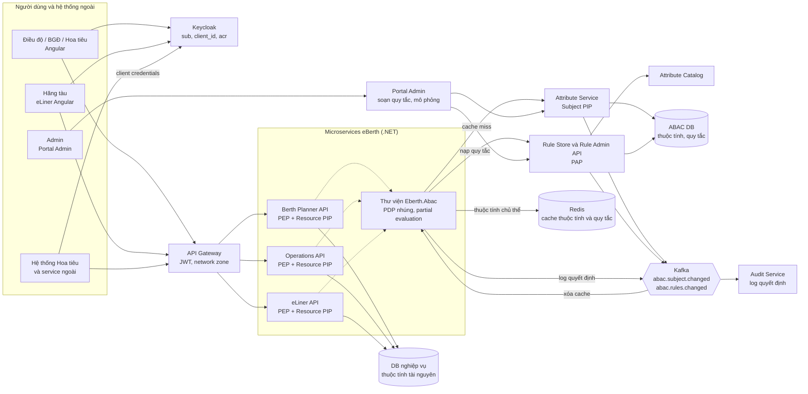
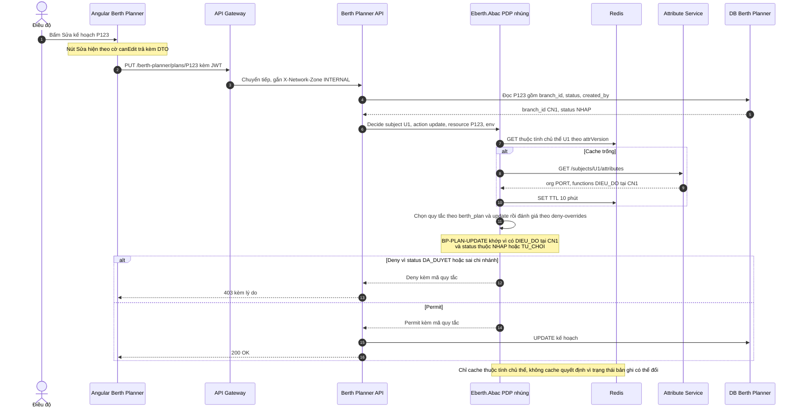
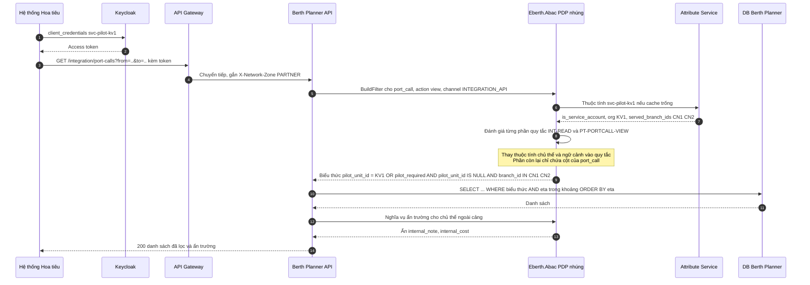
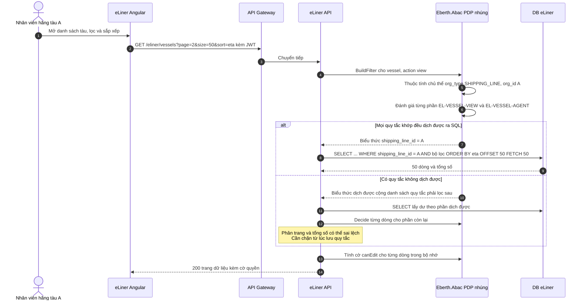
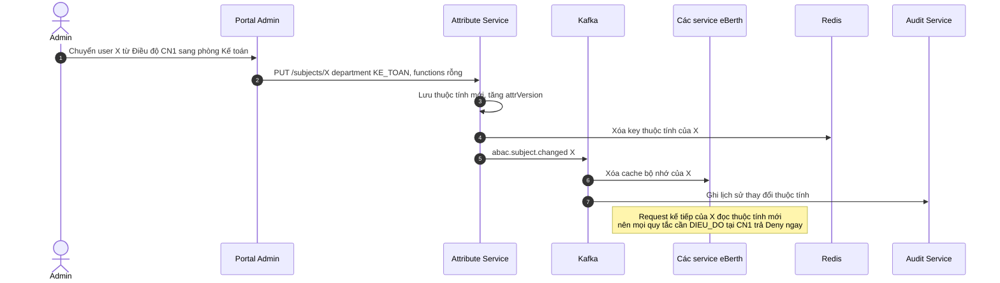

# Đánh giá mô hình ABAC – Attribute-Based Access Control cho dự án eBerth

> Agent 3 – phụ trách ABAC. Trọng tâm: xác định thuộc tính của chủ thể, tài nguyên, hành động, ngữ cảnh; quy tắc theo trạng thái và thời gian; cách quản lý khi số quy tắc tăng; khó khăn khi trả lời "ai đang có quyền gì".

**Phạm vi đánh giá.** ABAC được đánh giá như một **mô hình ra quyết định**: quyền được tính từ thuộc tính tại thời điểm kiểm tra. Cách cài đặt có thể là (a) bộ đánh giá quy tắc nhúng trong ứng dụng, hoặc (b) policy engine bên ngoài. Báo cáo này chọn phương án (a): thư viện .NET nhúng, quy tắc lưu trong DB, sửa được trên Portal Admin. Lý do là phương án (b) và vòng đời policy thuộc phạm vi đánh giá PBAC (Agent 4). Những chỗ hai phương án cho kết quả khác nhau đều được ghi chú.

Ranh giới với mô hình khác:
- **Vai trò** được coi là *một thuộc tính* của chủ thể (`subject.functions`). Dùng nó không làm mô hình thành RBAC, vì quyết định vẫn là biểu thức trên thuộc tính.
- **Quan hệ một bước** nằm sẵn trên bản ghi (ví dụ `port_call.pilot_unit_id`) được coi là thuộc tính tài nguyên. **Quan hệ nhiều bước** hoặc nhiều-nhiều (danh sách ủy quyền) phải đi qua bộ cung cấp thuộc tính (PIP). Đây là vùng ABAC yếu và được đánh giá thẳng như vậy.

---

## 1. GIẢI THÍCH MÔ HÌNH

### 1.1. Định nghĩa và nguồn gốc

**ABAC (Attribute-Based Access Control – kiểm soát truy cập dựa trên thuộc tính)**: quyết định cho phép hay từ chối được tính bằng **quy tắc** (rule) trên bốn nhóm thuộc tính: **chủ thể** (subject), **tài nguyên** (resource/object), **hành động** (action), **ngữ cảnh/môi trường** (environment).

- Ý tưởng kiểm soát truy cập theo thuộc tính có từ những năm 2000. Chuẩn **XACML** (eXtensible Access Control Markup Language) của OASIS ra bản 1.0 năm 2003, bản 3.0 năm 2013.
- **NIST SP 800-162** (2014), "Guide to Attribute Based Access Control (ABAC) Definition and Considerations", là tài liệu định nghĩa ABAC được trích dẫn nhiều nhất.
- NIST cũng phát triển **NGAC** (Next Generation Access Control) như một cách cài đặt ABAC khác.

### 1.2. Thành phần cốt lõi (kiến trúc XACML)

| Thành phần | Tên đầy đủ | Vai trò |
|---|---|---|
| **PEP** | Policy Enforcement Point | Điểm chặn request (API, truy vấn, giao diện), hỏi PDP và thực thi kết quả. |
| **PDP** | Policy Decision Point | Đánh giá quy tắc trên thuộc tính, trả về Permit/Deny (kèm nghĩa vụ – obligation, ví dụ "ẩn trường X"). |
| **PIP** | Policy Information Point | Cung cấp thuộc tính PDP cần mà request chưa mang theo (phòng ban của user, trạng thái bản ghi). |
| **PAP** | Policy Administration Point | Nơi tạo, sửa, quản lý quy tắc. |
| **Thuật toán kết hợp** | Combining algorithm | Khi nhiều quy tắc cùng khớp: `deny-overrides` (có một Deny là Deny), `permit-overrides`, `first-applicable`. |

### 1.3. Ví dụ minh họa (không phải eBerth)

Hệ thống bệnh án điện tử của một bệnh viện:

```text
QUY TẮC: Bác sĩ được xem bệnh án khi
    subject.chuc_danh == "BacSi"
    AND subject.khoa == resource.khoa_dieu_tri
    AND (environment.gio trong ca truc của subject OR resource.cap_cuu == true)
QUY TẮC TỪ CHỐI: Không ai được xem bệnh án có resource.bao_mat == "VIP"
    trừ khi subject.id thuộc resource.danh_sach_duoc_phep
```

Bác sĩ Hòa khoa Tim mạch xem được bệnh án của bệnh nhân đang điều trị ở khoa Tim mạch trong ca trực của mình. Khi Hòa chuyển sang khoa Nội, thuộc tính `khoa` đổi, nên Hòa tự động mất quyền với bệnh án khoa Tim mạch mà không cần thu hồi gì. Nhưng câu hỏi *"hiện tại những ai xem được bệnh án X?"* thì không có bảng nào trả lời sẵn: phải lấy quy tắc, thay thuộc tính của bệnh án X vào, rồi tìm mọi người thỏa điều kiện.

### 1.4. Khi nào phù hợp, khi nào không

**Phù hợp khi:**
- Quyền phụ thuộc **thuộc tính của dữ liệu** (tổ chức sở hữu, chi nhánh, trạng thái, mức nhạy cảm của trường).
- Có điều kiện **thời gian, ngữ cảnh** (ca trực, khung giờ, mạng nội bộ, mức xác thực MFA).
- Muốn tránh bùng nổ vai trò: một quy tắc "cùng tổ chức" thay cho hàng trăm role theo tổ chức.

**Không phù hợp khi:**
- Cần trả lời nhanh và chính xác **"ai đang có quyền gì"**, ví dụ rà soát quyền định kỳ theo yêu cầu kiểm toán.
- Quyền đi theo **chuỗi quan hệ nhiều bước** hoặc chia sẻ tùy ý giữa các đối tượng (ReBAC hợp hơn).
- Thuộc tính không đáng tin cậy hoặc không có nguồn gốc rõ ràng. ABAC chỉ đúng khi thuộc tính đúng.
- Đội không có kỷ luật quản lý quy tắc: quy tắc nhân lên không kiểm soát sẽ khó dự đoán hơn cả bùng nổ vai trò.

---

## 2. ÁP DỤNG VÀO eBERTH

### 2.1. Danh mục thuộc tính

**Thuộc tính chủ thể (subject)**

| Thuộc tính | Kiểu | Nguồn (PIP) | Ghi chú |
|---|---|---|---|
| `subject.id` | string | Keycloak `sub`, ánh xạ sang user eBerth | |
| `subject.org_id`, `subject.org_type` | string, enum `PORT / SHIPPING_LINE / PILOT_UNIT / SERVICE` | Bảng hồ sơ user eBerth | Phân biệt người trong cảng, hãng tàu, hoa tiêu, tài khoản dịch vụ |
| `subject.department` | string | Hồ sơ user (quản lý trên Portal Admin) [GIẢ ĐỊNH] | Đổi phòng thì đổi thuộc tính (KB11) |
| `subject.functions` | list<{function, branch_id}> | Bảng chức năng của user | Ví dụ `[{DIEU_DO, CN1}]`, `[{BGD, CN1}, {BGD, CN2}]` |
| `subject.temp_functions` | list<{function, branch_id, valid_from, valid_to}> | Bảng ủy quyền/trực thay | KB12 |
| `subject.served_branch_ids` | list | Bảng "đơn vị hoa tiêu phục vụ chi nhánh" | Chỉ cho `PILOT_UNIT` (KB07) |
| `subject.delegated_vessel_ids` | list<{vessel_id, valid_to}> | Bảng ủy quyền đại lý | KB10, hiện chưa dùng |
| `subject.is_service_account`, `subject.client_id`, `subject.allowed_api_actions` | bool, string, list | Cấu hình tài khoản dịch vụ | KB18 |
| `subject.employment_status` | enum | Hồ sơ user | Nghỉ việc hoặc tạm khóa thì mọi quy tắc trả Deny |

**Thuộc tính tài nguyên (resource)**

| Loại tài nguyên | Thuộc tính | Ghi chú |
|---|---|---|
| `berth_plan` | `id`, `branch_id`, `status` (`NHAP / CHO_DUYET / DA_DUYET / TU_CHOI`), `created_by`, `approved_at` | KB01–KB04 |
| `port_call` | `id`, `branch_id`, `vessel_id`, `shipping_line_id`, `pilot_unit_id`, `pilot_required`, `status`, `eta` | KB07, KB08, KB14 |
| `vessel` | `id`, `shipping_line_id` | KB08 |
| `field` | `resource_type`, `name`, `classification` (`PUBLIC / PARTNER / INTERNAL`) | Quyền mức trường (KB09) |
| `screen` | `code`, `module`, `audiences` (danh sách `org_type` hoặc chức năng được dùng) | KB06, KB13, KB15 |

**Thuộc tính hành động (action)**: `action.module`, `action.name` (`view / create / update / submit / approve / reject / register / export`), `action.channel` (`UI / INTEGRATION_API`).

**Thuộc tính ngữ cảnh (environment)**: `env.now` (giờ hệ thống, múi giờ Việt Nam), `env.network_zone` (`INTERNAL / PARTNER / INTERNET`, suy ra từ gateway), `env.auth_level` (mức xác thực, lấy từ claim `acr` của Keycloak, ví dụ có MFA), `env.current_shift` (ca hiện tại theo lịch ca của chi nhánh).

### 2.2. Quy tắc mẫu cho các nhóm người dùng

Cú pháp minh họa: biểu thức logic trên thuộc tính. **Mặc định Deny.** Kết hợp các quy tắc bằng **deny-overrides**.

| Mã quy tắc | Nhóm | Hành động / tài nguyên | Điều kiện | Hiệu lực |
|---|---|---|---|---|
| `GLB-DENY-INACTIVE` | Mọi người | mọi | `subject.employment_status != ACTIVE` | **Deny** |
| `BP-PLAN-CREATE` | Điều độ | create `berth_plan` | `has_function(subject, DIEU_DO, input.branch_id)` | Permit |
| `BP-PLAN-UPDATE` | Điều độ | update `berth_plan` | `has_function(subject, DIEU_DO, resource.branch_id) AND resource.status IN (NHAP, TU_CHOI)` | Permit |
| `OP-PLAN-APPROVE` | Ban giám đốc | approve, reject `berth_plan` | `has_function(subject, BGD, resource.branch_id) AND resource.status == CHO_DUYET AND resource.created_by != subject.id` | Permit |
| `OP-APPROVE-MFA` | Ban giám đốc | approve `berth_plan` | `env.auth_level < MFA` | **Deny** (KB-THÊM-01) |
| `OP-DASHBOARD-VIEW` | Ban giám đốc | view `berth_plan`, `port_call` (tổng hợp) | `has_function(subject, BGD, resource.branch_id)` | Permit |
| `PT-PORTCALL-VIEW` | Hoa tiêu | view `port_call` | `subject.org_type == PILOT_UNIT AND (resource.pilot_unit_id == subject.org_id OR (resource.pilot_required AND resource.pilot_unit_id IS NULL AND resource.branch_id IN subject.served_branch_ids))` | Permit |
| `PT-PLAN-VIEW` | Hoa tiêu | view `berth_plan` | `subject.org_type == PILOT_UNIT AND resource.branch_id IN subject.served_branch_ids AND resource.status == DA_DUYET` | Permit |
| `EL-VESSEL-VIEW` | Hãng tàu | view `vessel`, `port_call` | `subject.org_type == SHIPPING_LINE AND resource.shipping_line_id == subject.org_id` | Permit |
| `EL-VESSEL-AGENT` | Đại lý (tương lai) | view, update `vessel`, `port_call` | `resource.vessel_id IN valid(subject.delegated_vessel_ids, env.now)` | Permit |
| `FLD-INTERNAL` | Mọi người ngoài cảng | đọc trường | `field.classification == INTERNAL AND subject.org_type != PORT` | **Deny** (ẩn trường) |
| `SCR-ACCESS` | Mọi người | view `screen` | `subject.org_type IN screen.audiences OR any(subject.functions.function IN screen.audiences)` | Permit |
| `INT-READ` | Tài khoản dịch vụ | view qua `INTEGRATION_API` | `subject.is_service_account AND action.name IN subject.allowed_api_actions AND env.network_zone IN (INTERNAL, PARTNER)` cộng thêm điều kiện dữ liệu như `PT-PORTCALL-VIEW` | Permit |
| `ADM-ALL` | Admin hệ thống | mọi hành động module `admin` | `has_function(subject, ADMIN_HT, *)` | Permit |

Trong đó `has_function(s, f, b)` đúng khi `{f, b}` có trong `s.functions`, hoặc có trong `s.temp_functions` và `env.now` nằm trong `[valid_from, valid_to)`.

### 2.3. Giả định đã dùng

| Mã | Giả định | Nếu sai thì sao |
|---|---|---|
| GĐ-A01 | [GIẢ ĐỊNH] Mỗi user thuộc một tổ chức; user nội bộ có phòng ban và danh sách chức năng theo chi nhánh, quản lý trong eBerth (chưa tích hợp HR). | Nếu có HR thì PIP lấy phòng ban từ HR. KB11 tốt hơn nữa vì đổi phòng ở HR là đổi quyền. |
| GĐ-A02 | [GIẢ ĐỊNH] Tách dữ liệu một tầng chi nhánh; mọi tài nguyên cần tách đều có cột `branch_id`. | Nếu cây nhiều tầng thì cần thuộc tính dạng đường dẫn (`branch_path LIKE 'TCT/CN1/%'`), vẫn dịch ra SQL được. |
| GĐ-A03 | [GIẢ ĐỊNH] Kế hoạch có trạng thái `NHAP → CHO_DUYET → DA_DUYET` (và `TU_CHOI`), lưu trên bản ghi. | Không đổi kết luận: ABAC đọc trạng thái trực tiếp. |
| GĐ-A04 | [GIẢ ĐỊNH] `port_call` có các cột `shipping_line_id`, `pilot_unit_id`, `pilot_required`; phân công hoa tiêu được hệ thống Hoa tiêu đẩy về eBerth qua API. | Nếu phân công theo từng hoa tiêu, nhiều-nhiều, thì cần thuộc tính danh sách hoặc bảng phụ; KB07 giảm xuống Được. Nếu không có dữ liệu phân công thì không mô hình nào làm được. |
| GĐ-A05 | [GIẢ ĐỊNH] Hoa tiêu dùng màn hình Berth Planner bằng tài khoản Keycloak; hệ thống Hoa tiêu gọi API bằng client credentials. | Nếu gọi thay mặt từng hoa tiêu thì cần Token Exchange; ABAC không đổi. |
| GĐ-A06 | [GIẢ ĐỊNH] Hãng tàu thấy dữ liệu của mình ở mọi chi nhánh. | Nếu giới hạn theo chi nhánh thì thêm một điều kiện vào quy tắc, không tốn thêm gì. |
| GĐ-A07 | Theo PHẦN 1.4: **hiện không có đại lý hàng hải**; quy tắc `EL-VESSEL-AGENT` chỉ để đánh giá KB10. | Nếu đại lý phát sinh nhiều thì điểm yếu của ABAC với quan hệ nhiều-nhiều lộ rõ (mục 6). |
| GĐ-A08 | [GIẢ ĐỊNH] Quy mô: vài trăm user nội bộ, vài nghìn user ngoài, khoảng 200.000 lượt cập cảng/năm, khoảng 30–80 quy tắc ở giai đoạn ổn định. | Nếu quy tắc lên hàng trăm thì quản lý quy tắc (mục 5.8) trở thành công việc chính. |
| GĐ-A09 | [GIẢ ĐỊNH] Quy tắc do **admin kỹ thuật hoặc nhóm phát triển** sửa trên Portal Admin, có bước kiểm thử; không giao cho người dùng nghiệp vụ tự viết biểu thức. | Nếu muốn nghiệp vụ tự sửa thì cần giao diện dạng mẫu (template) có tham số, không cho viết biểu thức tự do. |
| GĐ-A10 | Keycloak chỉ xác thực; claim dùng được: `sub`, `azp`/`client_id`, `acr`. Thuộc tính khác lấy từ eBerth. | Nếu đưa thuộc tính vào JWT thì nhanh hơn nhưng thuộc tính cũ sống tới khi token hết hạn (KB11 kém đi). |
| GĐ-A11 | [GIẢ ĐỊNH] Hoa tiêu chỉ được xem kế hoạch **đã duyệt** (quy tắc `PT-PLAN-VIEW`). Mỗi đơn vị hoa tiêu phục vụ một số chi nhánh xác định (bảng `pilot_unit_branch`); yêu cầu hoa tiêu chưa phân công chỉ hiện cho các đơn vị phục vụ chi nhánh đó. PHẦN 1 chưa nêu hai quy tắc này. | Nếu hoa tiêu được xem cả kế hoạch nháp thì bỏ điều kiện `status`. Nếu mọi đơn vị hoa tiêu thấy mọi yêu cầu chưa phân công thì bỏ điều kiện chi nhánh. Không đổi mức đáp ứng KB05, KB07. |

---

## 3. TRẢ LỜI BỘ KỊCH BẢN KB01–KB18

| Mã | Cách xử lý | Mức đáp ứng | Lý do / ghi chú |
|---|---|---|---|
| KB01 | `BP-PLAN-CREATE`, `BP-PLAN-UPDATE`: có chức năng `DIEU_DO` tại chi nhánh của kế hoạch. | **Tốt** | – |
| KB02 | `BP-PLAN-UPDATE` có điều kiện `resource.status IN (NHAP, TU_CHOI)`. PDP đọc trạng thái từ chính bản ghi lúc kiểm tra. | **Tốt** | Không cần đồng bộ trạng thái sang nơi khác. Đổi quy tắc (ví dụ cho Điều độ trưởng sửa trong 2 giờ sau duyệt: thêm `OR (has_function(subject, DIEU_DO_TRUONG, ...) AND env.now < resource.approved_at + 2h)`) không phải sửa code. |
| KB03 | `resource.created_by != subject.id` trong `OP-PLAN-APPROVE`. | **Tốt** | Phân tách nhiệm vụ theo bản ghi là so sánh hai thuộc tính, rất tự nhiên với ABAC. |
| KB04 | `OP-DASHBOARD-VIEW` và `OP-PLAN-APPROVE`. Dashboard dùng điều kiện `resource.branch_id IN chi nhánh có chức năng BGD`, dịch thành `WHERE` cho truy vấn tổng hợp. | **Tốt** | Quy tắc chỉ dùng cột của bản ghi và hằng số từ chủ thể nên dịch ra SQL được. |
| KB05 | Keycloak xác thực hoa tiêu; PIP nạp `org_type = PILOT_UNIT`, `served_branch_ids`; quy tắc `PT-PLAN-VIEW`. | **Được** | Phần ABAC đơn giản; khó nằm ở tích hợp định danh (GĐ-A05). |
| KB06 | Màn hình có thuộc tính `audiences`; quy tắc `SCR-ACCESS`. Màn hình hoa tiêu có `audiences = [PILOT_UNIT]`; màn hình Điều độ có `audiences = [DIEU_DO]`. | **Được** | Làm được và gọn. Hạn chế: admin nghiệp vụ quen ma trận "role × màn hình" hơn là thuộc tính `audiences`; frontend phải đánh giá quy tắc cho từng màn hình. |
| KB07 | `PT-PORTCALL-VIEW`: `pilot_unit_id == subject.org_id` hoặc (`pilot_required` và chưa phân công và chi nhánh trong `served_branch_ids`). | **Tốt** | Với GĐ-A04 (phân công theo đơn vị, một cột trên bản ghi). Phân công theo từng hoa tiêu dạng nhiều-nhiều thì giảm xuống Được. |
| KB08 | `EL-VESSEL-VIEW`: `resource.shipping_line_id == subject.org_id`. Danh sách dịch thành `WHERE shipping_line_id = @org`. | **Tốt** | Một quy tắc thay cho mọi role theo hãng tàu. |
| KB09 | Mỗi trường nhạy cảm gắn `classification`. Quy tắc `FLD-INTERNAL` trả nghĩa vụ (obligation) "ẩn các trường INTERNAL"; serializer bỏ trường theo danh sách. | **Tốt** | Phân loại trường bằng thuộc tính là cách làm tự nhiên. Thêm trường nhạy cảm mới chỉ cần gắn nhãn. |
| KB10 | PIP nạp `subject.delegated_vessel_ids` (kèm `valid_to`) từ bảng ủy quyền; quy tắc `EL-VESSEL-AGENT`. | **Được** | Làm được, nhưng thực chất là quan hệ được "ép" thành thuộc tính danh sách. Danh sách dài thì PIP chậm; câu hỏi "ai đang được ủy quyền trên tàu V" phải truy vấn bảng ủy quyền riêng, không lấy được từ quy tắc. Hiện chưa có đại lý (GĐ-A07). |
| KB11 | Đổi `subject.department` và `subject.functions` trên Portal Admin. Attribute Service phát sự kiện Kafka, các service xóa cache thuộc tính của user. | **Tốt** | Không có "lần gán" nào phải thu hồi; quyền tính lại từ thuộc tính mới ở request kế tiếp. Điều kiện: không để thuộc tính trong JWT (GĐ-A10). |
| KB12 | `subject.temp_functions` có `valid_from/valid_to`; `has_function` so với `env.now`. Trực thay ca: thuộc tính `env.current_shift` và lịch ca. | **Tốt** | Điều kiện thời gian là sở trường của ABAC; hết hạn thì tự hết quyền, không cần job dọn. |
| KB13 | Màn hình mới: khai báo `screen` với `audiences` trên Portal Admin. Quy tắc mới: tạo trên PAP nếu chỉ dùng thuộc tính đã có. | **Được** | Không cần deploy nếu thuộc tính đã có trong danh mục. Cần thuộc tính mới (ví dụ `subject.certificate_level`) thì phải viết PIP mới, tức là có code. |
| KB14 | **Đánh giá từng phần (partial evaluation)**: thay thuộc tính chủ thể và ngữ cảnh vào quy tắc, phần còn lại chỉ chứa thuộc tính tài nguyên, dịch thành điều kiện `WHERE` (qua EF Core expression), cho DB phân trang, lọc, sắp xếp. | **Được** | Hiệu năng tốt *nếu* quy tắc chỉ dùng phép toán dịch được ra SQL (so sánh, `IN`, `AND/OR`, `IS NULL`). Quy tắc dùng hàm tùy biến hoặc thuộc tính từ PIP bên ngoài thì không dịch được, phải lọc sau, sinh lỗi phân trang. Phải tự xây bộ dịch hoặc dùng engine có sẵn tính năng này (xem 5.7). |
| KB15 | Endpoint `GET /authz/me/capabilities` đánh giá các quy tắc *chỉ phụ thuộc chủ thể* (màn hình, menu, hành động chung). Nút trên từng dòng: backend đánh giá theo thuộc tính bản ghi và trả cờ `canEdit`, `canApprove` kèm DTO. | **Được** | Đúng theo trạng thái từng bản ghi (nút Sửa tự ẩn khi đã duyệt). Tốn công hơn RBAC vì không có danh sách permission phẳng sẵn. |
| KB16 | "Vì sao X xem được Y": log quyết định ghi mã quy tắc khớp và giá trị thuộc tính lúc đó, giải thích được chính xác. "Ai đang có quyền trên Y": phải thay thuộc tính của Y vào quy tắc rồi tìm mọi chủ thể thỏa điều kiện (truy vấn ngược). | **Kém** | Chiều xuôi tốt, chiều ngược khó: quyền không được lưu mà được *tính*. Làm được bằng đánh giá từng phần theo chiều chủ thể (mục 5.9) nếu quy tắc dịch được ra SQL; với quy tắc thời gian hoặc ngữ cảnh thì câu trả lời chỉ đúng "tại thời điểm hỏi". |
| KB17 | Mọi quy tắc nội bộ dùng `has_function(subject, F, resource.branch_id)`. BGĐ chi nhánh chỉ có `{BGD, CN1}`. | **Tốt** | – |
| KB18 | Tài khoản dịch vụ có `is_service_account`, `allowed_api_actions`. Quy tắc `INT-READ` cộng điều kiện dữ liệu và `env.network_zone`. | **Tốt** | ABAC diễn đạt được cả giới hạn ngữ cảnh (vùng mạng, khung giờ), điều mà RBAC/ReBAC phải đẩy sang gateway. |
| KB-THÊM-01 | Phê duyệt kế hoạch bắt buộc đăng nhập có MFA và từ mạng nội bộ: quy tắc Deny `OP-APPROVE-MFA` theo `env.auth_level`, `env.network_zone`. | **Tốt** | Thuộc tính ngữ cảnh lấy từ claim `acr` của Keycloak và từ gateway. |
| KB-THÊM-02 | Rà soát quyền định kỳ: liệt kê mọi bản ghi user X *có thể* truy cập, và mọi user *có thể* truy cập bản ghi Y. | **Kém** | Cùng gốc với KB16: quyền là kết quả tính toán; báo cáo rà soát phải chạy mô phỏng, kết quả phụ thuộc thời điểm chạy. |

**Tổng hợp mức đáp ứng (KB01–KB18):** Tốt 11 · Được 6 · Kém 1 · Không làm được 0.
Nếu dùng policy engine có sẵn tính năng dịch quy tắc ra điều kiện truy vấn (OPA, Cerbos) thì KB14 có thể lên Tốt; phần này do báo cáo PBAC đánh giá.

---

## 4. ƯU ĐIỂM VÀ NHƯỢC ĐIỂM

### 4.1. Ưu điểm

| Ưu điểm | Ví dụ trong eBerth |
|---|---|
| **Quy tắc theo trạng thái nghiệp vụ là tự nhiên** | KB02: `resource.status IN (NHAP, TU_CHOI)`; đổi chính sách "Điều độ trưởng được sửa trong 2 giờ sau duyệt" chỉ cần sửa quy tắc, không deploy, không đồng bộ dữ liệu sang hệ thống khác. |
| **Phân tách nhiệm vụ theo bản ghi** | KB03: `resource.created_by != subject.id`, một điều kiện duy nhất. |
| **Một quy tắc thay cho nhiều role** | KB08: "cùng hãng tàu" là một quy tắc dùng cho mọi hãng tàu hiện có và tương lai, không bùng nổ vai trò. |
| **Điều kiện thời gian và ngữ cảnh** | KB12: ủy quyền phê duyệt từ 10/11 đến 15/11 tự hết hạn. KB-THÊM-01: phê duyệt bắt buộc MFA. KB18: tài khoản dịch vụ chỉ gọi được từ vùng mạng đối tác. |
| **Quyền mức trường gọn** | KB09: gắn nhãn `INTERNAL` cho `internal_note`, `internal_cost`; mọi API tự ẩn với hãng tàu. |
| **Thu hồi tự động khi thuộc tính đổi** | KB11: đổi phòng ban là đổi quyền ngay, không sót "lần gán cũ". |
| **Không thêm hạ tầng bắt buộc** | Phương án thư viện nhúng chạy trong process của service, đọc thuộc tính tài nguyên từ DB của chính module; chỉ cần Redis/Kafka đã có. |

### 4.2. Nhược điểm

| Nhược điểm | Ví dụ trong eBerth |
|---|---|
| **Khó trả lời "ai đang có quyền gì"** | KB16: kiểm toán hỏi "hiện ai xem được lượt cập cảng PC9?". Không có bảng lưu sẵn; phải thay thuộc tính PC9 vào mọi quy tắc rồi tìm user thỏa: Điều độ CN1, BGĐ CN1, thành viên hãng A, đơn vị hoa tiêu KV1, và cả mọi đơn vị hoa tiêu phục vụ CN1 nếu PC9 đang chờ phân công. Câu trả lời đổi theo thời gian. |
| **Quy tắc nhân lên khó kiểm soát** | Sau 2 năm có thể có `BP-PLAN-UPDATE`, `BP-PLAN-UPDATE-CN3-NGOAILE`, `BP-PLAN-UPDATE-TET`…; hai quy tắc chồng lấn khiến không ai chắc kết quả cuối cùng. |
| **Phụ thuộc chất lượng thuộc tính** | Nếu `port_call.shipping_line_id` nhập sai khi tạo lượt cập cảng thì hãng B thấy lượt cập cảng của hãng A. ABAC biến lỗi dữ liệu thành lỗi phân quyền. |
| **Quan hệ nhiều-nhiều phải "ép" thành thuộc tính** | KB10: danh sách tàu được ủy quyền của đại lý thành thuộc tính danh sách; thêm cấp ủy quyền theo chuyến thì danh sách phình to, PIP phải truy vấn mỗi request. |
| **Lọc danh sách đòi hỏi bộ dịch quy tắc sang SQL** | KB14: phải tự xây (hoặc mua/dùng engine) phần đánh giá từng phần; quy tắc viết "lệch" khỏi tập phép toán dịch được sẽ làm chậm hoặc sai phân trang. |
| **Khó dùng với admin nghiệp vụ** | KB06, KB13: admin quen "tick ô trong ma trận role × màn hình"; biểu thức `subject.org_type IN screen.audiences` khó hiểu hơn. |

---

## 5. THIẾT KẾ TRIỂN KHAI

### 5.1. Các service và module cần thêm hoặc sửa

| Thành phần | Vai trò XACML | Mới/Sửa | Trách nhiệm |
|---|---|---|---|
| **Keycloak** | Nguồn thuộc tính định danh | Sửa cấu hình | Xác thực; phát `sub`, `client_id`, `acr` (mức xác thực/MFA). Identity brokering cho hoa tiêu, client credentials cho service. |
| **API Gateway** | PEP thô, PIP ngữ cảnh | Sửa | Xác minh JWT; gắn header `X-Network-Zone` (từ IP), `X-Request-Id`; rate limit. |
| **Attribute Service (Subject PIP)** | PIP | Mới | Tổng hợp thuộc tính chủ thể: tổ chức, loại tổ chức, phòng ban, chức năng theo chi nhánh, chức năng tạm thời, chi nhánh phục vụ của đơn vị hoa tiêu, ủy quyền đại lý, tài khoản dịch vụ. API `GET /subjects/{id}/attributes`. Cache Redis; phát sự kiện `abac.subject.changed` qua Kafka. |
| **Rule Store + Rule Admin API** | PAP | Mới | Lưu quy tắc (mã, loại tài nguyên, hành động, hiệu lực Permit/Deny, biểu thức điều kiện, độ ưu tiên, trạng thái nháp/hiệu lực, phiên bản, người sở hữu, ngày hết hạn). Kiểm tra cú pháp và kiểm tra "dịch được ra SQL" khi lưu; chạy bộ test trước khi kích hoạt; phát sự kiện `abac.rules.changed`. |
| **Thư viện `Eberth.Abac` (.NET)** | PDP nhúng + PEP | Mới | Nạp quy tắc theo loại tài nguyên (cache, làm mới khi có sự kiện); đánh giá `Decide(subject, action, resource, env)`; **đánh giá từng phần** sinh `Expression<Func<T,bool>>` cho EF Core; trả nghĩa vụ (ẩn trường); ghi log quyết định. Chạy trong process nên không tốn thêm một lượt gọi mạng mỗi lần kiểm tra. |
| **Danh mục thuộc tính (Attribute Catalog)** | Phụ trợ PAP | Mới | Khai báo mọi thuộc tính hợp lệ: tên, nhóm, kiểu, nguồn, người chịu trách nhiệm, độ tươi (TTL), cột SQL tương ứng (với thuộc tính tài nguyên), cờ "dịch được ra SQL". Quy tắc chỉ được dùng thuộc tính có trong danh mục. |
| **Các module Berth Planner, Operations, eLiner** | PEP + Resource PIP | Sửa | Tải bản ghi rồi gọi `Decide`; với danh sách thì áp `BuildFilter<T>()`; ánh xạ thuộc tính tài nguyên sang thuộc tính entity; gắn nhãn phân loại cho trường nhạy cảm. |
| **Portal Admin – phân hệ ABAC** | PAP UI | Sửa | Quản lý thuộc tính chủ thể (chức năng, chi nhánh, ủy quyền tạm thời), danh mục màn hình và `audiences`, trình soạn quy tắc dạng mẫu có tham số, **trình mô phỏng** ("user X làm Y trên bản ghi Z thì kết quả gì, vì quy tắc nào"), báo cáo "ai có quyền trên Y" (5.9). |
| **Audit Service** | – | Mới | Lưu log quyết định (quy tắc khớp, thuộc tính đã dùng), lịch sử thay đổi quy tắc và thuộc tính. |
| **Redis, Kafka** | – | Dùng sẵn | Cache thuộc tính chủ thể và quy tắc; sự kiện thay đổi để xóa cache. |
| **Angular shared library** | PEP giao diện | Mới | `capabilities` của user cho menu và màn hình; dùng cờ quyền trả kèm DTO cho nút trên từng dòng. |

### 5.2. Kiến trúc tổng thể



### 5.3. Luồng kiểm tra quyền

**Điểm kiểm tra chung:**

| Tầng | Kiểm tra gì |
|---|---|
| Frontend | Menu, màn hình theo `capabilities` (quy tắc chỉ phụ thuộc chủ thể); nút trên từng dòng theo cờ trả kèm DTO. Không phải lớp bảo mật. |
| API Gateway | JWT, gắn thuộc tính ngữ cảnh (vùng mạng), rate limit. |
| Backend từng module | `Decide` trên bản ghi cụ thể với đầy đủ thuộc tính (thao tác đơn lẻ). |
| Tầng truy vấn DB | `BuildFilter<T>` từ đánh giá từng phần cho danh sách và dashboard. |
| Serializer | Thực thi nghĩa vụ ẩn trường (KB09). |

**Cache:**
- Thuộc tính chủ thể: Redis theo `subjectId + attrVersion`, cộng cache bộ nhớ 30–60 giây.
- Quy tắc: nạp vào bộ nhớ theo phiên bản bộ quy tắc, làm mới khi có sự kiện `abac.rules.changed`.
- Thuộc tính tài nguyên: **không cache**, đọc cùng bản ghi nghiệp vụ, nên trạng thái luôn mới.

**Khi quyền thay đổi:** đổi thuộc tính chủ thể thì Attribute Service tăng `attrVersion` và phát sự kiện; đổi quy tắc thì Rule Store kích hoạt phiên bản mới và phát sự kiện. Các service xóa cache trong vài giây.

**(a) Điều độ sửa kế hoạch trong Berth Planner (KB01, KB02)**



**(b) Hoa tiêu từ hệ thống ngoài xem kế hoạch (KB05, KB07)**



**(c) Hãng tàu xem danh sách tàu trên eLiner (KB08, KB14)**



**(d) Thuộc tính thay đổi: nhân viên chuyển phòng (KB11)**



### 5.4. Thiết kế cơ sở dữ liệu

**ERD**

```mermaid
erDiagram
    ATTRIBUTE_DEFINITION ||--o{ RESOURCE_ATTRIBUTE_MAPPING : mapped_by
    RESOURCE_TYPE ||--o{ RESOURCE_ATTRIBUTE_MAPPING : has
    RESOURCE_TYPE ||--o{ RULE : governs
    RESOURCE_TYPE ||--o{ FIELD_CLASSIFICATION : has
    RULE ||--o{ RULE_VERSION : versions
    RULE ||--o{ RULE_TEST_CASE : tested_by
    RULE_SET_RELEASE ||--o{ RULE_VERSION : includes
    USER_PROFILE ||--o{ USER_FUNCTION : has
    USER_PROFILE ||--o{ TEMP_FUNCTION : receives
    USER_PROFILE ||--o{ AGENT_DELEGATION : acts_for
    ORGANIZATION ||--o{ USER_PROFILE : employs
    ORGANIZATION ||--o{ PILOT_UNIT_BRANCH : serves
    SCREEN ||--o{ SCREEN_AUDIENCE : open_to
    USER_PROFILE ||--o{ DECISION_LOG : requests

    ATTRIBUTE_DEFINITION {
        string name PK "subject.org_id"
        string category "SUBJECT, RESOURCE, ACTION, ENV"
        string data_type
        string source
        string owner
        int ttl_seconds
        bit sql_translatable
    }
    RESOURCE_TYPE {
        string code PK "berth_plan, port_call"
        string module
        string combining_algorithm "deny-overrides"
    }
    RESOURCE_ATTRIBUTE_MAPPING {
        string resource_type PK, FK
        string attribute_name PK, FK
        string entity_property
    }
    RULE {
        bigint id PK
        string code UK
        string resource_type FK
        string actions
        string effect "PERMIT hoặc DENY"
        int priority
        string status "DRAFT, ACTIVE, RETIRED"
        string owner
        datetime expires_at
    }
    RULE_VERSION {
        bigint id PK
        bigint rule_id FK
        int version_no
        string condition_expr
        string obligations_json
        bigint release_id FK
        string created_by
        datetime created_at
    }
    RULE_SET_RELEASE {
        bigint id PK
        string status "STAGED, ACTIVE, ROLLED_BACK"
        string approved_by
        datetime activated_at
    }
    RULE_TEST_CASE {
        bigint id PK
        bigint rule_id FK
        string scenario_code "KB02"
        string input_json
        string expected "PERMIT hoặc DENY"
    }
    ORGANIZATION {
        bigint id PK
        string code UK
        string org_type
    }
    USER_PROFILE {
        bigint id PK
        string keycloak_sub UK
        bigint org_id FK
        string department
        string employment_status
        bit is_service_account
        string allowed_api_actions
        int attr_version
    }
    USER_FUNCTION {
        bigint user_id PK, FK
        string function_code PK
        bigint branch_id PK
    }
    TEMP_FUNCTION {
        bigint id PK
        bigint user_id FK
        string function_code
        bigint branch_id
        datetime valid_from
        datetime valid_to
        string reason
        bigint granted_by
    }
    AGENT_DELEGATION {
        bigint id PK
        bigint agent_user_or_org_id
        bigint vessel_id
        datetime valid_from
        datetime valid_to
        datetime revoked_at
    }
    PILOT_UNIT_BRANCH {
        bigint pilot_org_id PK, FK
        bigint branch_id PK
    }
    FIELD_CLASSIFICATION {
        string resource_type PK, FK
        string field_name PK
        string classification "PUBLIC, PARTNER, INTERNAL"
    }
    SCREEN {
        string code PK
        string module
        string route
    }
    SCREEN_AUDIENCE {
        string screen_code PK, FK
        string audience PK "PILOT_UNIT hoặc DIEU_DO"
    }
    DECISION_LOG {
        bigint id PK
        datetime at
        bigint user_id FK
        string action
        string resource_ref
        string decision
        string matched_rules
        string attributes_snapshot
        bigint release_id
    }
```



**Danh sách bảng**

| Bảng | Cột chính | Khóa / chỉ mục quan trọng | Mục đích |
|---|---|---|---|
| `attribute_definition` | `name`, `category`, `data_type`, `source`, `owner`, `ttl_seconds`, `sql_translatable` | PK `name` | Danh mục thuộc tính; nền tảng để quản lý quy tắc khi số lượng tăng. |
| `resource_type` | `code`, `module`, `combining_algorithm` | PK `code` | Loại tài nguyên và thuật toán kết hợp quy tắc. |
| `resource_attribute_mapping` | `resource_type`, `attribute_name`, `entity_property` | PK kép | Ánh xạ thuộc tính tài nguyên sang thuộc tính entity/cột để dịch ra SQL. |
| `rule` | `code`, `resource_type`, `actions`, `effect`, `priority`, `status`, `owner`, `expires_at` | UK `code`; IX `(resource_type, status)` | Đầu mục quy tắc; PDP nạp theo `resource_type` (đánh chỉ mục theo đích – target). |
| `rule_version` | `rule_id`, `version_no`, `condition_expr`, `obligations_json`, `release_id` | UK `(rule_id, version_no)` | Nội dung quy tắc theo phiên bản, không sửa đè. |
| `rule_set_release` | `status`, `approved_by`, `activated_at` | IX `status` | Gom nhiều phiên bản quy tắc thành một lần phát hành, rollback được. |
| `rule_test_case` | `rule_id`, `scenario_code`, `input_json`, `expected` | IX `rule_id` | Ca kiểm thử bắt buộc chạy trước khi kích hoạt phát hành. |
| `organization` | `code`, `org_type` | UK `code` | Nguồn `subject.org_type`. |
| `user_profile` | `keycloak_sub`, `org_id`, `department`, `employment_status`, `is_service_account`, `allowed_api_actions`, `attr_version` | UK `keycloak_sub` | Thuộc tính chủ thể cơ bản. |
| `user_function` | `user_id`, `function_code`, `branch_id` | PK `(user_id, function_code, branch_id)`; IX `(function_code, branch_id)` cho truy vấn ngược | Thuộc tính chức năng theo chi nhánh. |
| `temp_function` | `user_id`, `function_code`, `branch_id`, `valid_from`, `valid_to`, `reason`, `granted_by` | IX `(user_id, valid_to)`; IX `(function_code, branch_id, valid_to)` | Ủy quyền, trực thay có thời hạn (KB12). |
| `agent_delegation` | `agent_user_or_org_id`, `vessel_id`, `valid_from`, `valid_to`, `revoked_at` | IX `(agent_user_or_org_id, valid_to)`; IX `vessel_id` | Nguồn `subject.delegated_vessel_ids` (KB10, tương lai). |
| `pilot_unit_branch` | `pilot_org_id`, `branch_id` | PK kép | Nguồn `subject.served_branch_ids` (KB07). |
| `field_classification` | `resource_type`, `field_name`, `classification` | PK kép | Nhãn trường (KB09). |
| `screen`, `screen_audience` | `code`, `module`, `route`; `screen_code`, `audience` | PK | Màn hình và đối tượng được dùng (KB06, KB13). |
| `decision_log` | `user_id`, `action`, `resource_ref`, `decision`, `matched_rules`, `attributes_snapshot`, `release_id` | IX `(resource_ref, at)`, `(user_id, at)`; phân vùng theo tháng | Log quyết định để giải thích "vì sao" (KB16). Chỉ ghi đầy đủ cho thao tác ghi, phê duyệt và các lần Deny; danh sách chỉ ghi biểu thức lọc. |
| `rule_change_log`, `attribute_change_log` | `actor`, `entity`, `before`, `after`, `reason`, `at` | IX `(entity, at)` | Lịch sử thay đổi quy tắc và thuộc tính. |

**Yêu cầu với DB nghiệp vụ:** thuộc tính tài nguyên là cột thật trên bảng (`branch_id`, `shipping_line_id`, `pilot_unit_id`, `pilot_required`, `status`, `created_by`), có chỉ mục ghép phục vụ các biểu thức lọc thường gặp: `(shipping_line_id, eta)`, `(branch_id, status)`, `(pilot_unit_id, eta)`. Không cần kho lưu riêng ngoài ABAC DB; **không phải đồng bộ thuộc tính tài nguyên** sang hệ thống khác vì PDP đọc trực tiếp từ bản ghi.

### 5.5. Ví dụ mã giả hoặc cấu hình

**Quy tắc lưu trong Rule Store (JSON)**

```json
{
  "code": "OP-PLAN-APPROVE",
  "resourceType": "berth_plan",
  "actions": ["approve", "reject"],
  "effect": "PERMIT",
  "priority": 100,
  "condition": "HasFunction(\"BGD\", r.BranchId) && r.Status == \"CHO_DUYET\" && r.CreatedBy != subject.Id",
  "tests": [
    { "scenario": "KB03", "subject": { "id": "u7", "functions": [["BGD", "CN1"]] },
      "resource": { "BranchId": "CN1", "Status": "CHO_DUYET", "CreatedBy": "u7" }, "expected": "DENY" }
  ]
}
```

**PEP trong API và lọc danh sách (C#, mã giả)**

```csharp
// Thao tác đơn lẻ: thuộc tính tài nguyên đọc từ bản ghi, không cache quyết định
[HttpPost("plans/{id}/approve")]
public async Task<IActionResult> Approve(long id)
{
    var plan = await _db.Plans.FindAsync(id) ?? throw new NotFound();
    var d = await _abac.DecideAsync("approve", plan);       // subject, env lấy từ HttpContext
    if (!d.Permit) return Problem(statusCode: 403, title: d.DenyReason);
    plan.Approve(_currentUser.Id);
    await _db.SaveChangesAsync();
    return Ok();
}

// Danh sách: đánh giá từng phần, kết quả là Expression để EF Core dịch ra WHERE
[HttpGet("vessels")]
public async Task<PagedResult<VesselDto>> List([FromQuery] VesselQuery q)
{
    Expression<Func<Vessel, bool>> filter = await _abac.BuildFilterAsync<Vessel>("view");
    return await _db.Vessels.Where(filter).ApplyQuery(q).ToPagedAsync(q.Page, q.Size);
}
```

**Phần cốt lõi của `BuildFilterAsync` (ý tưởng)**: chọn các quy tắc `ACTIVE` của loại tài nguyên và hành động; thay `subject.*`, `env.*` bằng hằng số; quy tắc nào rút gọn thành `false` thì bỏ, thành `true` thì cả bộ lọc là `true`; còn lại ghép `OR` cho các Permit, rồi `AND NOT` cho các Deny; dịch cây biểu thức chỉ chứa `r.*` thành `Expression<Func<T,bool>>`. Khi lưu quy tắc, Rule Admin API từ chối biểu thức dùng hàm hoặc thuộc tính có `sql_translatable = 0` cho các hành động `view`.

### 5.6. Lộ trình triển khai

| Giai đoạn | Nội dung | Độ phức tạp |
|---|---|---|
| GĐ1 – Danh mục thuộc tính và Subject PIP | Attribute Catalog, Attribute Service, bảng thuộc tính chủ thể, cache Redis và sự kiện Kafka. Chuẩn hóa cột thuộc tính tài nguyên trong DB nghiệp vụ. | Trung bình |
| GĐ2 – PDP nhúng, quy tắc trong file cấu hình | Thư viện `Eberth.Abac` đánh giá đơn lẻ; quy tắc cho `berth_plan`, `port_call`, `vessel` đặt trong file cấu hình có version trong Git. Áp cho KB01–KB04, KB07–KB09, KB17. | Trung bình |
| GĐ3 – Đánh giá từng phần cho danh sách | Bộ dịch quy tắc sang Expression/SQL, kiểm tra "dịch được" khi lưu, chỉ mục DB. KB14, dashboard KB04. | Cao |
| GĐ4 – Rule Store và Portal Admin | Chuyển quy tắc từ file vào DB có phiên bản và phát hành; trình soạn dạng mẫu; trình mô phỏng; ca kiểm thử bắt buộc. KB13, KB15. | Cao |
| GĐ5 – Thời gian, ngữ cảnh và audit | Chức năng tạm thời, lịch ca, MFA, vùng mạng, log quyết định, báo cáo truy vấn ngược "ai có quyền trên Y". KB12, KB16, KB18, KB-THÊM-01. | Trung bình – Cao |

### 5.7. Công cụ và thư viện

> Phiên bản và tính năng cần được kiểm tra lại tại thời điểm triển khai.

| Công cụ | Ưu điểm | Nhược điểm |
|---|---|---|
| **System.Linq.Dynamic.Core** (.NET) | Biên dịch biểu thức dạng chuỗi thành cây biểu thức LINQ, nên dùng được cho cả đánh giá trong bộ nhớ lẫn dịch sang SQL qua EF Core. Hợp với nhu cầu KB14. | Phải giới hạn tập kiểu và hàm được phép để tránh chèn biểu thức nguy hiểm; không có sẵn khái niệm rule, thuật toán kết hợp, partial evaluation, nên phải tự xây phần này. |
| **Microsoft RulesEngine** (.NET, mã nguồn mở) | Quy tắc dạng JSON, biểu thức lambda, có workflow và kết quả theo từng rule, dễ nhúng. | Chỉ đánh giá trong bộ nhớ, không dịch sang SQL; không có mô hình PEP/PDP/PIP sẵn. |
| **CEL** (Common Expression Language) | Ngôn ngữ biểu thức an toàn, không có vòng lặp vô hạn, được dùng trong Kubernetes, OpenFGA, SpiceDB. | Bản cài đặt chính thức là Go, Java, C++; bản .NET do cộng đồng phát triển, cần đánh giá độ chín. |
| **XACML 3.0 engine** (AuthzForce, WSO2 Identity Server) | Chuẩn đầy đủ: PEP/PDP/PIP/PAP, thuật toán kết hợp, obligation. | Viết bằng Java, policy dạng XML nặng nề; cộng đồng ngày càng chuyển sang OPA/Cedar/Cerbos; không có sẵn đường dịch sang SQL. |
| **ALFA** (Axiomatics) | Ngôn ngữ viết policy ABAC gọn hơn XACML. | Hệ sinh thái thương mại. |
| **Casbin.NET** (mô hình ABAC) | Có sẵn cho .NET, matcher truy cập thuộc tính đối tượng. | Khả năng ABAC hạn chế; khó viết quy tắc phức tạp; không lọc danh sách. |
| **OPA, Cerbos, Cedar** | Policy engine hỗ trợ ABAC đầy đủ; OPA (partial evaluation, Compile API) và Cerbos (PlanResources) sinh được điều kiện truy vấn cho danh sách. | Thuộc phương án PBAC, được đánh giá trong báo cáo của Agent 4. Nhắc ở đây vì nếu chọn ABAC thì dùng engine có sẵn có thể rẻ hơn tự xây GĐ3–GĐ4. |

### 5.8. Quản lý khi số quy tắc tăng (trọng tâm riêng)

| Biện pháp | Cách làm trong eBerth |
|---|---|
| **Danh mục thuộc tính có chủ sở hữu** | Mỗi thuộc tính có nguồn, người chịu trách nhiệm, độ tươi, cờ dịch được ra SQL. Quy tắc dùng thuộc tính ngoài danh mục thì bị từ chối khi lưu. |
| **Tổ chức quy tắc theo đích (target)** | Mỗi quy tắc gắn một loại tài nguyên và tập hành động; PDP chỉ đánh giá quy tắc của đúng `(resource_type, action)`. 80 quy tắc nhưng mỗi lần chỉ đánh giá 3–5. |
| **Mặc định Deny, ít quy tắc Deny** | Chủ yếu là quy tắc Permit; chỉ vài quy tắc Deny "rào chắn" toàn cục (`GLB-DENY-INACTIVE`, `FLD-INTERNAL`, `OP-APPROVE-MFA`); thuật toán `deny-overrides` thống nhất cho mọi loại tài nguyên. |
| **Mẫu quy tắc có tham số** | Thay vì chép quy tắc cho từng trường hợp, dùng mẫu `same_org(attr)`, `has_function(F, attr)`, `status_in(...)`. Admin chọn mẫu và điền tham số. |
| **Quy tắc tạm thời có hạn** | Bắt buộc `expires_at` cho quy tắc ngoại lệ; job cảnh báo trước khi hết hạn; tự chuyển `RETIRED`. |
| **Kiểm thử bắt buộc** | Mỗi quy tắc có ca kiểm thử; bộ kịch bản KB01–KB18 là bộ hồi quy chung; phát hành chỉ được kích hoạt khi mọi ca đạt. |
| **Mô phỏng trước khi phát hành** | Chạy bộ quy tắc mới trên mẫu log quyết định thật của 7 ngày gần nhất, báo cáo các quyết định *thay đổi* (Permit thành Deny và ngược lại) để người duyệt xem. |
| **Chỉ số sức khỏe quy tắc** | Quy tắc không bao giờ khớp (ứng viên xóa), quy tắc khớp chồng lấn, số quy tắc theo loại tài nguyên; review định kỳ mỗi quý. |
| **Giới hạn ngôn ngữ** | Chỉ cho phép so sánh, `IN`, `AND/OR/NOT`, `IS NULL`, phép cộng thời gian và vài hàm đã đăng ký. Giữ được khả năng dịch ra SQL và khả năng phân tích ngược. |

### 5.9. Trả lời "ai đang có quyền gì" (trọng tâm riêng)

Khó khăn cốt lõi: ABAC **không lưu quyền**, chỉ lưu quy tắc và thuộc tính. Muốn biết ai có quyền trên Y thì về nguyên tắc phải đánh giá quy tắc với mọi chủ thể; muốn biết X có quyền gì thì phải đánh giá với mọi tài nguyên. Kết quả còn phụ thuộc thời gian và ngữ cảnh (ca trực, MFA, vùng mạng).

Cách giảm khó khăn trong eBerth:

1. **Truy vấn ngược bằng đánh giá từng phần theo chiều chủ thể.** Cố định thuộc tính của Y (ví dụ PC9: `branch_id = CN1`, `shipping_line_id = A`, `pilot_unit_id = KV1`), rút gọn quy tắc thành điều kiện chỉ trên thuộc tính chủ thể, rồi dịch thành SQL trên `user_profile`, `user_function`, `temp_function`, `pilot_unit_branch`:
   ```sql
   SELECT u.* FROM user_profile u
   WHERE u.employment_status = 'ACTIVE' AND (
         (u.org_id = @A AND u.org_type = 'SHIPPING_LINE')
      OR (u.org_id = @KV1 AND u.org_type = 'PILOT_UNIT')
      OR EXISTS (SELECT 1 FROM user_function f WHERE f.user_id = u.id AND f.branch_id = @CN1 AND f.function_code IN ('DIEU_DO','BGD'))
      OR EXISTS (SELECT 1 FROM temp_function t WHERE t.user_id = u.id AND t.branch_id = @CN1 AND t.function_code = 'BGD' AND @now BETWEEN t.valid_from AND t.valid_to))
   ```
   Chỉ làm được khi thuộc tính chủ thể nằm trong DB và quy tắc dùng tập phép toán đã giới hạn. Điều kiện ngữ cảnh (MFA, vùng mạng) được đánh dấu "có điều kiện" trong báo cáo thay vì tính.
2. **Log quyết định** trả lời "ai *đã* truy cập Y, theo quy tắc nào" (khác với "ai *có thể*"). Phù hợp yêu cầu điều tra sự cố.
3. **Báo cáo theo quy tắc thay vì theo bản ghi**: "Quy tắc `EL-VESSEL-VIEW`: mọi user hãng tàu xem được tàu của hãng mình". Kiểm toán viên dễ hiểu hơn danh sách hàng nghìn dòng.
4. **Giữ số quy tắc ít và nông**: đây là điều kiện để (1) khả thi.

---

## 6. CÁC TRƯỜNG HỢP KHÔNG LÀM ĐƯỢC HOẶC LÀM KHÔNG TỐT

| # | Trường hợp | Hậu quả nếu cố ép ABAC | Cách bù đắp |
|---|---|---|---|
| 1 | **"Ai đang có quyền trên Y", rà soát quyền định kỳ** (KB16, KB-THÊM-02). | Báo cáo chạy chậm (đánh giá chéo user × bản ghi), kết quả phụ thuộc thời điểm, khó làm bằng chứng kiểm toán. | Truy vấn ngược bằng đánh giá từng phần (5.9); log quyết định; giữ quy tắc ít; dùng RBAC cho lớp chức năng để phần lớn câu hỏi "ai có quyền" trả lời bằng bảng gán. |
| 2 | **Quan hệ nhiều bước, nhiều-nhiều** (đại lý theo tàu/chuyến KB10, phân công theo từng hoa tiêu, cây tổ chức sâu). | Thuộc tính danh sách phình to (`delegated_vessel_ids` hàng trăm phần tử), PIP truy vấn mỗi request, không dịch được ra SQL gọn, khó giải thích. | **ReBAC** cho phần quan hệ ủy quyền; hoặc bảng quan hệ riêng JOIN trong SQL. |
| 3 | **Quy tắc không dịch được ra SQL** (gọi hàm ngoài, thuộc tính từ dịch vụ khác) cho danh sách lớn (KB14). | Lọc sau trong bộ nhớ làm sai phân trang và tổng số, chậm khi dữ liệu lớn. | Chặn từ lúc lưu quy tắc (cờ `sql_translatable`); đưa thuộc tính cần thiết về cột của bản ghi; hoặc dùng engine có sẵn partial evaluation (PBAC). |
| 4 | **Quy tắc nhân lên, chồng chéo.** | Không ai dự đoán được kết quả; sửa một quy tắc làm hỏng kịch bản khác; debug mất nhiều thời gian. | Các biện pháp ở 5.8: đích, mẫu, kiểm thử bắt buộc, mô phỏng, review định kỳ. |
| 5 | **Thuộc tính sai hoặc cũ.** | Nhập sai `shipping_line_id` là lộ dữ liệu sang hãng khác; cache thuộc tính cũ làm quyền đã đổi chưa có hiệu lực. | Ràng buộc dữ liệu (FK, kiểm tra khi tạo lượt cập cảng), thuộc tính tài nguyên không cache, thuộc tính chủ thể có version và sự kiện xóa cache. |
| 6 | **Quản trị quyền màn hình bởi admin nghiệp vụ** (KB06, KB13, KB15). | Admin không hiểu biểu thức nên cấu hình sai hoặc phải nhờ dev. | Lớp màn hình/chức năng dùng mô hình đơn giản kiểu RBAC (ma trận), ABAC chỉ cho lớp dữ liệu và trạng thái. |

---

## 7. RỦI RO KHI TRIỂN KHAI VÀ VẬN HÀNH

| Loại | Rủi ro | Biện pháp |
|---|---|---|
| Bảo mật | Quy tắc viết sai (`OR` thay `AND`) mở quyền diện rộng ngay khi phát hành. | Ca kiểm thử bắt buộc, mô phỏng trên log thật, phê duyệt 2 người cho phát hành, rollback nhanh bằng `rule_set_release`. |
| Bảo mật | Chèn biểu thức nguy hiểm qua trình soạn quy tắc (gọi phương thức .NET tùy ý). | Ngôn ngữ giới hạn, danh sách kiểu và hàm cho phép, chỉ admin kỹ thuật được sửa. |
| Bảo mật | Quên áp `BuildFilter` ở endpoint danh sách, export. | Repository chuẩn bắt buộc đi qua bộ lọc; test tự động "hãng A không thấy dữ liệu hãng B". |
| Sai lệch quyền | Thuộc tính chủ thể cũ trong cache, hoặc thuộc tính đặt trong JWT. | Version + sự kiện Kafka; TTL ngắn; không đặt thuộc tính phân quyền trong token. |
| Chất lượng dữ liệu | Thuộc tính tài nguyên sai làm quyết định sai. | Ràng buộc DB, kiểm tra nghiệp vụ, đối soát định kỳ cột tổ chức. |
| Hiệu năng | PIP gọi mạng nhiều lần mỗi request; quy tắc nặng; biểu thức lọc sinh SQL kém. | Nạp thuộc tính chủ thể một lần mỗi request; quy tắc theo đích; xem kế hoạch thực thi của SQL sinh ra; chỉ mục theo biểu thức thường gặp. |
| Khó debug | Người dùng bị từ chối mà không biết vì sao. | Trả mã quy tắc và lý do (không lộ dữ liệu nhạy cảm); trình mô phỏng trên Portal Admin; log quyết định có `release_id`. |
| Audit | Không trả lời được "ai có quyền" đúng hạn kiểm toán. | Chuẩn bị báo cáo truy vấn ngược (5.9) từ GĐ5; thống nhất với kiểm toán về cách trình bày theo quy tắc. |
| Vận hành | Bộ dịch quy tắc sang SQL tự xây là mã phức tạp, phụ thuộc vài người. | Giữ ngôn ngữ nhỏ, test đầy đủ, tài liệu hóa; cân nhắc engine có sẵn (PBAC) thay vì tự xây. |
| Phụ thuộc nhà cung cấp | Thấp nếu tự xây; trung bình nếu chọn engine XACML thương mại. | – |

---

## 8. CHẤM ĐIỂM THEO TIÊU CHÍ (PHẦN 3)

| Tiêu chí | Trọng số | Điểm 1–5 | Giải thích |
|---|---|---|---|
| Mức độ đáp ứng bộ kịch bản KB01–KB18 | 25% | 4 | 11 Tốt, 6 Được, 1 Kém; xử lý tốt trạng thái, phân tách nhiệm vụ, thời gian, mức trường, nhưng audit chiều ngược yếu và KB14 phụ thuộc bộ dịch SQL. |
| Phân quyền theo dữ liệu và tổ chức | 15% | 4 | Hãng tàu, chi nhánh, hoa tiêu theo cột trên bản ghi làm rất gọn; ủy quyền nhiều-nhiều kém tự nhiên. |
| Phân quyền động, đổi quyền không cần deploy | 10% | 4 | Đổi thuộc tính và quy tắc lúc chạy; cần thuộc tính mới thì phải viết PIP và deploy. |
| Độ phức tạp triển khai (cao = đơn giản) | 15% | 3 | Không thêm hạ tầng nhưng phải xây PIP, PDP, danh mục thuộc tính, bộ dịch SQL, Rule Store và trình mô phỏng. |
| Chi phí vận hành, bảo trì | 10% | 3 | Phải quản trị quy tắc liên tục (kiểm thử, review, hết hạn) và chất lượng thuộc tính. |
| Hiệu năng, đặc biệt là lọc danh sách | 10% | 3 | Kiểm tra đơn lẻ nhanh vì PDP nhúng; danh sách tốt khi quy tắc dịch được ra SQL, kém nếu phải lọc sau. |
| Khả năng audit, giải thích quyết định | 10% | 2 | "Vì sao" giải thích tốt qua log quyết định; "ai có quyền" khó và phụ thuộc thời điểm. |
| Mức độ quen thuộc với đội, chi phí học | 5% | 3 | Quy tắc giống business rule nên dễ đọc; kỹ thuật partial evaluation và quản trị quy tắc là mới. |

**Điểm tổng có trọng số:**
4×0,25 + 4×0,15 + 4×0,10 + 3×0,15 + 3×0,10 + 3×0,10 + 2×0,10 + 3×0,05
= 1,00 + 0,60 + 0,40 + 0,45 + 0,30 + 0,30 + 0,20 + 0,15 = **3,40 / 5**

---

## 9. KẾT LUẬN NGẮN

ABAC giải quyết tốt nhất nhóm yêu cầu mà RBAC yếu: quyền theo trạng thái nghiệp vụ, phân tách nhiệm vụ theo bản ghi, quyền có thời hạn, mức trường và ngữ cảnh (KB02, KB03, KB09, KB12, KB18). Nó cũng tách dữ liệu theo hãng tàu, chi nhánh, đơn vị hoa tiêu gọn bằng thuộc tính trên bản ghi. Điểm yếu là trả lời "ai đang có quyền gì" (KB16) và quản trị quy tắc khi số lượng tăng; quan hệ ủy quyền nhiều-nhiều (KB10) thì kém tự nhiên. **Không nên dùng ABAC một mình**: nên dùng ABAC cho lớp phạm vi dữ liệu và quy tắc trạng thái, kết hợp với RBAC cho lớp màn hình/chức năng (vai trò trở thành một thuộc tính của chủ thể). Nên cân nhắc đặt quy tắc ABAC trong một policy engine có sẵn partial evaluation và quy trình vòng đời policy (khung PBAC) thay vì tự xây bộ dịch quy tắc sang SQL.
