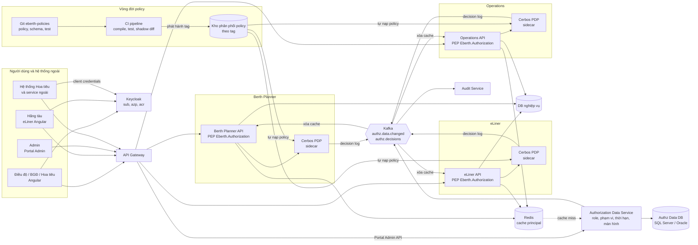
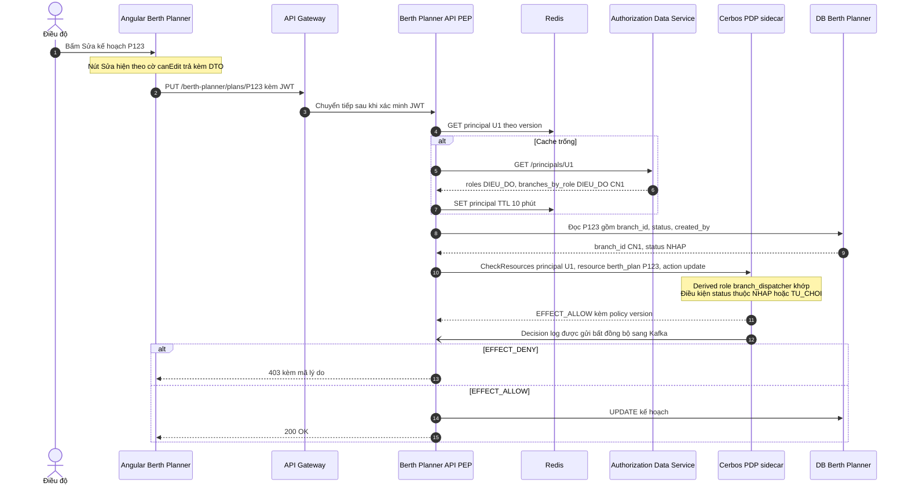
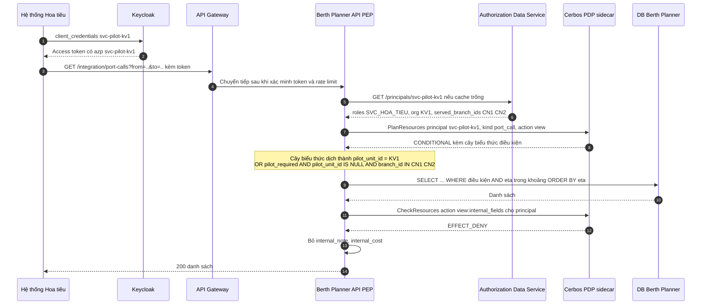
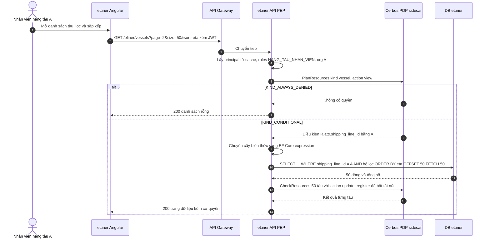
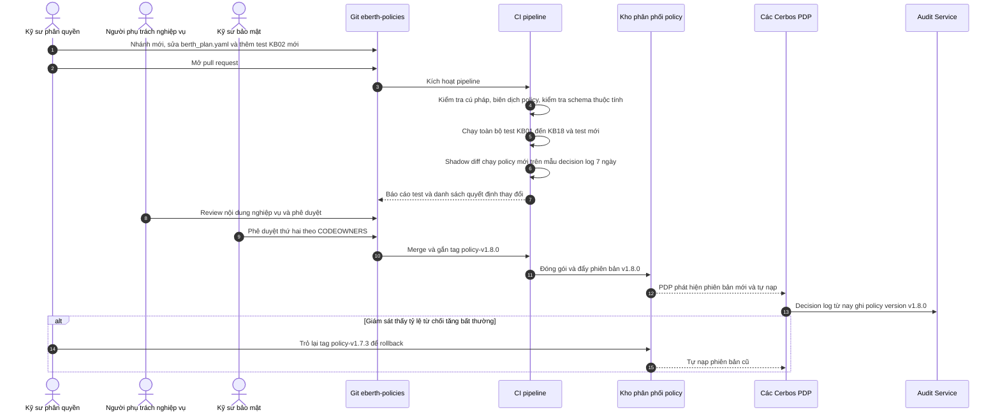
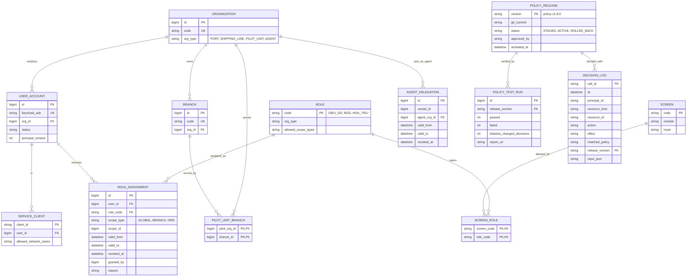

# Đánh giá mô hình PBAC – Policy-Based Access Control cho dự án eBerth

> Agent 4 – phụ trách PBAC. Trọng tâm: policy tách khỏi code, đặt ở policy engine dùng chung; cách kết hợp role, thuộc tính và quan hệ trong policy; vòng đời policy (viết, review, test, version, deploy); công cụ Cedar, OPA, Cerbos.

**Phạm vi đánh giá.** PBAC được hiểu là **cách tổ chức phân quyền**: quyết định được đưa ra bởi một **policy engine dùng chung**, tách khỏi code ứng dụng (externalized authorization). Policy được quản lý như mã nguồn ("policy as code"). Trong policy, người viết được dùng cả **role**, **thuộc tính** và **quan hệ** (khi quan hệ được cung cấp dưới dạng dữ liệu đầu vào).

Hai lưu ý để kết quả so sánh được với ba báo cáo kia:
1. PBAC là **khung kết hợp**. Nó thừa hưởng khả năng của RBAC (role) và ABAC (thuộc tính), nên đáp ứng kịch bản tốt hơn là điều dễ hiểu. Cái giá nằm ở hạ tầng, quy trình và chi phí học. Agent Tổng hợp nên đọc điểm "đáp ứng kịch bản" của PBAC trong bối cảnh này.
2. **Quan hệ nhiều bước** (đồ thị kiểu Zanzibar) **không** được tính là năng lực của PBAC. Policy engine không duyệt đồ thị hiệu quả; quan hệ phải được tính sẵn thành thuộc tính, hoặc lấy từ một engine ReBAC rồi đưa vào policy.

Công cụ dùng làm ví dụ chính là **Cerbos**, vì có SDK .NET chính thức, policy dạng YAML + CEL, có sẵn API lập kế hoạch truy vấn cho danh sách. **OPA** và **Cedar** được trình bày song song để so sánh (mục 5.7).

---

## 1. GIẢI THÍCH MÔ HÌNH

### 1.1. Định nghĩa và nguồn gốc

**PBAC (Policy-Based Access Control – kiểm soát truy cập dựa trên chính sách)**: quyền truy cập được quyết định bằng các **chính sách** (policy) viết bằng một ngôn ngữ riêng, lưu và quản lý **tập trung**, đánh giá bởi một **policy engine** (PDP – Policy Decision Point) độc lập với ứng dụng. Ứng dụng chỉ hỏi "chủ thể X được làm hành động A trên tài nguyên R không?" và thực thi kết quả.

- Báo cáo NIST IR 7316 "Assessment of Access Control Systems" (2006) và khảo sát của Kuhn, Coyne, Weil (2010) mô tả PBAC như cách *chuẩn hóa và quản lý tập trung* các quy tắc ABAC trong toàn tổ chức.
- Gartner gọi hướng này là **Externalized Authorization Management** và sau đó là "dynamic authorization".
- Thế hệ hiện nay gắn với **policy as code**: policy nằm trong Git, được review, test, version và phát hành qua CI/CD giống mã nguồn. Các engine tiêu biểu:
  - **OPA** (Open Policy Agent, dự án tốt nghiệp CNCF năm 2021, ngôn ngữ Rego).
  - **Cedar** (AWS công bố mã nguồn mở năm 2023, ngôn ngữ được kiểm chứng hình thức).
  - **Cerbos** (mã nguồn mở, YAML + CEL).

Khác biệt với ABAC: ABAC trả lời *quyết định dựa trên cái gì* (thuộc tính); PBAC trả lời *quyết định được viết, lưu, đánh giá và quản lý ở đâu, như thế nào* (policy tập trung, engine dùng chung, vòng đời policy). Một hệ PBAC thường dùng thuộc tính (ABAC) cùng role (RBAC) bên trong policy.

### 1.2. Thành phần cốt lõi

| Thành phần | Vai trò |
|---|---|
| **Policy** | Tập quy tắc viết bằng ngôn ngữ của engine (Rego, Cedar, YAML + CEL), có hiệu lực allow/deny, có điều kiện. |
| **PDP – Policy engine** | Dịch vụ không trạng thái (stateless), nạp policy và trả lời quyết định. Thường chạy cạnh ứng dụng (sidecar) hoặc thành cụm dịch vụ nội bộ. |
| **PEP** | Điểm thực thi trong ứng dụng/gateway: dựng đầu vào (principal, resource, action, context), gọi PDP, thực thi kết quả. |
| **PIP / dữ liệu đầu vào** | Role đã gán, thuộc tính của chủ thể và tài nguyên, quan hệ đã tính sẵn. PDP **không tự lưu** dữ liệu nghiệp vụ. |
| **PAP – Kho policy và quy trình** | Repository Git, CI kiểm thử, phát hành theo phiên bản, phân phối tới các PDP (bundle, đồng bộ Git, kho blob). |
| **Decision log** | Nhật ký quyết định do PDP xuất ra: đầu vào, kết quả, policy và quy tắc đã khớp, phiên bản policy. |
| **Query plan / partial evaluation** | Engine trả về điều kiện còn lại khi biết chủ thể nhưng chưa biết tài nguyên, để ứng dụng dịch thành điều kiện truy vấn cho danh sách. |

### 1.3. Ví dụ minh họa (không phải eBerth)

Một công ty phần mềm có 30 microservice. Trước đây mỗi service tự viết `if (user.IsManager && expense.Amount < 10_000)`. Khi chính sách công tác phí đổi hạn mức, phải sửa 4 service và deploy lại.

Chuyển sang PBAC:

```yaml
# policies/expense.yaml – nằm trong repo policy, không nằm trong service
resource: expense
rules:
  - actions: [approve]
    effect: ALLOW
    roles: [manager]
    condition: R.attr.amount < 10000 && R.attr.owner != P.id
```

Các service chỉ gọi `Check(principal, "approve", expense)`. Đổi hạn mức thì sửa một file, mở pull request, CI chạy bộ test, người phụ trách duyệt, phát hành, các PDP tự nạp policy mới trong vài phút. **Không service nào phải deploy lại.**

### 1.4. Khi nào phù hợp, khi nào không

**Phù hợp khi:**
- **Nhiều module/microservice** cần dùng chung một bộ quy tắc phân quyền, và muốn quy tắc nhất quán.
- Quy tắc kết hợp **role + thuộc tính + trạng thái + ngữ cảnh** và thay đổi theo chính sách nghiệp vụ.
- Cần **audit** thay đổi quy tắc (ai sửa, ai duyệt, khi nào) và nhật ký quyết định tập trung.
- Có văn hóa CI/CD, review code.

**Không phù hợp khi:**
- Ứng dụng nhỏ, một khối, quy tắc ít và ổn định: thêm engine là thừa.
- Muốn **người dùng nghiệp vụ tự sửa quy tắc** bằng giao diện kéo thả: policy as code dành cho kỹ sư.
- Quyền chủ yếu là **đồ thị quan hệ** sâu (ReBAC hợp hơn).
- Không chấp nhận thêm một bước gọi mạng (dù nhỏ) hoặc thêm thành phần cần vận hành.

---

## 2. ÁP DỤNG VÀO eBERTH

### 2.1. Nguyên tắc: tách "policy" và "dữ liệu phân quyền"

Đây là điểm thiết kế quan trọng nhất để đáp ứng đồng thời yêu cầu **phân quyền động** (PHẦN 1.3) và **policy được review, test**.

| | **Policy** (quy tắc) | **Dữ liệu phân quyền** |
|---|---|---|
| Ví dụ | "Điều độ chỉ sửa kế hoạch chưa duyệt của chi nhánh mình"; "người lập không tự duyệt" | User A là Điều độ ở CN1; hoa tiêu KV1 phục vụ CN1, CN2; B được ủy quyền BGĐ từ 10/11 đến 15/11 |
| Lưu ở đâu | Repository Git `eberth-policies` | Authorization Data Service (DB SQL Server/Oracle) |
| Ai thay đổi | Kỹ sư/nhóm bảo mật, có người phụ trách nghiệp vụ duyệt | Admin hệ thống, admin chi nhánh, admin hãng tàu trên Portal Admin |
| Thay đổi qua | Pull request → CI test → phát hành → PDP tự nạp (vài phút, **không deploy ứng dụng**) | Ghi DB → hiệu lực ngay (sau khi xóa cache) |
| Tần suất | Vài lần mỗi tháng | Hằng ngày |

### 2.2. Kết hợp role, thuộc tính và quan hệ trong policy

| Thành phần | Nguồn | Cách đưa vào policy | Ví dụ eBerth |
|---|---|---|---|
| **Role** | Bảng gán role trong Authorization Data Service (có thời hạn) | `P.roles` | `DIEU_DO`, `BGD`, `HOA_TIEU`, `HANG_TAU_NHAN_VIEN`, `HANG_TAU_QUAN_TRI`, `ADMIN_HT`, `SVC_HOA_TIEU` |
| **Phạm vi của role** | Bảng gán role (scope chi nhánh) | `P.attr.branches_by_role` | `{"DIEU_DO": ["CN1"], "BGD": ["CN1","CN2"]}` |
| **Thuộc tính chủ thể** | Authorization Data Service, claim Keycloak | `P.attr.*` | `org_id`, `org_type`, `served_branch_ids`, `auth_level` |
| **Thuộc tính tài nguyên** | DB nghiệp vụ của module (đọc cùng bản ghi) | `R.attr.*` | `branch_id`, `status`, `created_by`, `shipping_line_id`, `pilot_unit_id`, `pilot_required` |
| **Quan hệ một bước** | Cột trên bản ghi | Như thuộc tính tài nguyên | `R.attr.pilot_unit_id == P.attr.org_id` |
| **Quan hệ nhiều bước / nhiều-nhiều** | (a) Tính sẵn thành thuộc tính; (b) hỏi engine ReBAC rồi đưa kết quả vào | `R.attr.agent_org_ids` hoặc `P.attr.delegated_vessel_ids`; hoặc cờ `R.attr.rebac_can_view` | Ủy quyền đại lý theo tàu (KB10, tương lai) |
| **Ngữ cảnh** | Gateway, claim `acr`, đồng hồ hệ thống | `request.aux_data` / thuộc tính chủ thể; hàm `now()` trong CEL | Vùng mạng, MFA, khung giờ |

**Derived role** (vai trò suy diễn) của Cerbos là chỗ role và thuộc tính gặp nhau. Ví dụ: `branch_dispatcher` = có role `DIEU_DO` **và** chi nhánh của tài nguyên nằm trong phạm vi role đó. Nhờ vậy policy của từng tài nguyên ngắn và đọc được theo ngôn ngữ nghiệp vụ.

### 2.3. Policy mẫu (Cerbos)

**Vai trò suy diễn dùng chung**

```yaml
# derived_roles/eberth_common.yaml
apiVersion: api.cerbos.dev/v1
derivedRoles:
  name: eberth_common
  definitions:
    - name: branch_dispatcher
      parentRoles: ["DIEU_DO"]
      condition:
        match:
          expr: R.attr.branch_id in P.attr.branches_by_role["DIEU_DO"]

    - name: branch_director
      parentRoles: ["BGD"]
      condition:
        match:
          expr: R.attr.branch_id in P.attr.branches_by_role["BGD"]

    - name: owner_line_member
      parentRoles: ["HANG_TAU_NHAN_VIEN", "HANG_TAU_QUAN_TRI"]
      condition:
        match:
          expr: R.attr.shipping_line_id == P.attr.org_id

    - name: pilot_unit_member
      parentRoles: ["HOA_TIEU", "SVC_HOA_TIEU"]
      condition:
        match:
          any:
            of:
              - expr: R.attr.pilot_unit_id == P.attr.org_id
              - all:
                  of:
                    - expr: R.attr.pilot_required == true
                    - expr: R.attr.pilot_unit_id == null
                    - expr: R.attr.branch_id in P.attr.served_branch_ids
```

**Kế hoạch cầu bến – Điều độ, Ban giám đốc, Hoa tiêu**

```yaml
# resources/berth_plan.yaml
apiVersion: api.cerbos.dev/v1
resourcePolicy:
  version: default
  resource: berth_plan
  importDerivedRoles:
    - eberth_common
  rules:
    - actions: ["view"]
      effect: EFFECT_ALLOW
      derivedRoles: ["branch_dispatcher", "branch_director"]

    - actions: ["view"]
      effect: EFFECT_ALLOW
      roles: ["HOA_TIEU"]
      condition:
        match:
          all:
            of:
              - expr: R.attr.branch_id in P.attr.served_branch_ids
              - expr: R.attr.status == "DA_DUYET"

    - actions: ["create", "update", "submit"]
      effect: EFFECT_ALLOW
      derivedRoles: ["branch_dispatcher"]
      condition:
        match:
          expr: R.attr.status in ["NHAP", "TU_CHOI"]

    - actions: ["approve", "reject"]
      effect: EFFECT_ALLOW
      derivedRoles: ["branch_director"]
      condition:
        match:
          all:
            of:
              - expr: R.attr.status == "CHO_DUYET"
              - expr: R.attr.created_by != P.id

    # Thiếu thuộc tính cũng phải bị chặn: biểu thức lỗi sẽ làm quy tắc DENY không kích hoạt
    - actions: ["approve"]
      effect: EFFECT_DENY
      roles: ["*"]
      condition:
        match:
          expr: '!has(P.attr.auth_level) || P.attr.auth_level != "mfa"'
```

**Lượt cập cảng – Hãng tàu, Hoa tiêu, nội bộ, quyền mức trường**

```yaml
# resources/port_call.yaml
apiVersion: api.cerbos.dev/v1
resourcePolicy:
  version: default
  resource: port_call
  importDerivedRoles:
    - eberth_common
  rules:
    - actions: ["view"]
      effect: EFFECT_ALLOW
      derivedRoles: ["branch_dispatcher", "branch_director", "owner_line_member", "pilot_unit_member"]

    - actions: ["view:internal_fields"]
      effect: EFFECT_ALLOW
      derivedRoles: ["branch_dispatcher", "branch_director"]

    # Tài khoản dịch vụ chỉ được gọi từ vùng mạng đã đăng ký (PEP đưa network_zone từ gateway vào principal)
    - actions: ["*"]
      effect: EFFECT_DENY
      roles: ["SVC_HOA_TIEU"]
      condition:
        match:
          expr: '!has(P.attr.network_zone) || !(P.attr.network_zone in P.attr.allowed_network_zones)'
```

Ghi chú:
- **Admin hệ thống**: có policy riêng cho các tài nguyên `admin_*` (role `ADMIN_HT`).
- **Màn hình**: là tài nguyên `screen` với các action `open`, policy cho phép theo role (mục 2.4).
- **Ủy quyền tạm thời** (KB12): Authorization Data Service chỉ trả các role/phạm vi *còn hiệu lực tại thời điểm hỏi* trong `branches_by_role`; cache có TTL không vượt quá thời điểm hết hạn gần nhất. Cũng có thể đưa `valid_to` vào thuộc tính và so với `now()` trong CEL.

### 2.4. Danh mục role và màn hình

Role giữ cách đặt tên và phạm vi như mô hình RBAC (role theo chức năng, phạm vi chi nhánh/tổ chức gắn ở lần gán). Quyền **màn hình** được viết thành một policy `screen` dùng danh sách role:

```yaml
# resources/screen.yaml (trích)
apiVersion: api.cerbos.dev/v1
resourcePolicy:
  version: default
  resource: screen
  rules:
    - actions: ["open"]
      effect: EFFECT_ALLOW
      roles: ["*"]
      condition:
        match:
          expr: P.roles.exists(r, r in R.attr.allowed_roles)
```

`R.attr.allowed_roles` của từng màn hình là **dữ liệu** (bảng `screen_role` trên Portal Admin). Vì vậy admin thêm màn hình và gán quyền mà không phải sửa policy (KB13).

### 2.5. Giả định đã dùng

| Mã | Giả định | Nếu sai thì sao |
|---|---|---|
| GĐ-P01 | [GIẢ ĐỊNH] Mỗi user thuộc một tổ chức; role gán theo phạm vi chi nhánh/tổ chức, lưu trong eBerth. | Không đổi kết luận. |
| GĐ-P02 | [GIẢ ĐỊNH] Tách dữ liệu một tầng chi nhánh; tài nguyên có `branch_id`. | Cây nhiều tầng: tính sẵn danh sách chi nhánh con vào thuộc tính chủ thể; policy không đổi. |
| GĐ-P03 | [GIẢ ĐỊNH] Kế hoạch có trạng thái `NHAP / CHO_DUYET / DA_DUYET / TU_CHOI` trên bản ghi. | Không đổi. |
| GĐ-P04 | [GIẢ ĐỊNH] `port_call` có `shipping_line_id`, `pilot_unit_id`, `pilot_required`; phân công hoa tiêu được đẩy về eBerth qua API. | Phân công nhiều-nhiều theo từng hoa tiêu: tính sẵn danh sách thành thuộc tính hoặc dùng ReBAC; KB07 giảm xuống Được. Không có dữ liệu thì không mô hình nào làm được. |
| GĐ-P05 | [GIẢ ĐỊNH] Hoa tiêu dùng màn hình bằng tài khoản Keycloak; hệ thống Hoa tiêu gọi API bằng client credentials. | Gọi thay mặt từng hoa tiêu thì cần Token Exchange; policy không đổi. |
| GĐ-P06 | [GIẢ ĐỊNH] Hãng tàu thấy dữ liệu của mình ở mọi chi nhánh. | Thêm một điều kiện trong derived role. |
| GĐ-P07 | Theo PHẦN 1.4: **không có đại lý hàng hải** hiện tại. | Nếu phát sinh nhiều ủy quyền theo tàu/chuyến thì cần ReBAC bổ sung (mục 6). |
| GĐ-P08 | [GIẢ ĐỊNH] eBerth chạy trên container (Kubernetes hoặc tương đương), có thể chạy PDP dạng sidecar hoặc cụm dịch vụ nội bộ. | Nếu chạy máy ảo/IIS truyền thống thì PDP chạy thành dịch vụ riêng trên các máy; thêm độ trễ mạng, cần HA riêng. |
| GĐ-P09 | [GIẢ ĐỊNH] Đội đã có Git và hệ thống CI/CD (Azure DevOps, GitLab hoặc tương đương) và chấp nhận quy trình review cho policy. | Không có CI/CD thì vòng đời policy (mục 5.8) mất phần lớn giá trị; nên làm hạ tầng CI trước. |
| GĐ-P10 | [GIẢ ĐỊNH] Quy mô: vài trăm user nội bộ, vài nghìn user ngoài, khoảng 200.000 lượt cập cảng/năm, khoảng 10–20 file policy. | Không đổi kết luận; PDP không trạng thái nên mở rộng theo chiều ngang. |
| GĐ-P11 | Keycloak chỉ xác thực; quyền không nằm trong JWT; claim `acr` dùng làm mức xác thực. | – |

---

## 3. TRẢ LỜI BỘ KỊCH BẢN KB01–KB18

| Mã | Cách xử lý | Mức đáp ứng | Lý do / ghi chú |
|---|---|---|---|
| KB01 | `berth_plan`: `create/update/submit` cho derived role `branch_dispatcher`. | **Tốt** | Role + phạm vi chi nhánh trong một derived role. |
| KB02 | Điều kiện `R.attr.status in ["NHAP","TU_CHOI"]`; PEP đưa trạng thái đọc từ bản ghi vào request. | **Tốt** | Không đồng bộ trạng thái sang nơi khác. Đổi quy tắc qua pull request, không deploy ứng dụng. |
| KB03 | `R.attr.created_by != P.id` trong quy tắc `approve`. | **Tốt** | Có test riêng trong bộ test policy (mục 5.5). |
| KB04 | `approve/reject` cho `branch_director`; dashboard dùng query plan để lọc theo chi nhánh. | **Tốt** | – |
| KB05 | Keycloak xác thực hoa tiêu; role `HOA_TIEU`, thuộc tính `served_branch_ids`; quy tắc `view` cho kế hoạch đã duyệt. | **Được** | Policy đơn giản; khó nằm ở tích hợp định danh (GĐ-P05). |
| KB06 | Tài nguyên `screen` với `allowed_roles`. Màn hình hoa tiêu chỉ có `HOA_TIEU`; màn hình Điều độ chỉ có `DIEU_DO`. API của màn hình cũng kiểm tra action tương ứng. | **Tốt** | Có role là khái niệm hạng nhất, cộng danh sách màn hình là dữ liệu. |
| KB07 | Derived role `pilot_unit_member`: đơn vị được phân công, hoặc có yêu cầu hoa tiêu chưa phân công trong chi nhánh phục vụ. | **Tốt** | Với GĐ-P04. Danh sách dùng query plan (KB14). |
| KB08 | Derived role `owner_line_member`: `R.attr.shipping_line_id == P.attr.org_id`. | **Tốt** | Danh sách dùng query plan sinh `WHERE shipping_line_id = @org`. |
| KB09 | Action riêng `view:internal_fields`; PEP kiểm tra cùng lúc với `view` (một lần gọi nhiều action) rồi bỏ trường. | **Tốt** | Thêm trường nhạy cảm: thêm vào danh sách trường của action đó trong code PEP (một chỗ). |
| KB10 | Hãng tàu tạo ủy quyền (dữ liệu: tàu, đại lý, thời hạn) trong Authorization Data Service; PEP đưa `R.attr.agent_org_ids` (đại lý còn hiệu lực của tàu) vào request; policy: `P.attr.org_id in R.attr.agent_org_ids`. | **Được** | Policy viết được, nhưng quan hệ phải tính sẵn; ủy quyền theo chuyến hoặc nhiều cấp thì nên dùng engine ReBAC rồi đưa kết quả vào policy. Hiện chưa có đại lý (GĐ-P07). |
| KB11 | Admin hủy lần gán role trên Portal Admin, Authorization Data Service phát sự kiện Kafka, PEP xóa cache principal. Policy không đổi. | **Tốt** | Đây là thay đổi dữ liệu, không phải thay đổi policy. Hiệu lực ngay với điều kiện quyền không nằm trong JWT. |
| KB12 | Lần gán role có `valid_from/valid_to`; Authorization Data Service chỉ trả role còn hiệu lực. Hoặc điều kiện `now() < timestamp(P.attr.acting_until)` trong CEL. | **Tốt** | Thời gian là điều kiện tự nhiên trong CEL/Rego/Cedar. |
| KB13 | Màn hình mới: thêm dòng `screen` và `screen_role` (dữ liệu), không đổi policy. Chức năng mới cần quy tắc mới: sửa policy qua pull request, PDP tự nạp, không deploy ứng dụng. | **Được** | Gán quyền không cần deploy. Quy tắc mới phải qua quy trình review và CI (khoảng vài chục phút tới vài giờ), không phải bấm là xong; đây là đánh đổi có chủ đích. |
| KB14 | **PlanResources** của Cerbos (hoặc partial evaluation của OPA) trả về điều kiện còn lại dạng cây biểu thức, PEP dịch sang `Expression<Func<T,bool>>` của EF Core, DB phân trang, lọc, sắp xếp. | **Tốt** | Có sẵn trong engine nên không phải tự xây bộ đánh giá từng phần. Phải viết bộ chuyển cây biểu thức sang EF Core (ước tính vài trăm dòng, vì chưa có adapter .NET chính thức – cần kiểm tra). Điều kiện dùng thuộc tính không phải cột của bảng thì không dịch được. |
| KB15 | Một lần gọi kiểm tra nhiều tài nguyên × nhiều action (`CheckResources`) cho danh sách màn hình và hành động chung; nút trên từng dòng: backend kiểm tra theo trang dữ liệu và trả cờ kèm DTO. | **Được** | Đúng theo trạng thái từng bản ghi; tốn công hơn danh sách permission phẳng của RBAC. |
| KB16 | "Vì sao X xem được Y": decision log của PDP có đầu vào, kết quả, policy và quy tắc khớp, phiên bản policy. Lịch sử thay đổi quy tắc: lịch sử Git và pull request. "Ai có quyền trên Y": phần role trả lời bằng bảng gán; phần điều kiện thuộc tính phải mô phỏng. | **Được** | Tốt hơn ABAC tự xây nhờ policy tập trung và lịch sử Git rõ ràng. Engine **không** có API truy vấn ngược "ai được phép trên Y" theo dữ liệu (Cedar có công cụ phân tích ở mức policy, không ở mức dữ liệu). |
| KB17 | Phạm vi chi nhánh trong `branches_by_role`; derived role so `R.attr.branch_id`. | **Tốt** | – |
| KB18 | PEP dựng principal từ claim `azp` của token client credentials; role `SVC_HOA_TIEU` chỉ có `view` qua derived role `pilot_unit_member`; quy tắc `EFFECT_DENY` khi vùng mạng của request không thuộc `allowed_network_zones` của tài khoản. | **Tốt** | Giới hạn dữ liệu, hành động và ngữ cảnh trong cùng một policy. |
| KB-THÊM-01 | Thay đổi chính sách an toàn: sửa quy tắc duyệt kế hoạch, có test, chạy thử song song (shadow), rollback về phiên bản trước. | **Tốt** | Đây là giá trị cốt lõi của PBAC (mục 5.8). |
| KB-THÊM-02 | Phê duyệt bắt buộc MFA: quy tắc `EFFECT_DENY` khi thiếu `auth_level` hoặc `auth_level != "mfa"`. | **Tốt** | Một quy tắc từ chối áp cho mọi role. Phải xử lý trường hợp thiếu thuộc tính: trong Cerbos, biểu thức lỗi làm quy tắc không kích hoạt, nên quy tắc DENY viết thiếu `has()` sẽ bị bỏ qua. |

**Tổng hợp mức đáp ứng (KB01–KB18):** Tốt 13 · Được 5 · Kém 0 · Không làm được 0.
Lưu ý: KB14 đạt Tốt với điều kiện có bộ chuyển query plan sang EF Core, cần chứng minh ở PoC. KB10 và KB16 vẫn cần thành phần ngoài engine (tính sẵn quan hệ, báo cáo mô phỏng).

---

## 4. ƯU ĐIỂM VÀ NHƯỢC ĐIỂM

### 4.1. Ưu điểm

| Ưu điểm | Ví dụ trong eBerth |
|---|---|
| **Một nguồn quy tắc cho mọi module** | Quy tắc "kế hoạch đã duyệt thì không sửa" nằm ở `berth_plan.yaml`. Berth Planner (API sửa), Operations (màn hình duyệt) và một API tích hợp tương lai đều dùng chung, không có bản sao `if` trong ba service. |
| **Kết hợp role, thuộc tính, trạng thái trong một chỗ** | KB01–KB04: derived role `branch_director` (role + chi nhánh) cộng điều kiện trạng thái và `created_by`. RBAC và ABAC phải ghép thủ công trong code. |
| **Đổi chính sách không deploy ứng dụng, có kiểm soát** | KB-THÊM-01: Ban giám đốc yêu cầu "cho Điều độ trưởng sửa trong 2 giờ sau duyệt". Kỹ sư sửa một quy tắc, CI chạy lại bộ test KB01–KB18, người phụ trách nghiệp vụ duyệt pull request, PDP nạp trong vài phút. |
| **Kiểm thử policy độc lập với ứng dụng** | Bộ test YAML mô tả đúng các kịch bản KB (mục 5.5), chạy trong vài giây ở CI, không cần dựng DB hay service. |
| **Audit tốt về thay đổi quy tắc** | KB16: "Ai đổi quy tắc duyệt kế hoạch tháng trước, ai duyệt?" có trong lịch sử Git và pull request. Decision log có phiên bản policy cho từng quyết định. |
| **Lọc danh sách có sẵn trong engine** | KB14: PlanResources trả về `shipping_line_id == "A"` cho user hãng tàu; không phải tự viết bộ đánh giá từng phần như ABAC tự xây. |
| **PDP không trạng thái** | Không có kho dữ liệu phải đồng bộ như ReBAC; mở rộng bằng cách chạy thêm instance. |

### 4.2. Nhược điểm

| Nhược điểm | Ví dụ trong eBerth |
|---|---|
| **Thêm thành phần cần vận hành** | PDP (sidecar hoặc cụm), kho phân phối policy, pipeline CI cho policy, thu gom decision log. PDP lỗi thì mọi API bị từ chối (fail closed). |
| **Ngôn ngữ mới và tư duy policy as code** | Đội .NET/Angular phải học YAML + CEL (Cerbos), Rego (OPA) hoặc Cedar; viết sai điều kiện CEL (ví dụ so `null` không đúng cách) dễ mở hoặc khóa quyền ngoài ý muốn. |
| **Admin không tự sửa quy tắc trên giao diện** | Portal Admin chỉ sửa *dữ liệu* (gán role, màn hình, ủy quyền). Muốn đổi *quy tắc* phải nhờ kỹ sư; một số người kỳ vọng "phân quyền động" là bấm trên giao diện. |
| **Quan hệ nhiều bước không phải sở trường** | KB10: ủy quyền theo chuyến, đại lý cấp hai, phải tính sẵn ở PEP hoặc gọi thêm ReBAC; policy chỉ thấy kết quả. |
| **Vẫn khó trả lời "ai có quyền trên Y" theo dữ liệu** | KB16: engine trả lời câu hỏi xuôi; câu hỏi ngược với điều kiện thuộc tính (hãng tàu, hoa tiêu theo phân công) phải mô phỏng như ABAC. |
| **PEP phải dựng đầu vào đúng và đủ** | Nếu Berth Planner quên đưa `created_by` vào `R.attr`, điều kiện `R.attr.created_by != P.id` cho kết quả sai. Cần schema thuộc tính và test tích hợp. |
| **Thêm một bước gọi (dù nhỏ)** | Mỗi quyết định là một lần gọi gRPC tới PDP (sidecar cùng máy: thường dưới 1–2 ms; qua mạng: vài ms). Màn hình danh sách nhiều nút cần gom lô (batch). |

---

## 5. THIẾT KẾ TRIỂN KHAI

### 5.1. Các service và module cần thêm hoặc sửa

| Thành phần | Mới/Sửa | Trách nhiệm |
|---|---|---|
| **Keycloak** | Sửa cấu hình | Xác thực; claim `sub`, `azp`, `acr`; identity brokering cho hoa tiêu; client credentials cho service ngoài. |
| **API Gateway** | Sửa | Xác minh JWT, gắn thuộc tính ngữ cảnh (vùng mạng), rate limit. Có thể gọi PDP cho kiểm tra thô theo route (tùy chọn). |
| **Policy Engine – PDP (Cerbos)** | Mới | Nạp policy theo phiên bản, trả lời `CheckResources`, `PlanResources`; xuất decision log. Chạy dạng **sidecar** cạnh mỗi service (khuyến nghị nếu dùng Kubernetes) hoặc cụm 2–3 instance nội bộ. Không trạng thái, không DB. |
| **Repository `eberth-policies` + CI** | Mới | Lưu policy, derived role, schema thuộc tính, bộ test. CI: kiểm tra cú pháp và biên dịch, kiểm tra schema, chạy test, báo cáo khác biệt, đóng gói phát hành theo tag. |
| **Kênh phân phối policy** | Mới | PDP lấy policy theo tag từ Git hoặc kho blob/bundle nội bộ, tự nạp lại khi có phiên bản mới, không khởi động lại ứng dụng. |
| **Authorization Data Service (eberth-authz-data)** | Mới | Lưu *dữ liệu* phân quyền: role, lần gán có phạm vi và thời hạn, tổ chức, chi nhánh, đơn vị hoa tiêu phục vụ chi nhánh, màn hình và role được dùng, ủy quyền (tương lai), tài khoản dịch vụ. API `GET /principals/{id}` trả principal đã làm phẳng (roles + attributes). Phát sự kiện thay đổi qua Kafka. |
| **Thư viện `Eberth.Authorization` (.NET)** | Mới | PEP chuẩn: dựng principal (cache), dựng resource từ entity theo schema, gọi PDP qua SDK .NET, gom lô kiểm tra, **chuyển query plan sang EF Core expression**, bỏ trường theo action mức trường, mã lỗi chuẩn, timeout/circuit breaker (fail closed). |
| **Các module Berth Planner, Operations, eLiner, Portal Admin** | Sửa | Dùng thư viện cho mọi endpoint; khai báo ánh xạ entity sang `R.attr`; xóa logic `if` phân quyền rải rác. |
| **Redis, Kafka** | Dùng sẵn | Cache principal; sự kiện thay đổi dữ liệu phân quyền; topic decision log. |
| **Audit Service** | Mới | Nhận decision log từ PDP (qua Kafka hoặc file), lưu có chỉ mục; lưu lịch sử phát hành policy. |
| **Portal Admin – phân hệ Phân quyền** | Sửa | Quản lý dữ liệu (gán role, phạm vi, thời hạn, màn hình, tài khoản dịch vụ); xem policy đang hiệu lực (chỉ đọc); **trình mô phỏng** gọi PDP với đầu vào giả định; tra cứu decision log. |
| **Angular shared library** | Mới | Tải "capabilities" (màn hình, hành động chung) qua một endpoint gom lô; directive và route guard; cờ quyền trên từng dòng từ DTO. |
| **ReBAC engine (tùy chọn, giai đoạn sau)** | Tùy chọn | Chỉ khi ủy quyền đại lý theo tàu/chuyến trở thành nhu cầu thật; kết quả được đưa vào policy dưới dạng thuộc tính. |

### 5.2. Kiến trúc tổng thể



### 5.3. Luồng kiểm tra quyền

**Điểm kiểm tra chung:**

| Tầng | Kiểm tra gì |
|---|---|
| Frontend | Menu, màn hình theo capabilities (một lần gọi gom lô lúc đăng nhập, làm mới khi có thay đổi); nút từng dòng theo cờ DTO. Không phải lớp bảo mật. |
| API Gateway | JWT, ngữ cảnh, rate limit. Tùy chọn: kiểm tra thô "client này được vào module này" qua PDP. |
| Backend từng module | PEP gọi PDP với principal + resource đầy đủ cho thao tác đơn lẻ. |
| Tầng truy vấn DB | Query plan dịch thành `WHERE` cho danh sách, dashboard, export. |
| Serializer | Bỏ trường khi không có action mức trường. |

**Cache:**
- **Principal** (role, phạm vi, thuộc tính): Redis theo `userId + version`, cộng bộ nhớ trong 30–60 giây.
- **Policy**: nằm sẵn trong bộ nhớ PDP, theo phiên bản.
- **Quyết định**: không cache cho thao tác ghi. Có thể cache vài giây cho capabilities màn hình.

**Khi quyền thay đổi:**
- *Dữ liệu*: Authorization Data Service tăng version và phát sự kiện, PEP xóa cache.
- *Policy*: phát hành tag mới, PDP tự nạp. Mọi decision log ghi phiên bản policy để truy vết.

**(a) Điều độ sửa kế hoạch trong Berth Planner (KB01, KB02)**



**(b) Hoa tiêu từ hệ thống ngoài xem kế hoạch (KB05, KB07)**



**(c) Hãng tàu xem danh sách tàu trên eLiner (KB08, KB14)**



**(d) Vòng đời một thay đổi policy (trọng tâm riêng)**



### 5.4. Thiết kế cơ sở dữ liệu

PBAC có hai nơi lưu: **kho policy** là Git (không phải DB), và **DB dữ liệu phân quyền** (SQL Server/Oracle). PDP không có DB riêng.

**ERD (DB dữ liệu phân quyền và audit)**



**Danh sách bảng**

| Bảng | Cột chính | Khóa / chỉ mục quan trọng | Mục đích |
|---|---|---|---|
| `organization`, `branch` | `code`, `org_type`; `org_id` | UK `code` | Danh mục tổ chức, chi nhánh (đồng bộ từ module gốc nếu có). |
| `user_account` | `keycloak_sub`, `org_id`, `status`, `principal_version` | UK `keycloak_sub` | Ánh xạ định danh; `principal_version` làm key cache. |
| `role` | `code`, `org_type`, `allowed_scope_types` | PK `code` | Danh mục role (theo chức năng). |
| `role_assignment` | `user_id`, `role_code`, `scope_type`, `scope_id`, `valid_from`, `valid_to`, `revoked_at` | IX `(user_id, revoked_at, valid_to)`; IX `(role_code, scope_type, scope_id)` | Gán role có phạm vi và thời hạn; nguồn của `P.roles` và `P.attr.branches_by_role`. |
| `pilot_unit_branch` | `pilot_org_id`, `branch_id` | PK kép | Nguồn `P.attr.served_branch_ids`. |
| `screen`, `screen_role` | `code`, `module`, `route`; `screen_code`, `role_code` | PK | Màn hình là dữ liệu (KB06, KB13). |
| `service_client` | `client_id`, `user_id`, `allowed_network_zones` | PK `client_id` | Tài khoản dịch vụ (KB18). |
| `agent_delegation` | `vessel_id`, `agent_org_id`, `valid_from`, `valid_to`, `revoked_at` | IX `(vessel_id, revoked_at)` | Ủy quyền đại lý, nguồn của `R.attr.agent_org_ids` (KB10, tương lai). |
| `policy_release` | `version`, `git_commit`, `status`, `approved_by`, `activated_at` | PK `version` | Sổ phát hành policy; ánh xạ phiên bản sang commit. |
| `policy_test_run` | `release_version`, `passed`, `failed`, `shadow_changed_decisions` | IX `release_version` | Kết quả CI cho mỗi phát hành. |
| `decision_log` | `principal_id`, `resource_kind`, `resource_id`, `action`, `effect`, `matched_policy`, `release_version`, `input_json` | IX `(resource_kind, resource_id, at)`, `(principal_id, at)`; phân vùng theo tháng | Nhật ký quyết định từ PDP; lưu đầy đủ cho thao tác ghi và Deny, lấy mẫu cho thao tác đọc. |

**Kho policy (Git)**

```text
eberth-policies/
├── _schemas/                 # JSON Schema cho P.attr và R.attr từng loại tài nguyên
│   ├── principal.json
│   ├── berth_plan.json
│   └── port_call.json
├── derived_roles/
│   └── eberth_common.yaml
├── resources/
│   ├── berth_plan.yaml
│   ├── port_call.yaml
│   ├── vessel.yaml
│   ├── screen.yaml
│   └── admin_user.yaml
├── tests/
│   ├── berth_plan_test.yaml  # một test cho mỗi kịch bản KB liên quan
│   └── port_call_test.yaml
├── CODEOWNERS                # bảo mật + nghiệp vụ phải duyệt
└── CHANGELOG.md
```

**Đồng bộ với DB nghiệp vụ:** không có kho tuple cần đồng bộ. Thuộc tính tài nguyên được PEP đọc trực tiếp từ bản ghi tại thời điểm kiểm tra. Thuộc tính chủ thể đọc từ Authorization Data Service (có cache và sự kiện xóa cache). Ràng buộc duy nhất: **tên và kiểu thuộc tính** trong `_schemas` phải khớp với ánh xạ entity trong PEP. CI có thể chạy test hợp đồng (contract test) để kiểm tra điều này.

### 5.5. Ví dụ mã giả hoặc cấu hình

**Test policy (Cerbos test suite)**

```yaml
# tests/berth_plan_test.yaml
name: BerthPlanTestSuite
description: Kịch bản KB01, KB02, KB03 và MFA khi phê duyệt
principals:
  dieudo_cn1:
    id: nva
    roles: ["DIEU_DO"]
    attr:
      org_id: "PORT"
      branches_by_role: { "DIEU_DO": ["CN1"] }
  bgd_cn1:
    id: ttb
    roles: ["BGD"]
    attr:
      auth_level: "mfa"
      branches_by_role: { "BGD": ["CN1"] }
  bgd_cn1_no_mfa:
    id: lvc
    roles: ["BGD"]
    attr:
      auth_level: "password"
      branches_by_role: { "BGD": ["CN1"] }
  bgd_cn1_missing_attr:
    id: pht
    roles: ["BGD"]
    attr:
      branches_by_role: { "BGD": ["CN1"] }
resources:
  plan_draft:
    id: P1
    kind: berth_plan
    attr: { branch_id: "CN1", status: "NHAP", created_by: "nva" }
  plan_approved:
    id: P2
    kind: berth_plan
    attr: { branch_id: "CN1", status: "DA_DUYET", created_by: "nva" }
  plan_pending_by_nva:
    id: P3
    kind: berth_plan
    attr: { branch_id: "CN1", status: "CHO_DUYET", created_by: "nva" }
  plan_pending_by_ttb:
    id: P4
    kind: berth_plan
    attr: { branch_id: "CN1", status: "CHO_DUYET", created_by: "ttb" }
tests:
  - name: KB01-KB02 Điều độ sửa bản nháp, không sửa bản đã duyệt
    input:
      principals: ["dieudo_cn1"]
      resources: ["plan_draft", "plan_approved"]
      actions: ["update"]
    expected:
      - principal: dieudo_cn1
        resource: plan_draft
        actions: { update: EFFECT_ALLOW }
      - principal: dieudo_cn1
        resource: plan_approved
        actions: { update: EFFECT_DENY }
  - name: KB03 BGĐ không tự duyệt kế hoạch do mình lập
    input:
      principals: ["bgd_cn1"]
      resources: ["plan_pending_by_nva", "plan_pending_by_ttb"]
      actions: ["approve"]
    expected:
      - principal: bgd_cn1
        resource: plan_pending_by_nva
        actions: { approve: EFFECT_ALLOW }
      - principal: bgd_cn1
        resource: plan_pending_by_ttb
        actions: { approve: EFFECT_DENY }
  - name: KB-THÊM-02 Phê duyệt bắt buộc MFA, kể cả khi thiếu thuộc tính
    input:
      principals: ["bgd_cn1_no_mfa", "bgd_cn1_missing_attr"]
      resources: ["plan_pending_by_nva"]
      actions: ["approve"]
    expected:
      - principal: bgd_cn1_no_mfa
        resource: plan_pending_by_nva
        actions: { approve: EFFECT_DENY }
      - principal: bgd_cn1_missing_attr
        resource: plan_pending_by_nva
        actions: { approve: EFFECT_DENY }
```

**PEP trong API (C#, mã giả dựa trên Cerbos .NET SDK – tên lớp và hàm cần kiểm tra theo phiên bản)**

```csharp
[HttpPut("plans/{id}")]
public async Task<IActionResult> UpdatePlan(long id, UpdatePlanDto dto)
{
    var plan = await _db.Plans.FindAsync(id) ?? throw new NotFound();
    var principal = await _principals.GetAsync(User);              // roles + attr, có cache

    var resource = Resource.Create("berth_plan", plan.Id.ToString())
        .WithAttr("branch_id", plan.BranchCode)
        .WithAttr("status", plan.Status.ToString())
        .WithAttr("created_by", plan.CreatedBySub);

    var result = await _cerbos.CheckResourcesAsync(principal, resource, "update");
    if (!result.IsAllowed("update")) return Problem(statusCode: 403, title: "FORBIDDEN_POLICY");

    plan.Update(dto, principal.Id);                                 // không còn if phân quyền trong domain
    await _db.SaveChangesAsync();
    return Ok();
}

// Danh sách: query plan sang EF Core
[HttpGet("vessels")]
public async Task<PagedResult<VesselDto>> List([FromQuery] VesselQuery q)
{
    var plan = await _cerbos.PlanResourcesAsync(await _principals.GetAsync(User), "vessel", "view");
    Expression<Func<Vessel, bool>> filter = plan.Kind switch
    {
        PlanKind.AlwaysAllowed => v => true,
        PlanKind.AlwaysDenied  => v => false,
        _ => CerbosToEf.Translate<Vessel>(plan.Condition, VesselAttrMap)  // ví dụ: R.attr.shipping_line_id -> v.ShippingLineCode
    };
    return await _db.Vessels.Where(filter).ApplyQuery(q).ToPagedAsync(q.Page, q.Size);
}
```

**Cùng quy tắc viết bằng OPA (Rego) và Cedar, để so sánh**

```rego
package eberth.berth_plan

import rego.v1

default allow := false

allow if {
	input.action == "update"
	"DIEU_DO" in input.principal.roles
	input.resource.attr.branch_id in input.principal.attr.branches_by_role.DIEU_DO
	input.resource.attr.status in {"NHAP", "TU_CHOI"}
}

allow if {
	input.action == "approve"
	"BGD" in input.principal.roles
	input.resource.attr.branch_id in input.principal.attr.branches_by_role.BGD
	input.resource.attr.status == "CHO_DUYET"
	input.resource.attr.created_by != input.principal.id
}
```

```cedar
permit (
  principal in Role::"DIEU_DO",
  action == Action::"update",
  resource is BerthPlan
)
when {
  principal.dispatcher_branches.contains(resource.branch) &&
  ["NHAP", "TU_CHOI"].contains(resource.status)
};

permit (
  principal in Role::"BGD",
  action == Action::"approve",
  resource is BerthPlan
)
when {
  principal.director_branches.contains(resource.branch) &&
  resource.status == "CHO_DUYET"
}
unless { resource.created_by == principal };
```

### 5.6. Lộ trình triển khai

| Giai đoạn | Nội dung | Độ phức tạp |
|---|---|---|
| GĐ1 – PoC chọn engine | Viết policy `berth_plan`, `port_call`, `vessel` bằng Cerbos và OPA (tùy chọn Cedar); test KB01–KB18; đo độ trễ sidecar; **chứng minh query plan sang EF Core** trên SQL Server và Oracle. Chốt engine. | Trung bình |
| GĐ2 – Dữ liệu phân quyền và PEP | Authorization Data Service (role, phạm vi, thời hạn, màn hình), thư viện `Eberth.Authorization`, cache và sự kiện Kafka. Áp cho Berth Planner và Operations (KB01–KB04, KB06, KB11, KB17). | Trung bình |
| GĐ3 – Vòng đời policy | Repo `eberth-policies`, schema thuộc tính, CI (biên dịch, test, shadow diff), phát hành theo tag, phân phối tới PDP, CODEOWNERS, sổ phát hành. | Trung bình |
| GĐ4 – eLiner, hoa tiêu, danh sách | Query plan cho mọi danh sách (KB08, KB14), quyền mức trường (KB09), hoa tiêu và tài khoản dịch vụ (KB05, KB07, KB18), capabilities cho Angular (KB15). | Trung bình – Cao |
| GĐ5 – Audit và vận hành | Decision log về Audit Service, tra cứu trên Portal Admin, trình mô phỏng, cảnh báo tỷ lệ Deny bất thường, quyền tạm thời (KB12, KB16). ReBAC cho ủy quyền đại lý nếu phát sinh (KB10). | Trung bình |

### 5.7. Công cụ và thư viện

> Phiên bản và tính năng cần được kiểm tra lại tại thời điểm triển khai. Hệ sinh thái thương mại quanh các engine này thay đổi nhanh.

| Tiêu chí | **Cerbos** | **OPA (Rego)** | **Cedar** |
|---|---|---|---|
| Ngôn ngữ policy | YAML + điều kiện CEL; có resource policy, principal policy, derived role | Rego (khai báo, gốc Datalog), rất linh hoạt | Ngôn ngữ riêng, cú pháp gần tiếng Anh, `permit`/`forbid`, `when`/`unless` |
| Mô hình | Thiết kế sẵn cho phân quyền ứng dụng (RBAC + ABAC) | Engine đa dụng (Kubernetes admission, API, dữ liệu…), phân quyền là một ứng dụng | Thiết kế cho phân quyền ứng dụng; thực thể có phân cấp (`in`), hỗ trợ RBAC, ABAC và một phần quan hệ qua phân cấp |
| Tích hợp .NET | **SDK .NET chính thức** (gRPC) | Gọi REST tới OPA; có SDK C# từ cộng đồng/Styra (cần kiểm tra mức độ duy trì) | Không có SDK .NET chính thức; dùng qua dịch vụ trung gian hoặc WASM (cần kiểm tra) |
| Lọc danh sách | **PlanResources** trả cây điều kiện; có adapter cho một số ORM (Prisma, SQLAlchemy…), .NET phải tự viết | Partial evaluation / Compile API; có công cụ dịch sang SQL/UCAST (cần kiểm tra cho SQL Server/Oracle) | Partial evaluation ở mức thử nghiệm (cần kiểm tra) |
| Kiểm thử | Test suite YAML tích hợp trong `cerbos compile` | `opa test` (test viết bằng Rego), coverage | Kiểm tra policy theo schema; công cụ phân tích chính sách dựa trên SMT; ngôn ngữ được kiểm chứng hình thức |
| Phân phối policy | Đọc từ thư mục, Git, kho blob; tự nạp lại | Bundle (HTTP server, OCI), discovery | Tùy cách tích hợp; Amazon Verified Permissions là dịch vụ managed |
| Decision log | Có sẵn, nhiều backend | Có sẵn, đẩy ra HTTP | Tự xây quanh engine (hoặc qua Verified Permissions) |
| Điểm mạnh với eBerth | Hợp đội .NET nhất; derived role khớp mô hình role + chi nhánh; có API cho danh sách | Phổ biến nhất, cộng đồng lớn, dùng được cho cả gateway/hạ tầng | Dễ đọc, dễ review với nghiệp vụ; phân tích chính sách mạnh |
| Điểm yếu với eBerth | Cộng đồng nhỏ hơn OPA; adapter EF Core phải tự viết; một số tính năng quản lý (Cerbos Hub) là thương mại | Rego khó học, dễ viết sai; tích hợp .NET kém tự nhiên | Tích hợp .NET yếu; Amazon Verified Permissions là dịch vụ AWS (on-premise thì không dùng được) |
| Giấy phép | Apache 2.0 | Apache 2.0 | Apache 2.0 |

**Công cụ khác:**
- **Topaz** (Aserto): OPA kết hợp thư mục quan hệ kiểu Zanzibar, hợp nếu muốn PBAC + ReBAC trong một sản phẩm.
- **Oso Cloud**: dịch vụ thương mại; thư viện mã nguồn mở cũ đã ngừng phát triển chính.
- **Permit.io**: dịch vụ thương mại có giao diện quản trị policy.

**Khuyến nghị cho PoC:** Cerbos là ứng viên chính, OPA là phương án so sánh.

### 5.8. Vòng đời policy (trọng tâm riêng)

| Bước | Thực hiện | Công cụ / tiêu chí |
|---|---|---|
| **Viết** | Kỹ sư phân quyền viết hoặc sửa policy theo yêu cầu nghiệp vụ (ticket), kèm test cho mọi thay đổi. Quy ước: mỗi loại tài nguyên một file; logic dùng chung đặt trong derived role; không hard-code id user hay tổ chức trong policy. | Mẫu file, lint, schema `_schemas` |
| **Review** | Pull request bắt buộc 2 người duyệt: một kỹ sư bảo mật/kiến trúc và một người phụ trách nghiệp vụ của module (theo `CODEOWNERS`). Mô tả PR nêu kịch bản KB bị ảnh hưởng. | Quy tắc bảo vệ nhánh |
| **Test** | CI: (1) biên dịch và kiểm tra schema; (2) test đơn vị policy cho toàn bộ KB01–KB18 và test bổ sung; (3) **shadow diff**: chạy policy mới trên mẫu đầu vào từ decision log gần nhất, liệt kê quyết định bị đổi; (4) contract test giữa `_schemas` và ánh xạ entity của PEP. | `cerbos compile` / `opa test`; job shadow tự viết |
| **Version** | Semantic versioning theo tag Git (`policy-vMAJOR.MINOR.PATCH`). MAJOR khi đổi tên action/thuộc tính (cần sửa PEP), MINOR khi thêm quy tắc, PATCH khi sửa điều kiện. Ghi `CHANGELOG.md`, sổ `policy_release`. | Git tag, bảng `policy_release` |
| **Deploy** | CI đóng gói và đẩy tag tới kho phân phối; PDP tự nạp. Triển khai dần: môi trường test, staging, rồi production. Có thể chạy policy mới ở chế độ "chỉ ghi log" (shadow) trước khi kích hoạt. | Kho Git/blob/bundle |
| **Giám sát** | Theo dõi tỷ lệ Deny theo action, độ trễ PDP, lỗi biên dịch; cảnh báo khi tỷ lệ Deny đổi bất thường sau phát hành. | Decision log, metrics Prometheus của PDP |
| **Rollback** | Trỏ kho phân phối về tag trước; PDP nạp lại trong vài phút; ghi sự cố. | Tag Git |
| **Dọn dẹp** | Review định kỳ mỗi quý: quy tắc không bao giờ khớp, ngoại lệ hết hạn, derived role trùng lặp. | Thống kê từ decision log |

---

## 6. CÁC TRƯỜNG HỢP KHÔNG LÀM ĐƯỢC HOẶC LÀM KHÔNG TỐT

| # | Trường hợp | Hậu quả nếu cố ép PBAC | Cách bù đắp |
|---|---|---|---|
| 1 | **"Ai đang có quyền trên Y" theo dữ liệu** (KB16, rà soát quyền định kỳ). | Phải chạy PDP cho mọi user × bản ghi để mô phỏng; chậm và kết quả phụ thuộc thời điểm. Engine không có chỉ mục ngược. | Phần role trả lời bằng bảng `role_assignment`; phần thuộc tính dùng truy vấn ngược kiểu ABAC (thay thuộc tính tài nguyên vào điều kiện và dịch thành SQL trên bảng user); decision log cho câu hỏi "ai *đã* truy cập". |
| 2 | **Quan hệ nhiều bước, nhiều-nhiều** (đại lý theo tàu/chuyến KB10, phân công theo từng hoa tiêu, chia sẻ tùy ý). | Policy gọi ra ngoài lúc đánh giá (ví dụ `http.send` trong OPA) làm tăng độ trễ và giảm tính dự đoán; hoặc PEP phải nạp danh sách quan hệ rất dài vào mỗi request. | **ReBAC** cho phần quan hệ; PEP hỏi ReBAC rồi đưa kết quả vào policy dưới dạng thuộc tính; hoặc tính sẵn ở Authorization Data Service. |
| 3 | **Admin nghiệp vụ muốn tự sửa quy tắc trên giao diện.** | Cho sửa policy trực tiếp trên Portal Admin thì bỏ qua review và test, mất ưu điểm chính của PBAC và có rủi ro mở quyền. | Thiết kế để phần lớn thay đổi hằng ngày là **dữ liệu** (gán role, màn hình, ủy quyền, chi nhánh phục vụ); thay đổi quy tắc đi qua quy trình nhanh (PR mẫu, CI vài phút). |
| 4 | **Điều kiện không dịch được ra truy vấn** cho danh sách (KB14) – điều kiện trên thuộc tính không phải cột, hàm phức tạp, danh sách dài trong thuộc tính chủ thể. | Query plan trả cây điều kiện mà bộ chuyển EF Core không xử lý được, phải lọc sau, sai phân trang. | Quy ước viết policy cho action `view` chỉ dùng thuộc tính có cột tương ứng; CI kiểm tra bằng test PlanResources; đưa thuộc tính cần thiết thành cột. |
| 5 | **Phụ thuộc PDP lúc chạy.** | PDP chậm hoặc chết thì mọi API bị từ chối; dùng một cụm PDP dùng chung cho tất cả thì thành điểm lỗi tập trung. | Sidecar cạnh từng service, timeout ngắn, circuit breaker fail closed, giám sát; PDP không trạng thái nên khởi động lại nhanh. |
| 6 | **Phụ thuộc ngôn ngữ policy của một engine.** | Đổi từ Cerbos sang OPA hay Cedar phải viết lại toàn bộ policy và test. | Che engine sau thư viện PEP; giữ mô hình role, thuộc tính, action độc lập với engine; bộ test KB viết ở dạng dữ liệu để tái sử dụng. |

---

## 7. RỦI RO KHI TRIỂN KHAI VÀ VẬN HÀNH

| Loại | Rủi ro | Biện pháp |
|---|---|---|
| Bảo mật | Policy viết sai mở quyền diện rộng khi phát hành. | Review 2 người, test KB bắt buộc, shadow diff, phát hành dần, rollback theo tag. |
| Bảo mật | PEP dựng thiếu hoặc sai thuộc tính (ví dụ thiếu `created_by`), làm policy đúng nhưng quyết định sai. | Schema thuộc tính bắt buộc (PDP từ chối đầu vào sai schema), contract test, thư viện PEP dựng thuộc tính từ ánh xạ khai báo một chỗ. |
| Bảo mật | Endpoint quên gọi PEP, hoặc danh sách quên áp query plan. | Thư viện bắt buộc, test quét endpoint, test "hãng A không thấy dữ liệu hãng B". |
| Bảo mật | PDP hoặc kho phân phối policy bị chiếm quyền, policy bị thay. | PDP chỉ lắng nghe localhost/mạng nội bộ; kho phân phối chỉ CI có quyền ghi; ký hoặc kiểm tra checksum bundle (nếu engine hỗ trợ). |
| Sẵn sàng | PDP lỗi hoặc chậm thì API bị chặn. | Sidecar, HA, timeout, circuit breaker; giám sát độ trễ p99. |
| Hiệu năng | Màn hình nhiều nút gọi PDP quá nhiều lần. | Gom lô `CheckResources` theo trang; capabilities lúc đăng nhập; query plan cho danh sách. |
| Sai lệch quyền | Cache principal cũ khi role đã thu hồi. | Version + sự kiện Kafka; TTL ngắn; không đặt quyền trong JWT. |
| Vận hành | Quy trình policy chậm làm nghiệp vụ phải chờ. | Cam kết thời gian xử lý thay đổi; PR mẫu; đưa thay đổi hay gặp về dạng dữ liệu. |
| Con người | Phụ thuộc vài kỹ sư hiểu ngôn ngữ policy. | Đào tạo, tài liệu, quy ước viết; chọn engine dễ đọc (YAML/Cedar) thay vì Rego nếu đội nhỏ. |
| Khó debug | Người dùng bị từ chối không rõ lý do. | Mã lỗi phân biệt; trình mô phỏng trên Portal Admin; tra decision log theo `call_id`. |
| Phụ thuộc nhà cung cấp | Trung bình: engine mã nguồn mở nhưng ngôn ngữ policy khác nhau; một số tính năng quản lý là thương mại. | Che engine sau PEP; tránh phụ thuộc tính năng thương mại cho chức năng cốt lõi. |
| Khối lượng log | Decision log của mọi thao tác đọc rất lớn. | Ghi đầy đủ cho ghi và Deny; lấy mẫu cho đọc; phân vùng và hạn lưu trữ. |

---

## 8. CHẤM ĐIỂM THEO TIÊU CHÍ (PHẦN 3)

| Tiêu chí | Trọng số | Điểm 1–5 | Giải thích |
|---|---|---|---|
| Mức độ đáp ứng bộ kịch bản KB01–KB18 | 25% | 5 | 13 Tốt, 5 Được, không có Kém; điểm cao một phần vì PBAC là khung kết hợp RBAC + ABAC, và KB14 phụ thuộc bộ chuyển query plan cần chứng minh ở PoC. |
| Phân quyền theo dữ liệu và tổ chức | 15% | 4 | Hãng tàu, chi nhánh, hoa tiêu qua derived role làm gọn; ủy quyền nhiều-nhiều phải tính sẵn hoặc dùng ReBAC. |
| Phân quyền động, đổi quyền không cần deploy | 10% | 4 | Dữ liệu đổi ngay; quy tắc đổi không deploy ứng dụng nhưng phải qua review/CI, không bấm trên giao diện. |
| Độ phức tạp triển khai (cao = đơn giản) | 15% | 3 | Thêm PDP, repo và CI policy, Authorization Data Service, bộ chuyển query plan; không có kho dữ liệu phải đồng bộ. |
| Chi phí vận hành, bảo trì | 10% | 3 | Vận hành PDP và pipeline policy, thu gom decision log; bù lại quy tắc tập trung giảm chi phí sửa ở nhiều service. |
| Hiệu năng, đặc biệt là lọc danh sách | 10% | 4 | Sidecar thường dưới vài ms mỗi quyết định; danh sách dùng query plan sinh SQL có chỉ mục; thêm một bước gọi so với RBAC. |
| Khả năng audit, giải thích quyết định | 10% | 3 | Decision log và lịch sử Git trả lời tốt "vì sao" và "ai đổi quy tắc"; "ai có quyền trên Y" vẫn khó như ABAC. |
| Mức độ quen thuộc với đội, chi phí học | 5% | 2 | Policy as code, CEL/Rego/Cedar và quy trình phát hành policy là mới với đội. |

**Điểm tổng có trọng số:**
5×0,25 + 4×0,15 + 4×0,10 + 3×0,15 + 3×0,10 + 4×0,10 + 3×0,10 + 2×0,05
= 1,25 + 0,60 + 0,40 + 0,45 + 0,30 + 0,40 + 0,30 + 0,10 = **3,80 / 5**

---

## 9. KẾT LUẬN NGẮN

PBAC phù hợp làm **khung phân quyền dùng chung** cho eBerth: nhiều module, nhiều tổ chức, quy tắc kết hợp role + chi nhánh + trạng thái + ngữ cảnh. Một policy engine (ứng viên chính Cerbos, so sánh với OPA) giữ toàn bộ quy tắc ở một nơi, có test, có version, đổi không cần deploy ứng dụng (KB01–KB04, KB09, KB12, KB14, KB18). Bên trong policy nên dùng RBAC (role có phạm vi, quản lý trên Portal Admin) cho lớp chức năng/màn hình và ABAC (thuộc tính bản ghi) cho phạm vi dữ liệu và trạng thái. ReBAC chỉ bổ sung khi ủy quyền đại lý theo tàu/chuyến thành nhu cầu thật (KB10). Cái giá là thêm PDP, quy trình policy as code và chi phí học; nên làm PoC trước, đặc biệt chứng minh bộ chuyển query plan sang EF Core trên SQL Server/Oracle và độ trễ sidecar.
